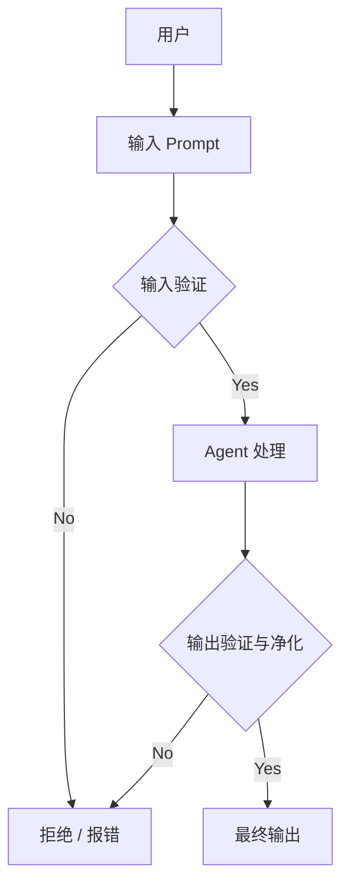

# **Prompt Chaining**

提示词链。

将复杂任务拆解为一系列有序子任务的设计模式。它的核心理念是"分而治之"。

前一个步骤的输出，会作为下一个步骤的输入。

每个环节都专注于处理自己那部分工作，并把半成品传递给下一个环节通过

这种顺序传递的方式，逐步构建出最终结果。


与期望AI一步到位处理复杂指令不同，Prompt Chaining将任务分解为多个环节。其运作主要包含三个关键机制：

1. **任务分解**：首先，将宏大、模糊的顶层任务，拆解成一系列逻辑清晰、职责单一的原子性子任务。例如，将"写一篇关于AI的营销文案"拆解为："生成核心观点" -> "撰写文案初稿" -> "润色风格" -> "添加行动号召"。
2. **顺序执行与上下文传递**：子任务会按预先定义的顺序（通常是线性的）依次执行。最重要的是，**每个步骤的输出都会作为结构化信息（如JSON格式）传递给下一步**，确保上下文不丢失。
3. **模块化与专业分工**：链中的每一个环节都是独立的模块，可以为其设计最精准的提示词（Prompt），甚至可以针对该环节的特性，**使用不同的大语言模型（LLM）或调用外部工具**。例如，第一个环节用擅长推理的模型，第二个环节用擅长创意生成的模型。


## 核心优势

- **高可靠性**：每个步骤目标明确，减少了AI因指令混乱而犯错的可能，任务整体成功率更高。
- **高可维护性**：流程模块化，调试方便。如果最终结果有问题，可以轻易定位到链条中的某个具体环节进行优化，而不会影响其他部分。
- **高可扩展性**：你可以轻松地在链条中插入、删除或替换某个环节，来实现功能的迭代。例如，在"识别趋势"后加入"与历史数据对比"的步骤。


## 弊端

- **错误会传播**：链条是顺序执行的，如果前一个环节出错，错误会像滚雪球一样被传递和放大，导致最终结果失败。
- **延迟累积**：多次调用LLM会增加总处理时间，对于需要快速响应的场景是一个挑战。
- **"冷启动"成本**：需要投入较多的前期设计工作来合理拆解任务和定义每个环节的接口。


# Routing

借助提示链实现的顺序处理，是执行确定性、线性工作流的基础技术；但当系统需要“见机行事”时，它就力不从心了。真实世界的智能代理必须能根据环境状态、用户输入或前一步结果，在多个潜在动作之间做出仲裁。这种动态决策能力——把控制权分派给不同专用函数、工具或子流程——称为路由（Routing）。


**核心：** 根据状态、输入或结果，动态选择执行路径（函数、工具、子流程）。
**价值：** 让Agent从“固定路径”跃迁至“见机行事”，提升灵活性与上下文感知力。


# **Parallelization**

许多复杂的代理任务包含多个彼此无依赖的子任务，它们完全可以同时执行，而非逐个等待。此时就需要**并行化**模式。并行化指让多个组

件（LLM 调用、工具调用、甚至整个子代理）并发运行。


# Reflection

反思模式让代理**评估自己的产出或内部状态**，并据此改进表现。它是一种“自修正”或“元认知”能力：通过**反馈—批判—迭代**循环，持续

精，炼答案。

1. 执行：代理生成初版结果。
2. 评估/批判：同构或异构模型按既定标准（事实、风格、完整度、指令符合度等）审阅。
3. 反思/精炼：根据批判，决定如何重写、调参或改整体计划。
4. 迭代（可选）：重复②③，直到达标或达到最大轮次。


**自反思**

只有一个Agent，它同时扮演“生成者”和“评审者”两个角色，通过多轮自我对话来优化输出。

```
flowchart TD
    A[用户输入任务] --> B[Agent生成初始回答]
    B --> C{是否达到<br>质量标准?}
    C -->|是| D[输出最终结果]
    C -->|否| E[Agent扮演评审者<br>对自身回答提出批评与建议]
    E --> F[Agent整合批评意见<br>生成改进版本]
    F --> C
```

**双Agent反思**

两个独立的Agent各司其职：**生成Agent**负责产出内容，**评审Agent**负责独立评估并给出反馈。

```
flowchart TD
    A[用户输入任务] --> B[生成Agent<br>生成初始回答]
    B --> C[评审Agent<br>独立评估回答质量<br>给出批评与改进建议]
    C --> D[生成Agent<br>根据反馈意见<br>生成改进版本]
    D --> E{是否达到<br>质量标准?}
    E -->|是| F[输出最终结果]
    E -->|否| C
```


# Tool Use

真正的智能体必须跳出自我，与外部世界交互——查天气、调数据库、发邮件、跑代码。Tool Use（通常以 Function Calling 形式落地）

就是解决“LLM 如何驱动外部函数”的标准模式。


# Planning

把复杂目标拆成可管理的小步骤，并制定达成目标的策略。


# Multi‑Agent

单一大模型Agent在目标明确的问题上表现良好，但在跨领域、多阶段的复杂任务面前，其能力往往受限于单一视角与工具集。

多智能体协作模式通过将系统拆分为多个专业化Agent来解决这一瓶颈——每个Agent只负责自己最擅长的子问题，再通过标准化通信协

议协同完成总体目标。比如

软件开发就可以按：需求 → 设计 → 编码 → 测试 → 文档，各阶段可由不同代理把关。


## 协作形式

顺序接力：A→B→C（如软件：需求→设计→编码→测试→文档）

并行分治：A/B/C处理不同数据，最后合并

辩论共识：多Agent讨论/投票达成更优解

层级管理：经理Agent分配任务，工人Agent执行

专家小组：研究员、分析师、写手、校对者协同

批判-复审：生产者出草案 → 批判者审校 → 循环迭代


## 通信与协作模型

单代理：无通信，最简单，能力受限于个体

对等网络：代理点对点通信，容错高但决策一致性难

监督者：中心节点协调，易管理但存在单点瓶颈

监督者即工具：中心代理只提供共享资源/分析能力，不直接下命令

层级式：多级监督，适合超大规模分解

自定义：按业务定制的混合拓扑，例如“先并行再辩论再汇总”


# 异常处理和恢复

要让 AI 智能体在不可预测的真实世界中持续可靠地运行，必须像人类一样具备“遇事不慌、容错自救”的能力。

异常处理与恢复模式正是为此而生。只要智能体可能遇到网络、工具、数据、权限、外部服务等不确定因素，且需要7×24 持续服务，就

必须落地异常处理与恢复模式。


| **场景**    | **典型异常**               | **容错/恢复动作**                           |
| :---------- | :------------------------- | :------------------------------------------ |
| 客服机器人  | 数据库连接超时             | 返回友好提示 + 记录工单 + 升人工            |
| 量化交易bot | 余额不足 / 市场关闭        | 停止重复下单 + 推送短信 + 切换策略          |
| 智能家居    | 灯泡离线                   | 重试3次 → 通知用户“请检查设备”              |
| 文档批处理  | 单份文件损坏               | 记录跳过 → 继续处理其余 → 最后汇总          |
| 网络爬虫    | CAPTCHA / 503              | 暂停 → 代理池轮换 → 失败URL入死信队列       |
| 工业机器人  | 抓取失败（传感器反馈偏差） | 重定位 → 再次抓取 → 换备用料槽 → 停线叫人工 |


# Resource-Aware Optimization

资源感知优化旨在让智能体在“算力、时间、金钱”三重预算下活得久、跑得快、花得少。


1.动态模型切换（Dynamic Model Switching）

按任务复杂度 + 当前预算 + 时延要求实时挑模型。比如简单查询用小模型/便宜工具秒回，而深度分析才上大模型/高精度服务。


2.自适应工具选择（Adaptive Tool Use）

同类 API 比价格、速率、精度，选“够用且最便宜”的那个。


3.上下文剪枝 & 摘要（Contextual Pruning）

历史消息、长文档先压缩，再进提示，降低 Token 火焰。


4.前瞻性资源预测（Proactive Resource Prediction）

用轻量预测器估计“下 5 分钟 GPU/预算/电量”需求，提前扩缩容。


5.成本敏感探索（Cost-Sensitive Exploration）

多智能体系统里，通信开销也算进总成本；宁可本地算一阵，也不盲目广播。


6.能效部署（Energy-Efficient Deployment）

边缘设备上自动关闭批处理、降频、换量化模型，延长续航。


7.并行 & 分布式感知（Parallelization Awareness）

把大任务切片后分发到闲置节点，做完再聚合，缩短 wall-clock 时间。


8.学习型资源分配（Learned Allocation Policies）

用强化学习或贝叶斯优化持续更新“路由表”，让花出去的钱→业务收益最大。


9.优雅降级 & 回退（Graceful Degradation）

预算或电量低于阈值时，主动丢弃非核心功能，只保留 MVP 路径。


# Guardrails/Safety Patterns

守护栏（Guardrails），也称为安全模式（safety patterns），是确保智能代理在更高自治性、更深度整合进关键系统时仍能安全、合

规、按预期运行的关键机制。它们如同一道保护屏障，引导代理的行为和输出，以防止产生有害、偏见、不相关或其他不良反应。





**应用场景**

守护栏可在多个环节加以实现，一些典型的用例如：

客服聊天机器人：防止生成冒犯性言语、错误或有害建议（如医疗、法律类）、离题回答。守护栏可识别有毒用户输入并指示机器人拒答

或升级至人工。

内容生成系统：确保生成文章、营销文案、创意内容等符合规范、法律与伦理标准，避免仇恨言论、误导信息或露骨内容。守护栏可通过

后处理过滤标记并删改问题片段。

教育辅导 / 助手：防止代理给出错误答案、宣传偏见观点或进行不当对话。可能通过内容过滤、与预设课程体系对齐等方式控制输出。


# Prioritization

在真实世界的“多任务、多目标、多约束”战场里，智能体每时每刻都面临“下一步该干啥”的灵魂拷问。优先级排序模式给出一套可解释、

可计算、可动态调整的决策框架，让 Agent 像资深项目经理一样，把有限的时间、算力、API 预算花在刀刃任务上，避免“捡了芝麻丢西

瓜”。


**典型场景**

客服智能体：面对用户请求时，Agent 会优先处理诸如“系统宕机”这类高紧急事项，而将“密码重置”一类的常规问题稍后解决。有些系统

还会根据客户等级给予差异化优先响应，高价值客户拥有更高优先级。


云资源调度系统：在高峰负载时，AI 会将资源分配优先权给予关键业务应用，而将批量计算等非紧急任务调度至夜间执行，以此优化整体

成本与性能。


自动驾驶系统：这是最典型的“实时优先级响应”场景。比如：当即将发生碰撞时，紧急刹车的指令会优先级压倒“保持车道”或“节能驾驶”等

目标。


智能交易系统：金融智能体会实时分析市场行情、风险敞口、利润空间以及重大新闻推送，动态决定交易的先后顺序，抢占先机。

项目管理 Agent：在协作平台中，AI 会根据任务的截止时间、依赖关系、资源可用性与战略价值，为团队成员重新排序待办清单，自动调

整项目推进节奏。


网络安全智能体：在监控网络流量时，Agent 会对告警信息做严重性评级，优先响应“高风险、关键资产”的攻击行为，防止系统性破坏。


