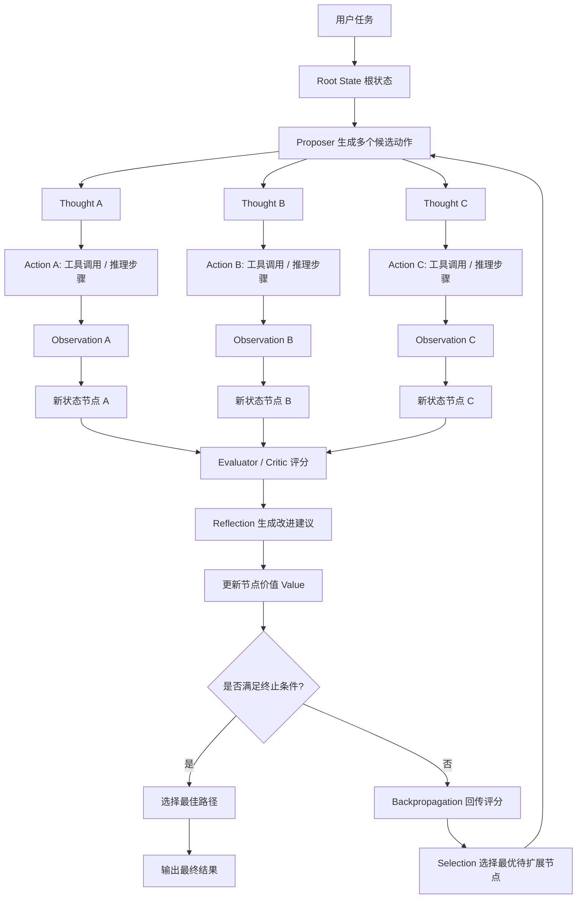
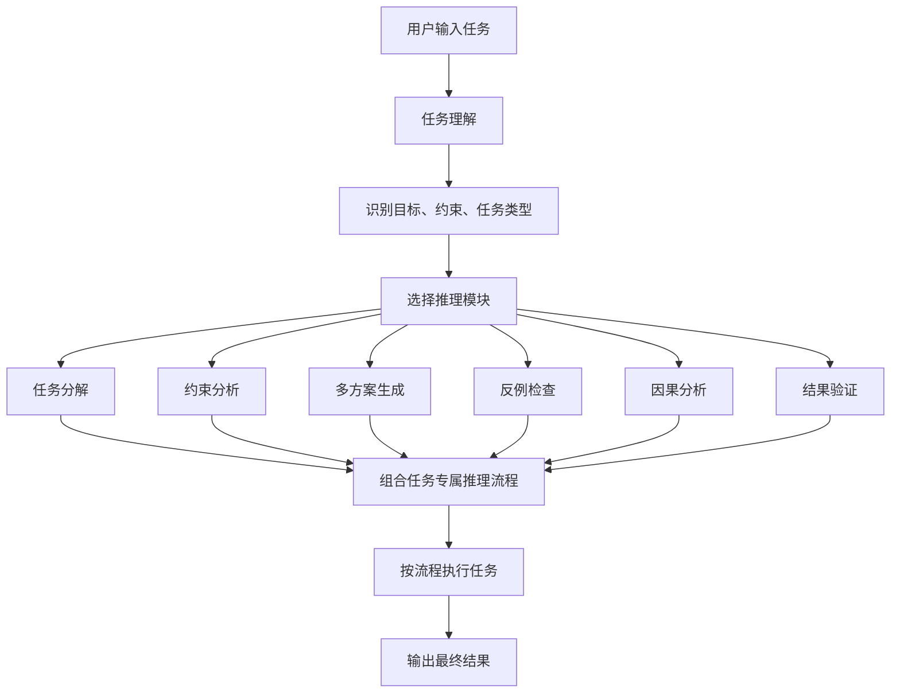
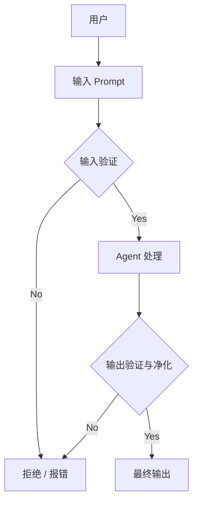

# **Prompt Chaining**

提示词链。

将复杂任务拆解为一系列有序子任务的设计模式。它的核心理念是"分而治之"。

前一个步骤的输出，会作为下一个步骤的输入。

每个环节都专注于处理自己那部分工作，并把半成品传递给下一个环节通过

这种顺序传递的方式，逐步构建出最终结果。


与期望AI一步到位处理复杂指令不同，Prompt Chaining将任务分解为多个环节。其运作主要包含三个关键机制：

1. **任务分解**：首先，将宏大、模糊的顶层任务，拆解成一系列逻辑清晰、职责单一的原子性子任务。例如，将"写一篇关于AI的营销文案"拆解为："生成核心观点" -> "撰写文案初稿" -> "润色风格" -> "添加行动号召"。
2. **顺序执行与上下文传递**：子任务会按预先定义的顺序（通常是线性的）依次执行。最重要的是，**每个步骤的输出都会作为结构化信息（如JSON格式）传递给下一步**，确保上下文不丢失。
3. **模块化与专业分工**：链中的每一个环节都是独立的模块，可以为其设计最精准的提示词（Prompt），甚至可以针对该环节的特性，**使用不同的大语言模型（LLM）或调用外部工具**。例如，第一个环节用擅长推理的模型，第二个环节用擅长创意生成的模型。


## 核心优势

- **高可靠性**：每个步骤目标明确，减少了AI因指令混乱而犯错的可能，任务整体成功率更高。
- **高可维护性**：流程模块化，调试方便。如果最终结果有问题，可以轻易定位到链条中的某个具体环节进行优化，而不会影响其他部分。
- **高可扩展性**：你可以轻松地在链条中插入、删除或替换某个环节，来实现功能的迭代。例如，在"识别趋势"后加入"与历史数据对比"的步骤。


## 弊端

- **错误会传播**：链条是顺序执行的，如果前一个环节出错，错误会像滚雪球一样被传递和放大，导致最终结果失败。
- **延迟累积**：多次调用LLM会增加总处理时间，对于需要快速响应的场景是一个挑战。
- **"冷启动"成本**：需要投入较多的前期设计工作来合理拆解任务和定义每个环节的接口。


# Agent 设计模式总览

Agent 设计模式可以理解为构建智能体或工作流的可复用架构蓝图。它不是单个 Prompt 技巧，而是把复杂智能体行为拆成可观察、可调试、可复用的阶段。

常见设计关注点：

- **清晰阶段**：把“理解、规划、执行、评估、修正”等职责拆开，避免所有逻辑挤在一次模型调用里。
- **状态管理**：记录任务进度、中间结果、工具返回、失败原因和下一步计划。
- **条件逻辑**：通过路由、优先级、重试和终止条件决定下一步走哪条路径。
- **工具集成**：把搜索、计算、数据库、API、代码执行等外部能力接入 Agent。
- **质量控制**：通过 Reflection、Critic、Guardrails、人工审核等方式验证输出。

选择模式时可以先问三个问题：

1. 任务是否需要外部工具？需要时优先考虑 ReAct、Tool Use、LLM Compiler、REWOO。
2. 任务是否需要多轮改进？需要时优先考虑 Reflection、Reflexion、LATS。
3. 任务是否可以先规划再执行？需要时优先考虑 Planning、Plan & Solve、Self-Discovery、Multi-Agent。


# Tool Use

真正的智能体必须跳出自我，与外部世界交互——查天气、调数据库、发邮件、跑代码。Tool Use（通常以 Function Calling 形式落地）

就是解决“LLM 如何驱动外部函数”的标准模式。


# Routing

借助提示链实现的顺序处理，是执行确定性、线性工作流的基础技术；但当系统需要“见机行事”时，它就力不从心了。真实世界的智能代理必须能根据环境状态、用户输入或前一步结果，在多个潜在动作之间做出仲裁。这种动态决策能力——把控制权分派给不同专用函数、工具或子流程——称为路由（Routing）。


**核心：** 根据状态、输入或结果，动态选择执行路径（函数、工具、子流程）。
**价值：** 让Agent从“固定路径”跃迁至“见机行事”，提升灵活性与上下文感知力。


# Intent Recognition

意图识别是 Routing 的前置能力：先判断用户真实想做什么，再把请求映射到对应工具、流程、人工审核或拒答路径。

它通常输出结构化结果，例如：

- **intent**：用户意图，如咨询、报障、查询、下单、投诉。
- **urgency**：紧急程度，如普通、重要、关键。
- **topic / entity / slot**：主题、对象、时间、地点、订单号等槽位信息。
- **summary**：对用户请求的压缩描述，供后续节点使用。

适用场景：

- 单轮任务型对话，如客服分流、工单分类、邮件处理。
- 工具调用前的动作选择，如“查文档、转人工、开缺陷单、生成回复”。
- 需要可解释分支的系统，因为每次路由都能看到分类结果。

局限：

- **单意图假设强**：一句话包含多个目标时容易漏掉一部分。
- **边界模糊**：相近意图会产生波动，需要补充规则、示例或置信度阈值。
- **多轮上下文敏感**：当前输入可能是上一轮意图的延续，不能只看单句。
- **流程偏线性**：适合明确业务流程，不适合开放式、长尾、多跳任务。


# **Parallelization**

许多复杂的代理任务包含多个彼此无依赖的子任务，它们完全可以同时执行，而非逐个等待。此时就需要**并行化**模式。并行化指让多个组

件（LLM 调用、工具调用、甚至整个子代理）并发运行。


## LLM Compiler

LLM Compiler 是把“可并行的工具调用”显式编译成执行计划的模式，常用于提升多工具任务的吞吐和响应速度。

典型结构：

1. **Planner**：把用户问题拆成多个可执行子任务，并识别任务之间的依赖关系。
2. **Executor**：对没有依赖关系的工具调用并行执行。
3. **Joiner**：聚合工具结果，生成最终回答或进入下一轮处理。

适用场景：

- 多个查询彼此独立，例如同时查询多个城市天气、多个商品价格、多个数据源。
- 工具调用耗时明显高于模型规划耗时。
- 希望减少串行 ReAct 中“想一步、调一次、再想一步”的等待时间。

注意点：

- 子任务必须边界清楚，否则并行结果难以合并。
- 需要显式处理工具失败、超时和部分成功。
- 如果任务强依赖上一步结果，强行并行反而会增加错误。


# ReAct

ReAct = Reasoning + Acting + Observation。它让模型在“思考、行动、观察”之间循环：先分析下一步要做什么，再调用工具或执行动作，然后根据工具返回继续判断下一步。

基本流程：

1. **Reason**：模型分析任务，决定当前最合理动作。
2. **Act**：调用工具、函数、API、代码执行器或外部系统。
3. **Observe**：把工具结果写回上下文。
4. **Repeat / Answer**：继续循环，直到足以给出最终答案。

优势：

- 能弥补模型无法直接访问实时数据、私有数据或外部系统的缺陷。
- 工具结果会进入上下文，可缓解纯生成导致的幻觉。
- 适合动态、多步骤、需要根据反馈调整策略的任务。

风险：

- **依赖模型能力**：模型选错工具或误读观察结果时，错误会被循环放大。
- **function_call 爆炸**：工具过多、边界重叠、调用顺序复杂时，动作组合会迅速膨胀。
- **上下文压力高**：长任务需要保存推理、动作、观察，容易超出上下文或注意力漂移。

落地建议：

- 让单个 Agent 职责更小，避免把几十个工具塞给同一个模型。
- 每个工具保持功能单一、命名清晰、参数明确。
- 对调用次数、可用工具集合和终止条件设置约束。


**示例**

用户问：“北京明天天气怎么样？”

Agent 流程：

1. 想：我需要先知道今天日期。
2. 做：调用时间工具。
3. 看结果：今天是 6 月 29 日。
4. 想：明天是 6 月 30 日，需要查天气。
5. 做：调用天气 API。
6. 看结果：天气晴。
7. 回答用户。

它的重点是：通过工具和外部世界交互。


# Reflection

反思模式让代理**评估自己的产出或内部状态**，并据此改进表现。它是一种“自修正”或“元认知”能力：通过**反馈—批判—迭代**循环，持续

精，炼答案。

1. 执行：代理生成初版结果。
2. 评估/批判：同构或异构模型按既定标准（事实、风格、完整度、指令符合度等）审阅。
3. 反思/精炼：根据批判，决定如何重写、调参或改整体计划。
4. 迭代（可选）：重复②③，直到达标或达到最大轮次。


**自反思**

只有一个Agent，它同时扮演“生成者”和“评审者”两个角色，通过多轮自我对话来优化输出。

```
flowchart TD
    A[用户输入任务] --> B[Agent生成初始回答]
    B --> C{是否达到<br>质量标准?}
    C -->|是| D[输出最终结果]
    C -->|否| E[Agent扮演评审者<br>对自身回答提出批评与建议]
    E --> F[Agent整合批评意见<br>生成改进版本]
    F --> C
```

**双Agent反思**

两个独立的Agent各司其职：**生成Agent**负责产出内容，**评审Agent**负责独立评估并给出反馈。

```
flowchart TD
    A[用户输入任务] --> B[生成Agent<br>生成初始回答]
    B --> C[评审Agent<br>独立评估回答质量<br>给出批评与改进建议]
    C --> D[生成Agent<br>根据反馈意见<br>生成改进版本]
    D --> E{是否达到<br>质量标准?}
    E -->|是| F[输出最终结果]
    E -->|否| C
```


**案例**

用户让 Agent 写一段产品介绍。

Agent 流程：

1. 先写一版。
2. 自己检查：是否太长？是否缺少卖点？语气是否合适？
3. 根据批评意见重写。
4. 再检查，直到质量达标。

它的重点是：通过自我批判提升结果质量。


# Reflexion

Reflexion 是 Reflection 的加强版：它不仅改进当前答案，还把失败经验、次优决策和改进策略沉淀为可复用记忆，用于未来相似任务。

核心闭环：

1. **Execute**：执行当前任务，产出结果或行动轨迹。
2. **Evaluate**：用规则、模型评分、测试结果或用户反馈判断成功、次优或失败。
3. **Record**：把失败原因、上下文、决策路径、改进建议写入经验存储。
4. **Reflect / Learn**：提炼可复用经验，更新 Prompt、工具选择或策略模板。
5. **Next Execution**：后续任务检索类似经验，避免重复犯错。

Reflection 更关注“把当前输出改好”；Reflexion 更关注“从失败中学习，让下一次更稳”。它适合失败成本较高、任务类型会反复出现、且可以积累经验的 Agent。


# REWOO

REWOO（Reasoning Without Observation）强调“先规划、再执行、最后整合”，把规划与工具执行分离，减少每一步都回到模型重新推理的成本。

典型流程：

1. **Plan**：模型一次性生成完整计划，并在计划中标出需要工具结果的位置。
2. **Execute**：执行计划中的工具调用，可按依赖顺序执行，也可对独立调用并行执行。
3. **Solve**：把工具结果填回计划，由模型生成最终答案。

与 ReAct 的差异：

- ReAct 是“边观察边调整”，适合动态环境。
- REWOO 是“先想清楚再批量执行”，适合依赖关系明确、反馈不太会改变路线的任务。
- REWOO 能减少昂贵的 LLM 调用，但如果计划一开始错了，后续执行会稳定地沿着错误方向推进。

适用场景：

- 多工具调用关系可预测。
- 需要控制成本和延迟。
- 任务目标明确，执行过程中不需要频繁改计划。


# Planning

把复杂目标拆成可管理的小步骤，并制定达成目标的策略。


# Plan & Solve

Plan & Solve / Plan-and-Execute 把一次复杂任务拆成“重规划 + 轻执行”：先生成全局计划，再逐步执行每个子任务。

流程：

1. **任务分析**：理解目标、约束、输入输出和成功标准。
2. **任务分解**：把目标拆成可执行的子任务。
3. **逐步执行**：按计划调用工具、检索资料、计算或生成内容。
4. **反馈调整**：执行结果偏离预期时，触发局部修正或重新规划。
5. **汇总输出**：所有子任务完成后，整合最终结果。

优势：

- 全局计划可审计、可人工修改、可复用。
- 执行阶段每次只处理当前步骤，降低上下文压力。
- 工具规模大时，可先在规划阶段筛选工具，减少动作空间。

局限：

- 计划质量决定上限，计划错了会系统性传播。
- 对高度动态环境不够灵活，需要显式 Replan 机制。
- 组件更多，通常需要 Planner、Executor、State、Replanner 等协同。


# LATS

LATS（Language Agent Tree Search）把 ReAct、Plan & Solve、树搜索和评估器结合起来，让 Agent 不只沿着单一路径推理，而是探索多条候选路径并选择更优路线。

核心思想：

- **状态节点**：当前问题进度、上下文、工具结果。
- **动作边**：下一步推理、工具调用、代码执行或子任务选择。
- **多分支探索**：同时生成多个可能动作，而不是只采样一条链。
- **价值评估**：用 LLM-as-Judge、规则或任务反馈给路径打分。
- **回溯优化**：发现路径质量差时回到上层节点，尝试其他分支。

适用场景：

- 算法题、复杂推理、研究规划、多步工具任务。
- 单条思维链容易走偏，需要比较多个候选方案。
- 可以接受更高计算成本来换取更强鲁棒性。

局限：

- 成本高、延迟高，实现复杂。
- 评估器质量决定搜索质量，评估偏差会把搜索带偏。
- 需要设计最大深度、分支数、终止条件，避免无限探索。





# Self-Discovery

Self-Discovery 的核心是：**让 Agent 在正式解题之前，先分析任务特点，并主动选择适合当前任务的推理策略**。

它不是固定套用某一种 Prompt 或流程，而是让模型根据任务特征“发现”应该采用什么思考结构。换句话说，Self-Discovery 关注的不是“马上给答案”，而是先判断：

- 这个任务属于什么类型？
- 最终目标是什么？
- 有哪些约束条件？
- 需要分解吗？
- 需要比较多个方案吗？
- 需要检查反例或风险吗？
- 需要先建立步骤、框架或判断标准吗？

然后 Agent 再把合适的推理模块组合成一条任务专属的思考流程。


## 核心流程

Self-Discovery 通常包含四个阶段：

1. **任务理解**：识别任务类型、目标、上下文、输入输出要求。
2. **推理模块选择**：从预设的推理模块库中选择适合当前任务的模块。
3. **推理结构组合**：把选中的模块组合成有顺序的解题流程。
4. **执行与输出**：严格按照生成的推理结构处理任务，并输出结果。




## 推理模块库

Self-Discovery 的关键在于准备一组可复用的“思考工具”。这些工具不是外部 API，而是不同类型的认知步骤。

常见推理模块：

| 模块 | 作用 |
| :--- | :--- |
| 目标澄清 | 明确任务真正要达成什么 |
| 任务分解 | 把复杂任务拆成多个子问题 |
| 约束识别 | 找出边界条件、限制、风险和不可做事项 |
| 多方案生成 | 生成多个候选解法或路线 |
| 方案比较 | 从成本、收益、风险、可行性等角度比较方案 |
| 因果分析 | 分析问题背后的原因链条 |
| 类比推理 | 借鉴相似问题的解决方式 |
| 反例检查 | 主动寻找可能推翻结论的情况 |
| 优先级排序 | 判断哪些子任务、目标或风险更重要 |
| 结果验证 | 检查最终结果是否满足任务要求 |

推理模块不宜无限扩展。模块太少会不够灵活，模块太多会增加选择难度。实践中可以先维护 8-12 个高频模块，再根据任务经验逐步补充。


## 典型执行方式

可以把 Self-Discovery 拆成三个 Prompt 阶段：

**第一步：选择推理模块**

```text
你是一个任务策略分析器。
请分析用户任务，并从以下推理模块中选择最适合的几个：

- 目标澄清
- 任务分解
- 约束识别
- 多方案生成
- 方案比较
- 因果分析
- 反例检查
- 优先级排序
- 结果验证

用户任务：
{task}

请输出：
1. 任务类型
2. 选择的推理模块
3. 选择原因
```

**第二步：组合推理流程**

```text
请根据已选择的推理模块，为当前任务设计一条专属推理流程。

要求：
- 步骤要有顺序
- 每一步说明要解决什么问题
- 不要直接回答用户任务
- 只输出推理流程
```

**第三步：执行推理流程**

```text
请严格按照以下推理流程解决用户任务：

用户任务：
{task}

推理流程：
{reasoning_plan}

请输出最终答案。
```


## 简化伪代码

```python
def self_discovery(task):
    modules = select_reasoning_modules(task)

    reasoning_plan = compose_reasoning_plan(
        task=task,
        modules=modules,
    )

    result = execute_reasoning_plan(
        task=task,
        plan=reasoning_plan,
    )

    return result
```


## 适用场景

- 创造性、开放性、策略不确定的任务。
- 复杂分析、方案设计、系统架构、学习路线、商业决策等问题。
- 用户只给出目标，但没有指定解决方法的任务。
- 任务没有稳定流程，需要先判断该用比较、分解、假设检验、反例检查还是多视角分析。
- 希望 Agent 能按问题类型自适应选择 Prompt 模板或推理模块。


## 不适合的场景

- 简单事实问答。
- 明确的一步工具调用。
- 用户只想快速得到直接答案。
- 任务本身已经指定了解题方法。
- 对延迟极其敏感的场景。


## 落地建议

- **先建立小型推理模块库**：不要一开始设计几十个模块，先覆盖最常用的分析方式。
- **保留模块选择结果**：输出中记录“为什么选择这些模块”，方便审计和复盘。
- **限制前置分析成本**：简单任务可以跳过 Self-Discovery，避免过度思考。
- **让推理流程结构化**：建议输出 JSON 或固定 Markdown 结构，方便后续节点执行。
- **结合任务反馈迭代模块库**：如果某类任务经常失败，就补充新的推理模块或调整选择规则。
- **避免把模块当成固定模板**：Self-Discovery 的价值在于动态组合，而不是机械套流程。


## 核心价值

Self-Discovery 的价值在于让 Agent 先获得“任务方法感”。它让 Agent 不只是回答问题，而是先判断“这个问题应该怎么被思考”。

可以用一句话概括：

```text
Self-Discovery = 先发现任务需要什么推理方式，再用这个方式解决任务。
```


# Multi‑Agent

单一大模型Agent在目标明确的问题上表现良好，但在跨领域、多阶段的复杂任务面前，其能力往往受限于单一视角与工具集。

多智能体协作模式通过将系统拆分为多个专业化Agent来解决这一瓶颈——每个Agent只负责自己最擅长的子问题，再通过标准化通信协

议协同完成总体目标。比如

软件开发就可以按：需求 → 设计 → 编码 → 测试 → 文档，各阶段可由不同代理把关。


## 协作形式

顺序接力：A→B→C（如软件：需求→设计→编码→测试→文档）

并行分治：A/B/C处理不同数据，最后合并

辩论共识：多Agent讨论/投票达成更优解

层级管理：经理Agent分配任务，工人Agent执行

专家小组：研究员、分析师、写手、校对者协同

批判-复审：生产者出草案 → 批判者审校 → 循环迭代


## 通信与协作模型

单代理：无通信，最简单，能力受限于个体

对等网络：代理点对点通信，容错高但决策一致性难

监督者：中心节点协调，易管理但存在单点瓶颈

监督者即工具：中心代理只提供共享资源/分析能力，不直接下命令

层级式：多级监督，适合超大规模分解

自定义：按业务定制的混合拓扑，例如“先并行再辩论再汇总”


# STORM

STORM 是面向深度研究和长文写作的多视角 Agent 模式。它通过多个角色或视角收集信息、提出问题、整合材料，最终生成结构化研究内容。

核心角色：

- **Perspective Generator**：从主题出发生成多个研究视角，例如历史、原理、案例、争议、影响。
- **Interviewer**：围绕每个视角提出深入问题，模拟研究员或记者追问。
- **Interviewee**：基于检索或知识库回答问题，形成可引用的知识片段。
- **Writer / Synthesizer**：把多视角材料组织成大纲、段落和最终文章。

工作流程：

1. 输入研究主题。
2. 生成多组研究视角。
3. 每个视角下进行问答式信息挖掘，可串行也可并行。
4. 汇总对话材料，生成文章大纲。
5. 按大纲写作，并进行事实检查、去重和结构优化。

适用场景：

- 需要全面、周详、多视角分析的主题研究。
- 长文、百科式文章、行业报告、深度调研。
- 可以接受较高成本和较长耗时来换取覆盖面与结构质量。

局限：

- 检索质量和资料可信度直接影响最终质量。
- 多角色对话成本高，速度慢。
- 容易生成看似全面但缺少关键证据的内容，需要配合引用、事实检查和人工审阅。


# 异常处理和恢复

要让 AI 智能体在不可预测的真实世界中持续可靠地运行，必须像人类一样具备“遇事不慌、容错自救”的能力。

异常处理与恢复模式正是为此而生。只要智能体可能遇到网络、工具、数据、权限、外部服务等不确定因素，且需要7×24 持续服务，就

必须落地异常处理与恢复模式。


| **场景**    | **典型异常**               | **容错/恢复动作**                           |
| :---------- | :------------------------- | :------------------------------------------ |
| 客服机器人  | 数据库连接超时             | 返回友好提示 + 记录工单 + 升人工            |
| 量化交易bot | 余额不足 / 市场关闭        | 停止重复下单 + 推送短信 + 切换策略          |
| 智能家居    | 灯泡离线                   | 重试3次 → 通知用户“请检查设备”              |
| 文档批处理  | 单份文件损坏               | 记录跳过 → 继续处理其余 → 最后汇总          |
| 网络爬虫    | CAPTCHA / 503              | 暂停 → 代理池轮换 → 失败URL入死信队列       |
| 工业机器人  | 抓取失败（传感器反馈偏差） | 重定位 → 再次抓取 → 换备用料槽 → 停线叫人工 |


# Resource-Aware Optimization

资源感知优化旨在让智能体在“算力、时间、金钱”三重预算下活得久、跑得快、花得少。


1.动态模型切换（Dynamic Model Switching）

按任务复杂度 + 当前预算 + 时延要求实时挑模型。比如简单查询用小模型/便宜工具秒回，而深度分析才上大模型/高精度服务。


2.自适应工具选择（Adaptive Tool Use）

同类 API 比价格、速率、精度，选“够用且最便宜”的那个。


3.上下文剪枝 & 摘要（Contextual Pruning）

历史消息、长文档先压缩，再进提示，降低 Token 火焰。


4.前瞻性资源预测（Proactive Resource Prediction）

用轻量预测器估计“下 5 分钟 GPU/预算/电量”需求，提前扩缩容。


5.成本敏感探索（Cost-Sensitive Exploration）

多智能体系统里，通信开销也算进总成本；宁可本地算一阵，也不盲目广播。


6.能效部署（Energy-Efficient Deployment）

边缘设备上自动关闭批处理、降频、换量化模型，延长续航。


7.并行 & 分布式感知（Parallelization Awareness）

把大任务切片后分发到闲置节点，做完再聚合，缩短 wall-clock 时间。


8.学习型资源分配（Learned Allocation Policies）

用强化学习或贝叶斯优化持续更新“路由表”，让花出去的钱→业务收益最大。


9.优雅降级 & 回退（Graceful Degradation）

预算或电量低于阈值时，主动丢弃非核心功能，只保留 MVP 路径。


# Guardrails/Safety Patterns

守护栏（Guardrails），也称为安全模式（safety patterns），是确保智能代理在更高自治性、更深度整合进关键系统时仍能安全、合

规、按预期运行的关键机制。它们如同一道保护屏障，引导代理的行为和输出，以防止产生有害、偏见、不相关或其他不良反应。





**应用场景**

守护栏可在多个环节加以实现，一些典型的用例如：

客服聊天机器人：防止生成冒犯性言语、错误或有害建议（如医疗、法律类）、离题回答。守护栏可识别有毒用户输入并指示机器人拒答

或升级至人工。

内容生成系统：确保生成文章、营销文案、创意内容等符合规范、法律与伦理标准，避免仇恨言论、误导信息或露骨内容。守护栏可通过

后处理过滤标记并删改问题片段。

教育辅导 / 助手：防止代理给出错误答案、宣传偏见观点或进行不当对话。可能通过内容过滤、与预设课程体系对齐等方式控制输出。


# Prioritization

在真实世界的“多任务、多目标、多约束”战场里，智能体每时每刻都面临“下一步该干啥”的灵魂拷问。优先级排序模式给出一套可解释、

可计算、可动态调整的决策框架，让 Agent 像资深项目经理一样，把有限的时间、算力、API 预算花在刀刃任务上，避免“捡了芝麻丢西

瓜”。


**典型场景**

客服智能体：面对用户请求时，Agent 会优先处理诸如“系统宕机”这类高紧急事项，而将“密码重置”一类的常规问题稍后解决。有些系统

还会根据客户等级给予差异化优先响应，高价值客户拥有更高优先级。


云资源调度系统：在高峰负载时，AI 会将资源分配优先权给予关键业务应用，而将批量计算等非紧急任务调度至夜间执行，以此优化整体

成本与性能。


自动驾驶系统：这是最典型的“实时优先级响应”场景。比如：当即将发生碰撞时，紧急刹车的指令会优先级压倒“保持车道”或“节能驾驶”等

目标。


智能交易系统：金融智能体会实时分析市场行情、风险敞口、利润空间以及重大新闻推送，动态决定交易的先后顺序，抢占先机。

项目管理 Agent：在协作平台中，AI 会根据任务的截止时间、依赖关系、资源可用性与战略价值，为团队成员重新排序待办清单，自动调

整项目推进节奏。


网络安全智能体：在监控网络流量时，Agent 会对告警信息做严重性评级，优先响应“高风险、关键资产”的攻击行为，防止系统性破坏。


