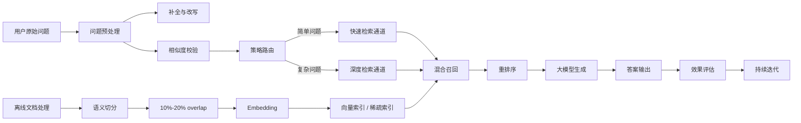

# 架构设计

## 相关资料

- 视频标题：[面试官问：RAG准确率怎么从60%提升到85%](https://www.bilibili.com/video/BV1YaGA6wE24/)
- UP 主：AI大模型-阿水
- 所属合集：2026年大模型高频面试题精讲
- 发布日期：2026-08-02
- 时长：5 分 45 秒

## 这期视频的核心观点

RAG 准确率从 `60%` 提升到 `85%`，不是靠单点暴力换模型，而是靠一整套工程化链路优化：

1. 先把问题定位清楚：到底是检索没召回，还是生成不忠实。
2. 再优化数据切分：让 chunk 顺着语义走，而不是按 token 生硬切。
3. 再处理用户问题：对模糊提问做改写、补全，但必须加校验。
4. 再做混合检索和重排序：把向量召回和关键词召回的优势合起来。
5. 最后做策略路由：简单问题走快通道，复杂问题走深度通道。
6. 线上持续迭代：形成 badcase 回流和指标闭环。

这条视频本质上讲的是一套 `工业级 RAG 优化架构`，而不是某个孤立技巧。

## 架构主线

## 一、先精准定位问题环节

视频一上来先强调一个很重要的点：

- RAG 准确率低，不一定都是检索的问题
- 也可能是生成阶段“编出来了”
- 所以先不要急着调 chunk、换 embedding、上 rerank
- 先拿两个指标把问题定位清楚

### 1. 上下文召回率 Context Recall

**含义**

- 看与问题相关的信息，是否真的被检索出来了
- 如果相关 chunk 没进上下文，再强的模型也答不好

**低了通常说明**

- embedding 模型不适合当前业务语料
- chunk 切分策略有问题
- 检索策略太单一
- query 本身太模糊，没有被正确改写

**本质**

- 它衡量的是 `检索环节` 的能力

### 2. 忠实度 Faithfulness

**含义**

- 看大模型最终给出的答案，是否严格基于检索到的内容
- 如果答案脱离检索上下文，或者夹带模型自己的幻觉，就属于忠实度低

**低了通常说明**

- 生成阶段 prompt 约束不够
- 模型把外部常识和检索内容混在了一起
- 没有做好引用约束或拒答策略

**本质**

- 它衡量的是 `生成环节` 的能力

### 3. 用两个指标定位问题

可以把问题粗分成下面这张表：

| Context Recall | Faithfulness | 问题主要出在哪 | 优先优化方向 |
| :-- | :-- | :-- | :-- |
| 低 | 高 | 检索没召回 | chunk、embedding、query rewrite、召回策略 |
| 高 | 低 | 生成不忠实 | prompt、引用约束、拒答策略、输出控制 |
| 低 | 低 | 两边都有问题 | 先修召回，再修生成 |
| 高 | 高 | 主流程正常 | 继续做细节优化和线上闭环 |

视频的意思很明确：

- `召回率低`，优先修检索管线
- `忠实度低`，优先修生成管线
- 别混着改，不然很难知道到底哪一步生效了

## 二、数据切分优化

视频把“提升准确率最划算的第一刀”放在了 `数据切分`。

### 1. 为什么先改切分

因为很多 RAG 项目一开始的切分方式太粗暴：

- 按固定 token 数一刀切
- 不关心句子边界和段落边界
- 不关心一个事实是否被切成了两半

这在 demo 阶段也许还能跑，但在真实业务里很容易出问题：

- 一个关键事实被切断在两个 chunk 的边界
- 检索时两边都不完整
- 模型拿到的上下文天然就是残缺的

### 2. 固定 token 切分的问题

视频明确对比了 `固定 token 一刀切` 和 `NLP 语义感知动态切分`。

**固定 token 切分的典型问题**

- 容易把完整语义硬拆开
- 关键事实可能跨 chunk 边界
- 上下文关联被破坏
- 检索命中的片段看起来“像相关”，但信息不完整

### 3. 更好的做法：语义感知动态切分

视频推荐的方向是：

- 让程序识别句子边界、段落边界
- 让 chunk 尽量围绕一个完整语义单元
- 不追求每段 token 绝对一样长
- 优先保证一个 chunk 内的信息是完整的、可回答的

这背后的工程思想是：

- 切分不是为了凑长度
- 切分是为了让知识片段更适合被检索和被模型消费

### 4. 加 overlap：保留 10%-20% 重叠窗口

这是视频里非常明确的一个经验值：

- 相邻 chunk 之间保留 `10% ~ 20%` 的重叠窗口

这样做的目的：

- 避免一个事实刚好落在边界附近时被切坏
- 减少跨 chunk 的语义断裂
- 提高召回到完整上下文的概率

视频的判断是：

- 这是一个工程上反复验证过的经验值
- 单是这一条，就可能直接带来 `10 到 15 个百分点` 的提升

### 5. 这一段的落地结论

如果面试里被问到 chunk 怎么设计，可以这么回答：

- 不建议固定 token 一刀切
- 优先做语义感知切分
- 结合句子、段落、标题等结构信息
- chunk 之间保留 10%-20% overlap
- 核心目标是保证知识单元完整，而不是长度绝对均匀

## 三、用户提问预处理

视频第三步开始转向 `Query 侧优化`。

它强调：很多用户提问天然是模糊的、口语化的、缺上下文的，如果你直接拿去检索，召回效果会很差。

### 1. 用户问题预处理链路

视频给出的流程可以整理成：

`用户模糊提问 -> 大模型扩写补全 -> 相似度校验 -> 进入检索`

也就是先做 `Query Rewrite`，再做一个安全检查。

### 2. 为什么要改写 Query

因为用户常见提问会有这些问题：

- 太短
- 太口语化
- 缺少检索关键词
- 省略上下文
- 问法含混，不利于召回

比如用户只问一个非常泛的“性能优化”类问题，系统如果能把它改写成更完整、更标准化、更便于检索的表达，召回质量通常会更高。

### 3. 但 Query 改写也有风险

视频这里不是一味夸 rewrite，而是专门提醒了一个坑：

- 改写不能凭空加用户没提到的限制条件
- 否则会把检索方向带偏

也就是说：

- 改写的目标是 `补全表达`
- 不是 `替用户瞎做业务假设`

### 4. 加一道校验关：相似度阈值机制

视频给出的安全做法是：

- 计算 `原始问题` 和 `改写后问题` 的向量相似度
- 如果相似度太低，说明改写偏航
- 这时直接丢弃改写结果，退回原问题检索

视频里提到的经验阈值大约是：

- `0.8 左右`
- 也可以理解为 `0.8 ~ 0.85` 的安全区间

这里没有绝对标准答案，但思路非常清楚：

- Rewrite 可以用
- 但一定要带回退机制

### 5. 这一段的架构价值

这一步的意义不是“把问题写得更漂亮”，而是：

- 提升 query 和知识库表达的对齐程度
- 提高召回命中率
- 降低模糊提问造成的漏召回
- 控制 rewrite 带来的偏航风险

## 四、混合检索 + 重排序

这部分是视频里最“工业化”的一段。

结论很明确：

- 不要只做向量检索
- 也不要只做关键词检索
- 最好做 `Dense + Sparse` 的混合召回，再上统一重排序

### 1. 向量检索 Dense 的优点和短板

**优点**

- 擅长语义匹配
- 对近义表达、同义表达、泛化表达更友好
- 能处理“字面不一样但意思相近”的问题

**短板**

- 对精确匹配不够稳定
- 对实体词、编号、术语、精确短语有时会漏

### 2. 关键词检索 Sparse 的优点和短板

**优点**

- 擅长精确匹配
- 对专业词、实体词、编号、关键短语更敏感
- 对明确关键词问题表现更稳

**短板**

- 对语义泛化能力弱
- 换一种问法，可能就召不回来

### 3. 为什么要做混合召回

视频想表达的是：

- Dense 负责语义理解
- Sparse 负责精确命中
- 两边都召回，能互补

这是很多企业级 RAG 系统的常见做法。

### 4. 混合之后，为什么还要 rerank

因为两路召回的分数体系不一致：

- 向量检索打的是余弦相似度分
- BM25 / 稀疏检索打的是另一套分数

这两个分数不在同一个量纲里，不能直接简单相加。

所以视频给出的思路是：

- 用一个统一的排序学习模型做融合和重排序

### 5. 视频里提到的方案：LambdaMART

视频点名了一个比较经典的工程方案：

- `LambdaMART`
- 本质上属于 `Learning to Rank`

它的作用是：

- 把 BM25 分数
- 向量相似度
- 实体匹配程度
- 其他检索特征

统一放进一个排序模型里，输出最终顺序。

### 6. 为什么这个方案适合工程落地

视频给出的理由大致是：

- 可解释
- 工程成熟
- 推理延迟低
- 容易和现有检索系统结合

换句话说，这不是最炫的方案，但很稳、很实用、很适合企业场景。

## 五、策略路由 + 分流

到了第五步，视频开始从“单条检索链路优化”升级到“系统级调度”。

### 1. 为什么需要路由

不是所有问题都值得走完整重链路。

如果你对所有请求都做：

- query rewrite
- 混合检索
- rerank
- 深度生成

那延迟和成本都会被拉高。

### 2. 先做意图识别分类

视频的做法是：

- 先用一个 `意图识别分类器`
- 判断当前问题是简单查询，还是复杂查询

### 3. 两条通道

#### 简单查询：快速通道

适合：

- 问题明确
- 关键词清晰
- 不需要多步推理
- 低延迟优先

处理方式：

- 轻量级检索
- 更快返回
- 控制整体时延

#### 复杂查询：深度通道

适合：

- 问题模糊
- 需要 query 改写
- 需要混合检索
- 需要重排序或更深推理

处理方式：

- 走完整优化链路
- 追求更高准确率

### 4. 这一步带来的价值

视频明确说了两个收益：

- 整体响应延迟可控
- 准确率和性能两手都能抓住

本质上就是：

- 简单问题不浪费资源
- 复杂问题不牺牲效果

## 六、效果复盘

视频最后把整套方案压缩成一条结果链：

- `语义切分`
- `Query 改写`
- `混合重排序`
- `策略路由`

组合起来，把准确率从：

- `60%`
- 提升到 `85%`

### 这 25 个点是怎么来的

从视频逻辑看，这不是某一个点单独贡献 25 个百分点，而是多个环节叠加：

1. 语义切分 + overlap，解决数据质量和上下文完整性问题
2. Query rewrite + 校验，解决用户提问模糊问题
3. Dense + Sparse + rerank，解决召回质量和候选排序问题
4. 策略路由，解决准确率和时延的平衡问题

### 视频特别强调的一点

这不是一次性操作，而是：

- 持续迭代
- 持续回看 badcase
- 持续做指标验证
- 持续优化各层参数

也就是要形成一个闭环。

## 七、这条视频适合怎么回答面试

如果面试官问：

`RAG 准确率怎么从 60% 提升到 85%？`

可以按下面这个框架回答：

### 1. 先拆指标

- 我们先不直接改模型，而是先把问题拆成召回率和忠实度
- 用 Context Recall 判断检索有没有把相关内容召回来
- 用 Faithfulness 判断答案是否忠于检索上下文

### 2. 再讲数据侧优化

- 先优化 chunk
- 不做固定 token 一刀切
- 改成语义感知切分
- chunk 之间保留 10%-20% overlap

### 3. 再讲 Query 侧优化

- 对模糊问题做 rewrite
- 但加相似度阈值校验
- 防止 rewrite 把检索方向带偏

### 4. 再讲召回与排序

- 同时做 Dense 和 Sparse 召回
- 再用 LambdaMART 这类排序学习模型统一重排

### 5. 最后讲系统级调度和闭环

- 简单请求走快通道
- 复杂请求走深通道
- 最后通过 badcase 回流和线上评测持续迭代

如果按这个顺序答，逻辑会非常完整，而且很像真实做过项目的人。

## 八、四句核心口诀

视频最后用四句话收束全篇，非常适合记忆：

1. 切分要顺着语义走，别按字数硬切。
2. 扩写要带校验，别让幻觉带偏检索。
3. 多路打分集统一，排序模型来兜底。
4. 召回忠实两把尺，问题出在哪层测哪层。

## 九、我对这期内容的补充理解

这期视频虽然只有 5 分多钟，但它其实讲清了企业级 RAG 的一个基本方法论：

- 准确率不是单一指标，而是多层指标的组合
- 优化顺序要按 ROI 来，不要一上来就换模型
- 很多问题不是模型不够强，而是数据切分、query 预处理、召回排序没做好
- 真正的工程方案，最终一定会走向 `多阶段链路 + 指标闭环`

所以从架构设计角度看，这条视频最重要的不是“60% 到 85%”这个数字本身，而是它给出了一条很典型的 RAG 系统优化路线：

`定位问题 -> 修数据 -> 修 query -> 修召回与排序 -> 做分流 -> 持续迭代`

