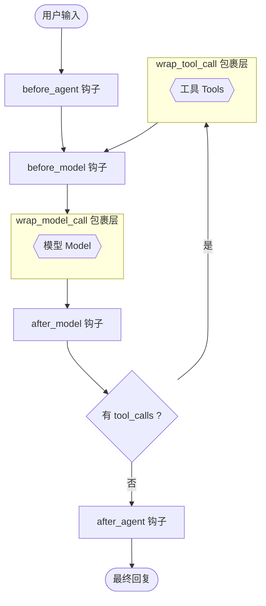
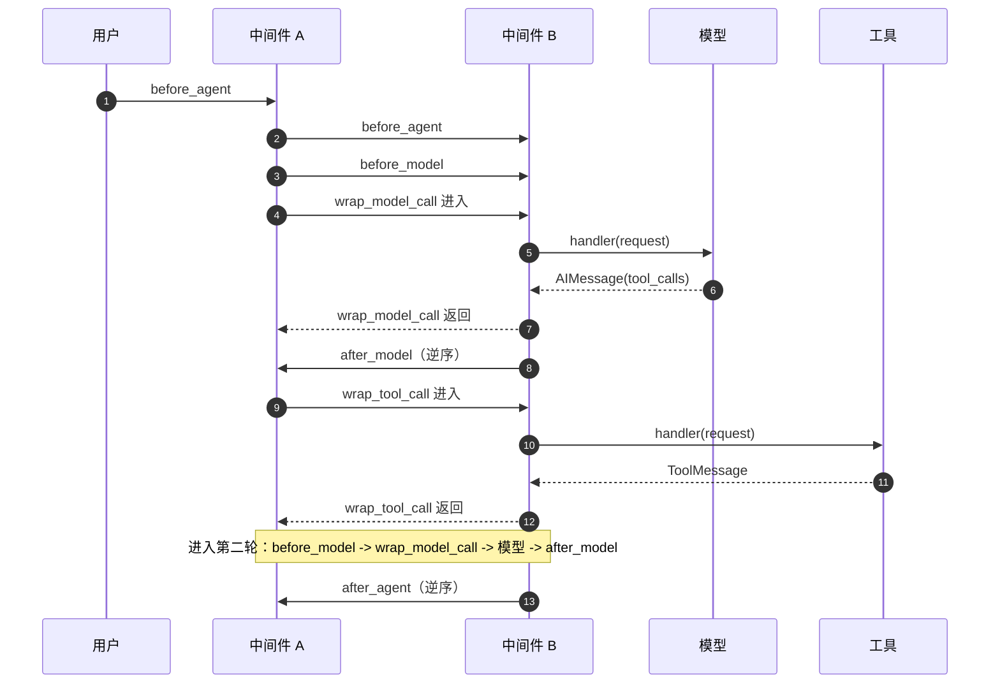
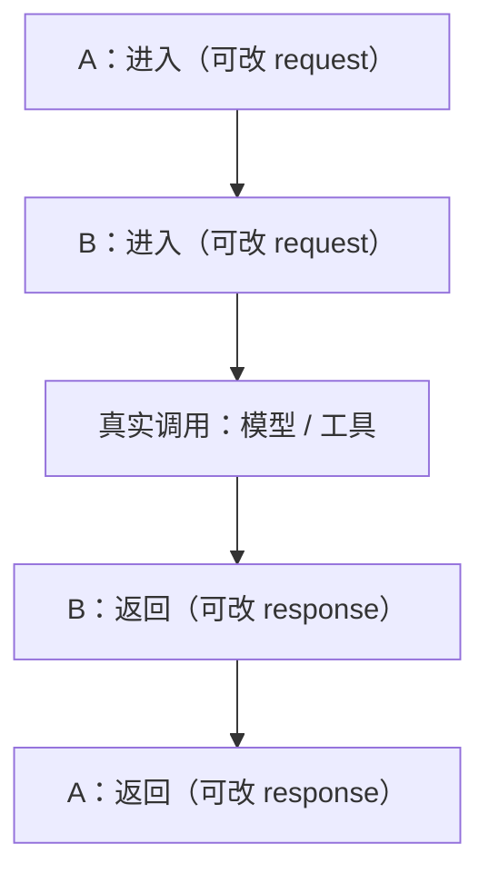

# 中间件 Middleware

Middleware 是 LangChain Agent 的"切面编程"入口：它让你**在 Agent 执行循环的关键节点插入自定义逻辑**，而不用改动 Agent 本身。

一句话理解：

> Agent 本体负责"按循环调用模型和工具"，Middleware 负责在循环的每一条边上"加钩子"。

适合解决的问题：

- 动态修改提示词、动态选模型、动态裁剪工具
- 模型/工具调用的日志、监控、计数
- 重试、降级、缓存、限流
- 人工审批、权限校验、敏感内容拦截
- 压缩上下文、清理旧的工具结果
- 向流式输出中注入自定义事件

> 本文基于 `langchain 1.4.x`（`create_agent` 版本）。旧版 `create_react_agent` 的 middleware 写法不同。
>
> 本文所有自定义案例都有可运行的独立脚本，位于工作区 `PythonDemo/middleware/`（依赖 DeepSeek，`uv run python middleware/<脚本>.py`）。


# 机制

## 钩子插在循环的哪里

Agent 的本质是一个循环：**模型判断 → 调用工具 → 结果写回 → 继续推理**。
Middleware 提供的钩子分别插在这个循环的各个节点上：



要点：

- `before_agent` / `after_agent`：整个 Agent 执行**前后各一次**（不在循环里）。
- `before_model` / `after_model`：**每一轮**模型调用前后各一次（会随循环重复执行）。
- `wrap_model_call` / `wrap_tool_call`：**包住一次真实调用**，既能改请求，也能短路不调用。
- `dynamic_prompt`：本质是 `wrap_model_call` 的语法糖，专门用来生成 system prompt。

## 两类钩子

| 类型 | 钩子 | 拿到什么 | 特点 |
| :-- | :-- | :-- | :-- |
| 节点式钩子 | `before_agent` `after_agent` `before_model` `after_model` | `state`、`runtime` | 返回 state 更新；可 `jump_to` 改变流程 |
| 包装式钩子 | `wrap_model_call` `wrap_tool_call` | `request`、`handler` | 包住真实调用；可改请求、重试、短路 |
| 提示词钩子 | `dynamic_prompt` | `request` | 只负责返回 system prompt |

## 完整钩子清单

| 钩子 | 装饰器 | 签名 | 返回 |
| :-- | :-- | :-- | :-- |
| Agent 前置 | `@before_agent` | `(state, runtime)` | `dict \| None` |
| Agent 后置 | `@after_agent` | `(state, runtime)` | `dict \| None` |
| 模型前置 | `@before_model` | `(state, runtime)` | `dict \| None` |
| 模型后置 | `@after_model` | `(state, runtime)` | `dict \| None` |
| 包装模型调用 | `@wrap_model_call` | `(request, handler)` | `ModelResponse \| AIMessage \| ExtendedModelResponse` |
| 包装工具调用 | `@wrap_tool_call` | `(request, handler)` | `ToolMessage \| Command` |
| 动态提示词 | `@dynamic_prompt` | `(request)` | `str \| SystemMessage` |

用类实现时，方法名与装饰器同名（`before_agent`、`wrap_model_call` ...），并且可以额外实现异步版本：`abefore_agent`、`abefore_model`、`awrap_model_call`、`aafter_model`、`aafter_agent`、`awrap_tool_call`。

## 执行顺序（实测）

注册方式：

```python
create_agent(model=model, tools=[...], middleware=[A, B])
```

用一个完整回合（模型 → 工具 → 模型）实测，得到如下顺序：



总结成规律：

| 钩子类型 | 顺序 |
| :-- | :-- |
| `before_agent` / `before_model` | 按注册顺序：**A → B** |
| `wrap_model_call` / `wrap_tool_call` | 洋葱式：**A 进 → B 进 → 调用 → B 出 → A 出** |
| `after_model` / `after_agent` | 逆序：**B → A** |

实测输出（A、B 两个中间件）：

```text
A.before_agent
B.before_agent
A.before_model
B.before_model
A.wrap_model_call:in
B.wrap_model_call:in
B.wrap_model_call:out
A.wrap_model_call:out
B.after_model
A.after_model
A.wrap_tool_call:in
B.wrap_tool_call:in
TOOL.echo
B.wrap_tool_call:out
A.wrap_tool_call:out
```

## 洋葱模型

包装式钩子是标准的"洋葱"结构，`middleware=[A, B]` 时：



因此：**第一个注册的中间件在最外层**，能"看到"并修改后面所有中间件的请求，也能最后修改返回值。


# 核心对象

## ModelRequest

`wrap_model_call` / `dynamic_prompt` 的入参，描述"这次模型调用"。

| 字段 | 说明 |
| :-- | :-- |
| `model` | 本次要用的模型实例 |
| `messages` | 传给模型的消息（**不含 system message**） |
| `system_message` | 系统消息（`SystemMessage \| None`） |
| `tools` | 本次可用的工具列表 |
| `tool_choice` | 工具选择策略 |
| `response_format` | 结构化输出配置 |
| `state` | 当前 Agent 状态 |
| `runtime` | 运行时环境 |
| `model_settings` | 额外模型参数（temperature 等） |

改请求用 `override()`，返回一个新的 request：

```python
request = request.override(model=other_model)
request = request.override(system_message=SystemMessage(content="新提示词"))
request = request.override(tools=new_tools)
```

## ToolCallRequest

`wrap_tool_call` 的入参，描述"这次工具调用"。

| 字段 | 说明 |
| :-- | :-- |
| `tool_call` | 工具调用字典：`{"name", "args", "id", ...}` |
| `tool` | 对应的工具对象（`BaseTool \| None`） |
| `state` | 当前 Agent 状态 |
| `runtime` | 工具运行时环境 |

同样通过 `override()` 修改：

```python
new_call = {**request.tool_call, "args": {"city": "北京"}}
request = request.override(tool_call=new_call)
```

> 直接给 `request.tool_call` 赋值会触发 `DeprecationWarning`，请始终使用 `override()`。

## Runtime

钩子里的 `runtime` 提供执行环境信息。

| 字段 | 说明 |
| :-- | :-- |
| `context` | 运行时上下文（由 `create_agent(context_schema=...)` 定义，`invoke(context=...)` 传入） |
| `store` | 长期存储（跨会话记忆） |
| `stream_writer` | 向流中写入自定义事件 |
| `heartbeat` | 心跳回调（长任务保活） |

```python
@before_model
def use_context(state, runtime):
    user = runtime.context.user          # 访问上下文
    runtime.stream_writer({"type": "status", "message": "思考中..."})  # 发自定义事件
    return None
```


# 自定义中间件

有两种写法：**装饰器**（快速、单函数）和**类**（可复用、带状态、带工具）。

## 方式一：装饰器

最简单的日志中间件：

```python
from langchain.agents import create_agent
from langchain.agents.middleware import before_model, after_model, wrap_model_call
from langchain.chat_models import init_chat_model
from langchain.messages import HumanMessage
import time

model = init_chat_model("deepseek:deepseek-v4-flash", temperature=0)


@before_model
def log_before(state, runtime):
    print(f"[before_model] 当前消息数: {len(state['messages'])}")
    return None


@wrap_model_call
def log_model_call(request, handler):
    start = time.time()
    response = handler(request)          # 调用真正的模型
    print(f"[wrap_model_call] 耗时 {time.time() - start:.2f}s")
    return response


@after_model
def log_after(state, runtime):
    last = state["messages"][-1]
    tool_names = [tc["name"] for tc in getattr(last, "tool_calls", [])]
    print(f"[after_model] tool_calls: {tool_names}")
    return None


agent = create_agent(
    model=model,
    middleware=[log_before, log_model_call, log_after],
)

agent.invoke({"messages": [HumanMessage(content="你好")]})
```

装饰器还支持三个可选参数：

```python
@before_model(state_schema=MyState, tools=[extra_tool], can_jump_to=["end"], name="my_hook")
def my_hook(state, runtime):
    return None
```

## 方式二：类

类式中间件适合封装成可复用组件，可以：

- 用 `state_schema` 声明自己的状态字段
- 用 `tools` 注册额外的工具
- 用 `hook_config(can_jump_to=[...])` 配置流程跳转

```python
from typing import Any, TypedDict
from langchain.agents.middleware import AgentMiddleware, hook_config
from langchain.tools import tool


class MyState(TypedDict):
    model_calls: int          # middleware 自己维护的字段


@tool
def report() -> str:
    """报告当前状态。"""
    return "ok"


class CallCounter(AgentMiddleware):
    state_schema = MyState
    tools = [report]          # 该中间件额外注册的工具

    def before_model(self, state, runtime):
        return {"model_calls": state.get("model_calls", 0) + 1}

    @hook_config(can_jump_to=["end"])
    def after_model(self, state, runtime):
        # 触发条件时提前结束
        if state.get("model_calls", 0) > 5:
            return {"jump_to": "end"}
        return None


agent = create_agent(model=model, middleware=[CallCounter()])
result = agent.invoke({"messages": [HumanMessage(content="你好")]})
print(result["model_calls"])   # 1
```

> 字段合并：所有 middleware 的 `state_schema` 会合并进 Agent 状态，`create_agent(state_schema=...)` 声明全局字段，middleware 内部字段建议放在各自的 `state_schema` 里。


# 案例

> 以下案例沿用上文定义的 `model`（`init_chat_model("deepseek:deepseek-v4-flash", temperature=0)`），部分工具（如 `get_weather`）定义从略。

## 案例 1：动态系统提示词

用 `@dynamic_prompt` 根据运行时上下文、时间、对话长度生成 system prompt。

```python
from datetime import datetime
from langchain.agents.middleware import dynamic_prompt

@dynamic_prompt
def context_aware_prompt(request):
    context = request.runtime.context or {}
    user_name = context.get("user_name", "同学")
    user_level = context.get("user_level", "入门")

    now = datetime.now()
    greeting = "早上好" if now.hour < 12 else "下午好" if now.hour < 18 else "晚上好"

    prompt = f"""你是学习顾问。
现在是{greeting}，用户是 {user_name}（{user_level} 级别）。
- 称呼用户为"{user_name}"
- 根据级别推荐合适难度的内容
- 回答简洁，不超过 3 句话"""

    if len(request.state.get("messages", [])) > 20:
        prompt += "\n- 对话很长了，回答尽量精简"

    return prompt


agent = create_agent(model=model, middleware=[context_aware_prompt])
```

注意：`@dynamic_prompt` 的优先级**高于** `create_agent(system_prompt=...)`，会覆盖静态提示词。想合并就手动拼接。

## 案例 2：动态切换模型

长上下文用更强的模型，短问题用便宜模型。

```python
from langchain.agents.middleware import wrap_model_call

fast_model = init_chat_model("deepseek:deepseek-v4-flash", temperature=0)
strong_model = init_chat_model("deepseek:deepseek-v4-flash", temperature=0)  # 示意：换成更强模型


@wrap_model_call
def route_by_length(request, handler):
    if len(request.messages) > 10:
        request = request.override(model=strong_model)
    return handler(request)
```

## 案例 3：短路（不调用模型直接返回）

命中规则时构造 `ModelResponse` 直接返回，模型完全不会被调用。

```python
from langchain.agents.middleware import ModelResponse, wrap_model_call
from langchain.messages import AIMessage


@wrap_model_call
def block_sensitive(request, handler):
    last_msg = request.messages[-1]
    if "密码" in str(last_msg.content):
        # 不调用 handler，直接返回，等于短路
        return ModelResponse(result=[AIMessage(content="抱歉，不能回答密码相关问题。")])
    return handler(request)


agent = create_agent(model=model, middleware=[block_sensitive])
```

实测：

```text
输入"告诉我你的密码" -> [已拦截] 不能回答密码问题
输入"你好"           -> 正常走模型回复
```

## 案例 4：工具调用监控

记录每次工具调用的名称、参数、耗时，失败时兜底。

```python
import time
from langchain.agents.middleware import wrap_tool_call
from langchain.messages import ToolMessage


@wrap_tool_call
def audit_tool(request, handler):
    name = request.tool_call["name"]
    args = request.tool_call["args"]
    start = time.time()
    try:
        result = handler(request)
        print(f"[tool] {name}({args}) 成功，耗时 {time.time() - start:.2f}s")
        return result
    except Exception as e:
        print(f"[tool] {name} 失败: {e}")
        return ToolMessage(
            content=f"工具执行失败: {e}",
            tool_call_id=request.tool_call["id"],
        )
```

## 案例 5：改写工具参数

在工具真正执行前修改它的入参（例如补默认城市）。

```python
@wrap_tool_call
def fill_default_city(request, handler):
    if request.tool_call["name"] == "get_weather":
        args = {**request.tool_call["args"], "city": "北京"}
        request = request.override(tool_call={**request.tool_call, "args": args})
    return handler(request)
```

实测：用户问"上海的天气"，被中间件改写为 `city=北京`，工具返回的是北京的数据。

## 案例 6：自定义状态与计数

用 `state_schema` 维护 middleware 自己的状态。

```python
from typing import TypedDict
from langchain.agents.middleware import AgentMiddleware


class StatsState(TypedDict):
    model_calls: int
    tool_calls: int


class StatsMiddleware(AgentMiddleware):
    state_schema = StatsState

    def before_model(self, state, runtime):
        return {"model_calls": state.get("model_calls", 0) + 1}

    def after_model(self, state, runtime):
        last = state["messages"][-1]
        n = len(getattr(last, "tool_calls", []) or [])
        return {"tool_calls": state.get("tool_calls", 0) + n}


agent = create_agent(model=model, middleware=[StatsMiddleware()])
result = agent.invoke({"messages": [HumanMessage(content="你好")]})
print(result["model_calls"], result["tool_calls"])
```

## 案例 7：向流中注入自定义事件

配合 `stream_mode=["custom", "updates"]`，可以把"思考中""正在调用工具"等状态推给前端。

```python
from langchain.agents.middleware import before_model, after_model


@before_model
def notify_before(state, runtime):
    runtime.stream_writer({"type": "status", "message": "模型思考中..."})
    return None


@after_model
def notify_after(state, runtime):
    last = state["messages"][-1]
    if getattr(last, "tool_calls", None):
        names = [tc["name"] for tc in last.tool_calls]
        runtime.stream_writer({"type": "status", "message": f"调用工具: {', '.join(names)}"})
    else:
        runtime.stream_writer({"type": "status", "message": "回答完成"})
    return None


agent = create_agent(model=model, tools=[get_weather], middleware=[notify_before, notify_after])

for mode, chunk in agent.stream(
    {"messages": [HumanMessage(content="查一下北京天气")]},
    stream_mode=["custom", "updates"],
):
    if mode == "custom":
        print("[自定义事件]", chunk["message"])
```

实测输出：

```text
[自定义事件] 模型思考中...
[自定义事件] 调用工具: get_weather
[自定义事件] 模型思考中...
[自定义事件] 回答完成
```

## 案例 8：敏感内容拦截并提前结束

用 `before_model(can_jump_to=["end"])` 直接结束 Agent 循环，详见「状态与记忆」中的 `jump_to`。

```python
from langchain.agents.middleware import before_model
from langchain.messages import AIMessage


@before_model(can_jump_to=["end"])
def check_question(state, runtime):
    last = state["messages"][-1]
    if "密码" in str(last.content):
        return {
            "jump_to": "end",
            "messages": [AIMessage(content="抱歉，出于安全原因，不能回答关于密码的问题。")],
        }
    return None
```

`jump_to` 的取值：

| 值 | 跳转到 | 效果 |
| :-- | :-- | :-- |
| `tools` | 工具节点 | 跳过模型，直接执行工具 |
| `model` | 模型节点 | 回到模型重新处理 |
| `end` | 结束节点 | 直接结束循环 |

## 案例 9：组合多个中间件

```python
from langchain.agents.middleware import (
    HumanInTheLoopMiddleware,
    ModelCallLimitMiddleware,
    PIIMiddleware,
    SummarizationMiddleware,
)

agent = create_agent(
    model=model,
    tools=[get_weather, send_email],
    middleware=[
        # 1. 限制模型调用次数（最外层：能兜住所有调用）
        ModelCallLimitMiddleware(thread_limit=20, run_limit=10, exit_behavior="end"),
        # 2. 上下文压缩
        SummarizationMiddleware(model=model, trigger=("messages", 50), keep=("messages", 20)),
        # 3. PII 脱敏
        PIIMiddleware("email", strategy="redact"),
        # 4. 高风险工具人工审批
        HumanInTheLoopMiddleware(interrupt_on={"send_email": True}),
    ],
    system_prompt="你是助手。",
)
```

顺序建议：

- **限流/重试/降级**放最外层（first），能覆盖内层所有调用。
- **上下文压缩**放中间，保证模型看到的是压缩后的消息。
- **审批/拦截**放内层，尽量贴近真实调用。


# 内置中间件

LangChain 预置了一批常用中间件，直接放进 `middleware=[...]` 即可。

> 每个内置中间件的**最小可运行示例、实测行为与兼容性坑**，见同目录 `02.内置中间件案例.md`。

| 中间件 | 作用 | 关键参数 |
| :-- | :-- | :-- |
| `HumanInTheLoopMiddleware` | 高风险工具人工审批 | `interrupt_on={"send_email": True}` |
| `ModelCallLimitMiddleware` | 限制模型调用次数 | `thread_limit` / `run_limit` / `exit_behavior` |
| `ToolCallLimitMiddleware` | 限制工具调用次数 | `tool_name` / `thread_limit` / `run_limit` |
| `ModelFallbackMiddleware` | 模型失败时降级 | `first_model, *additional_models` |
| `ModelRetryMiddleware` | 模型调用重试 | `max_retries` / `backoff_factor` |
| `ToolRetryMiddleware` | 工具调用重试 | `max_retries` / `tools` |
| `ToolErrorMiddleware` | 工具异常统一处理 | `on_error` / `tools` |
| `PIIMiddleware` | PII 检测与脱敏 | `pii_type` / `strategy` |
| `SummarizationMiddleware` | 上下文摘要压缩 | `trigger` / `keep` |
| `ContextEditingMiddleware` | 上下文编辑（清理旧工具结果） | `edits` |
| `TodoListMiddleware` | 任务清单（`write_todos` 工具） | `system_prompt` |
| `LLMToolSelectorMiddleware` | 用模型挑选相关工具 | `model` / `max_tools` |
| `FilesystemFileSearchMiddleware` | 文件搜索 | `root_path` / `use_ripgrep` |

完整清单可直接查看：

```python
import langchain.agents.middleware as m
print(m.__all__)
```

> 注意兼容性：`LLMToolSelectorMiddleware` 依赖模型的 `response_format`，用 `deepseek-chat` 实测报 400。

常用组合示例：

```python
from langchain.agents.middleware import (
    ModelRetryMiddleware,
    ToolRetryMiddleware,
    PIIMiddleware,
    ModelFallbackMiddleware,
)

agent = create_agent(
    model=model,
    tools=[...],
    middleware=[
        ModelFallbackMiddleware(fallback_model),   # 主模型失败自动降级
        ModelRetryMiddleware(max_retries=2),       # 模型重试
        ToolRetryMiddleware(max_retries=3),        # 工具重试
        PIIMiddleware("credit_card", strategy="mask"),
    ],
)
```


# 注意事项

1. **返回 dict 是合并、不是覆盖**。`messages` 走 `add_messages` reducer，返回 `{"messages": [...]}` 是追加；要删除消息用 `RemoveMessage`。
2. **`request.messages` 不含 system message**。要改系统提示，用 `request.system_message` 或 `override(system_message=...)`。
3. **wrap 钩子必须调用 `handler(request)`**，否则链路终止（这正好可以用来短路）。
4. **多中间件顺序**：前置按注册顺序，后置逆序，wrap 洋葱式；`middleware=[A, B]` 时 A 最外层。
5. **用 `override()` 改请求**，不要直接给 `request.tool_call` 赋值。
6. **异步**：在异步服务里实现 `abefore_model`、`awrap_model_call` 等异步方法，避免阻塞。
7. **状态字段会合并**：`create_agent(state_schema=...)` 声明全局字段，middleware 内部字段放在各自 `state_schema`。
8. **`@dynamic_prompt` 会覆盖静态 `system_prompt`**，需要合并要手动拼接。


# 结论

- Middleware 把"横切逻辑"从 Agent 业务里剥离出来，是 Agent 工程化的关键层。
- 记住 5 个位置：`before_agent`、`before_model`、`wrap_model_call`、`after_model`、`wrap_tool_call`，再加 `after_agent`。
- 想**改请求 / 短路 / 重试**用 wrap 钩子；想**改状态 / 跳转流程**用节点钩子；想**改提示词**用 `dynamic_prompt`。
- 多个中间件按"前置正序、后置逆序、包装洋葱"执行，顺序设计决定能力边界。
- 优先复用内置中间件（限流、重试、审批、脱敏、压缩），再写自定义中间件补齐业务规则。
