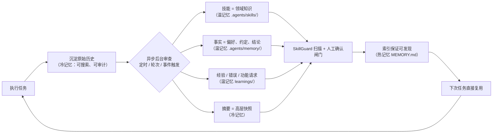
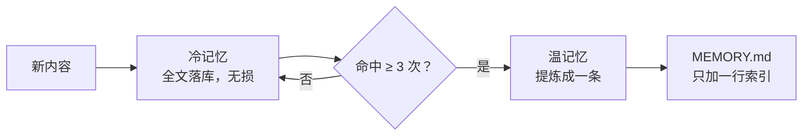
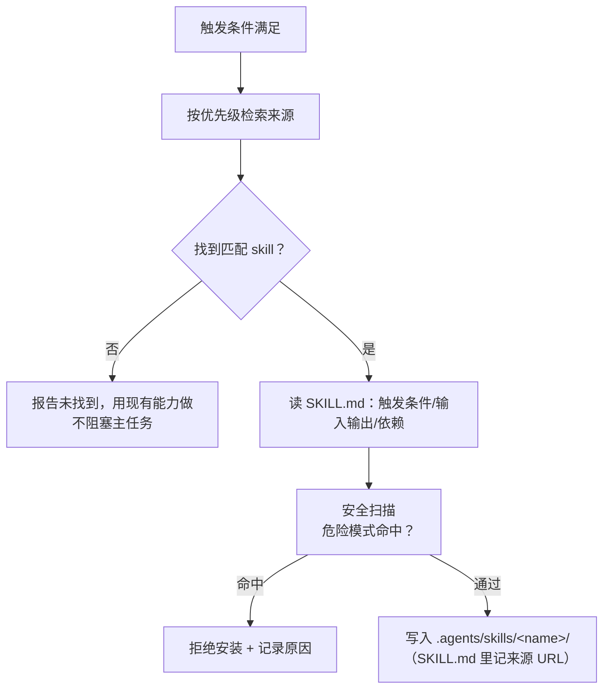
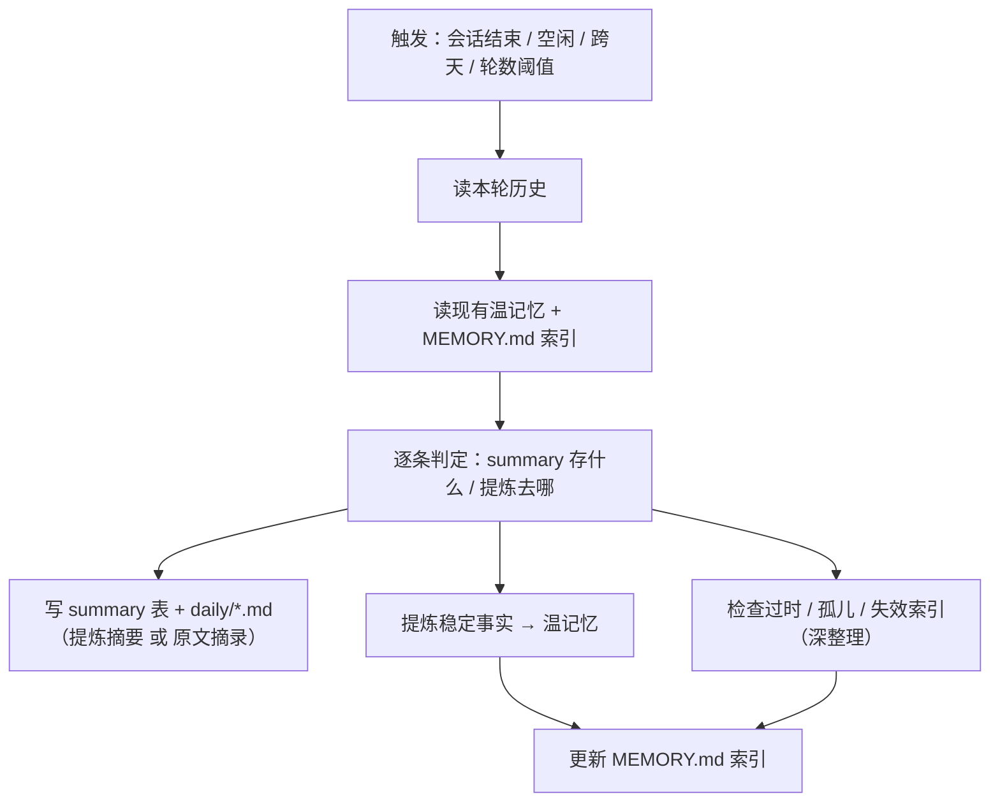

# 总览

**三层结构 + 一条晋级链 + 四个异步进程 + 一道人工确认闸门。**

热记忆（每次注入）→ 温记忆（按需读取）→ 冷记忆（检索才取）。新内容先无损落冷，被反复用到才提炼进温，温的目录行进热。

**总览闭环**



本图在原参考闭环（执行 → 沉淀 → 异步审查 → 技能／记忆 → 把关 → 索引 → 复用）的基础上，按本设计的三层落位改写。两处与原图不同：

1. **事实落在温记忆，不是热记忆。** 原图「记忆 = 事实」直接进热记忆（Hermes 的 USER.md／MEMORY.md 是这么做的）。本设计里热记忆只装索引，事实正文放温记忆，热记忆里只留一行目录。
2. **多一道人工确认闸门**，与 SkillGuard 并联（见第十一章）。


# 一、分层定义

| 层 | 位置 | 加载时机 | 容量 | 装什么 |
|---|---|---|---|---|
| 热 | `AGENTS.md`、`.agents/memory/MEMORY.md` | 每次注入 | **必须小** | 项目规则、索引、Skill 获取协议 |
| 温 | `.agents/memory/`（除 `archive/`）、`.agents/skills/` | 按需读取 | 可大 | 用户／反馈／项目／参考知识、技能 |
| 冷 | `.agents/history/memory.db` | 检索才取 | 无上限 | 原始历史全文 + 高层摘要 |

**为什么热记忆必须小**：它每次请求都付 token。所以热记忆不装正文，只装**索引**——告诉 Agent「有哪些温记忆、各讲什么、什么时候去读」。


# 二、目录布局

```text
<workspace>/
├── AGENTS.md                       ← 热记忆①：项目规则、硬约束、偏好设置
└── .agents/
    ├── BOOTSTRAP.md                ← 冷启动引导清单（一次性，填完归档）
    ├── .env                        ← 技能要的账号／令牌（不进 git；由 skill-creator-plus 管理）
    ├── memory/
    │   ├── MEMORY.md               ← 热记忆②：索引 + Skill 获取协议
    │   ├── 偏好设置记忆.md          ← 温记忆（按对象分）
    │   ├── 用户相关记忆.md
    │   ├── 用户反馈记忆.md
    │   ├── 项目相关记忆.md
    │   ├── 参考文档记忆.md
    │   ├── <主题>记忆.md            ← 按需新增
    │   ├── archive/                ← 降级归档（不再索引、不加载）
    │   └── learnings/              ← 温记忆（按性质分）
    │       ├── learnings.md            ← 经验
    │       ├── errors.md               ← 错误记录
    │       └── feature-requests.md     ← 功能请求
    ├── skills/                     ← 温记忆（技能形态）
    │   ├── skill-creator-plus/     ← 元技能：造／改技能（见 7.7）
    │   ├── skill-creator/          ← 上面那个的官方依赖，首次自动安装
    │   └── <skill-name>/           ← 自沉淀或安装的技能
    ├── prompts/                    ← 被宿主调用的提示词与规则
    │   ├── skill-review.md             ← 技能审查子智能体
    │   ├── memory-review.md            ← 记忆审查子智能体
    │   ├── history-organize.md         ← 轻整理子智能体
    │   ├── deep-organize.md            ← 深整理子智能体（低频）
    │   └── skillguard.md               ← 安装前安全扫描规则
    ├── templates/                  ← 模板 / 检查清单（沉淀用）
    ├── docs/
    │   ├── context-handoff.md
    │   └── cold-memory-schema.sql  ← 冷记忆建库脚本（宿主首次运行执行）
    └── history/                    ← 冷记忆
        ├── memory.db               ← SQLite：全文 + 摘要 + 检索日志
        ├── daily/
        │   └── YYYY-MM-DD.md       ← 摘要的人类可读副本
        └── organize-YYYY-MM-DD.md  ← 深整理日志（留痕）
```


# 三、热记忆

**`AGENTS.md`**

项目级硬规则。只放「每次都必须遵守」的约束，不放可查的知识。可查的东西一律下放到温记忆。

**硬上限：AGENTS.md ≤ 20000 字符。** 依据：Hermes 给 context 文件设的是 **20K 字符硬限**（另有 PR「keep repository instructions within startup budget」）；OpenClaw 的 MEMORY.md 截断阈值也在 **1.8 万**量级——两家独立收敛到同一档。当前内容约 **11,239 字符**，用了 56%。

**加规则时只合并、不线性追加**：新条款要么并入已有条目，要么替换旧条款。字符上限管「装不下」，这条管「别一路往后堆」。

**子目录局部规则的优先级**（将来要用时按 Hermes 的 4 级优先级）：子目录 `AGENTS.md` > 项目根 `AGENTS.md` > 全局规则。冲突时，离当前文件近的赢。

里面留一个固定的**偏好设置**分区，装每次对话都要生效的偏好：

| 类型 | 例 |
|---|---|
| 表达偏好 | 输出语言、精简级别、回复格式 |
| 工程偏好 | 代码风格、命名习惯、注释密度、提交信息格式 |
| 交互偏好 | 是否先提问、是否给方案候选、何时停下确认 |

**判定标准**：**不生效就会立刻做错**的偏好留在热记忆；只按场景偶尔用到的，下放 `偏好设置记忆.md`（第四章）。热记忆有硬顶，装不下要靠下放解决。

**`.agents/memory/MEMORY.md`**

只当索引，不装正文。三块内容：

1. **温记忆目录**：有哪些记忆文件、各讲什么、什么时候去读
2. **冷记忆检索入口**：什么时候该去搜历史
3. **Skill 获取协议**：见第七章

**技能不进索引。** `MEMORY.md` 不为每个技能加一行——技能数量会长，热记忆的 2000 字符容不下。Skill 协议里只留一句：「技能见 `.agents/skills/`，需要时列目录」。每个技能自己的来源、适用场景写在它的 `SKILL.md` 里。省下的字符留给第 1 块（其他温记忆的目录）。

**硬上限：MEMORY.md ≤ 2000 字符**（含索引 + Skill 协议）。

这个上限不是为了省 token，是为了**逼知识下沉**。Hermes 用同一招——USER.md + MEMORY.md 合计 < 4000 字符（笔记 6.3），目的就是让热记忆装不下，从而被迫把知识做成技能和温记忆。所以上限一满，该做的是往下搬东西，**不是把上限调高**。

**为什么不用 OpenClaw 的松口径**：OpenClaw 的 `MEMORY.md` 直接装事实（它没有独立温记忆层），预期量级到 **1.8 万字符**才触发截断——而且它的截断是**静默**的，已有 issue 记录「silently drops context with no warning」。本设计的 `MEMORY.md` 只装索引，天然就小；用硬上限要求「满了往下搬」，从机制上避开静默截断这个坑。

**Skill 协议里要写一条主动规则**（借 Hermes 案例三的原文）：

```text
在使用技能并发现它过时、不完整或错误时，立即修补它，
不要等着被要求。不维护的技能会变成负担。
```

**一条硬规则：写温记忆必须同步更新 MEMORY.md 索引。**

不更新索引，新记忆文件就是孤儿——文件在磁盘上，但 Agent 的上下文里没有它的名字，等于不存在。这是纯提示词方案最容易坏的地方（Claude Code 同样有此问题），所以第八章用异步进程兜底。


# 四、温记忆

温记忆有两个维度：**按内容分**（对象／性质）和**按更新方式分**（稳定型／演进型）。前者决定写进哪个文件，后者决定谁来写、什么时候加载。

## 4.1 按内容分

**按对象分**（回答「关于 X 我知道什么」）：

| 文件 | 装什么 |
|---|---|
| `偏好设置记忆.md` | 按场景生效的偏好：任务类型对应的格式、工具、风格选择 |
| `用户相关记忆.md` | 用户是谁、背景、风格、工作习惯 |
| `用户反馈记忆.md` | 用户纠正过什么、期望 Agent 怎么表现 |
| `项目相关记忆.md` | **本工作空间专属**：约定、环境事实、踩过的坑 |
| `参考文档记忆.md` | 外部资料摘要 + 出处链接 |

**按需可新增 `<主题>记忆.md`，但先并入、装不下再新建。** 判据两条必须**同时**满足：

1. 内容不属于上面五类中的任何一类
2. 预计会积累 **≥ 3 条**（只为一两句话单开一个文件不值得）

新建后要在 `MEMORY.md` 登记一行索引。文件数不设上限，但每新建一个就吃掉热记忆一行——门槛要守住。

**偏好分两处放，按生效范围决定**：

| 生效范围 | 放哪 |
|---|---|
| 每次对话都生效 | 热记忆 `AGENTS.md`（第三章） |
| 按场景／任务类型生效 | `偏好设置记忆.md` |

判据：**不生效就会立刻做错** → 热记忆；**用到才生效** → 温记忆。

**与 `用户相关记忆.md` 的分工**：`偏好设置记忆.md` 装「该怎么做」（可执行的偏好条目），`用户相关记忆.md` 装「用户是谁」（身份、背景、习惯）。同一条内容只进一个。

**按性质分**（回答「我该怎么做／犯过什么错／还缺什么」）：

| 文件 | 装什么 |
|---|---|
| `learnings/learnings.md` | 经验：验证过有效的做法 |
| `learnings/errors.md` | 错误记录：踩过的坑 + 原因 + 正确做法 |
| `learnings/feature-requests.md` | 功能请求：现有能力覆盖不到、需要补的东西 |

这组结构参考 OpenClaw「自提升智能体系」skill 的做法（笔记第八章）。

**两组不重叠**：事实（偏好、约定、环境）进按对象那组；方法、教训、能力缺口进 learnings 组。同一个坑不要两边都写。

**经验 → 技能是一条提升链**：验证过的做法先落 `learnings/learnings.md`（一句话结论）；被反复用到、稳定下来后，再补上步骤、输入输出、验证方式，**提升为技能**（第七章）。提升后 learnings 里那条改为指向该技能，不重复两份内容。

判据：**能一句话说清、不需要调用入口** → learnings；**需要多步流程、有明确输入输出** → 技能。这条与 9.3「根据成熟度选形式，不得为了沉淀而强行升级工具形态」是同一条原则。

## 4.2 按更新方式分（稳定型 / 演进型）

| | 稳定型 | 演进型 |
|---|---|---|
| 特点 | 长期固定，低频变化 | **随对话任务推进由 Agent 更新，跟当前项目息息相关** |
| 文件 | `偏好设置记忆.md`、`用户相关记忆.md`、`用户反馈记忆.md`、`参考文档记忆.md` | `项目相关记忆.md`、`learnings/*.md` |
| 谁写 | 多为用户确认后写入 | Agent 异步整理写入（第八、十章） |
| 加载 | 按需加载 | 项目任务开始时加载 + 按需 |
| 风险 | 低（内容稳定） | 高（Agent 自己写的，可能过时或写错） |

**演进型要额外维护**：过时检查、淘汰规则（第六章）、人工确认闸门（第十一章）。稳定型不需要——它本来就不怎么动。

## 4.3 一张表看全部

| 文件 | 内容分类 | 更新方式 |
|---|---|---|
| `偏好设置记忆.md` | 对象 | 稳定型 |
| `用户相关记忆.md` | 对象 | 稳定型 |
| `用户反馈记忆.md` | 对象 | 稳定型 |
| `参考文档记忆.md` | 对象 | 稳定型 |
| `项目相关记忆.md` | 对象 | **演进型** |
| `learnings/learnings.md` | 性质 | **演进型** |
| `learnings/errors.md` | 性质 | **演进型** |
| `learnings/feature-requests.md` | 性质 | **演进型** |

## 4.4 四条写作规则

1. 一文件一主题，不一文件多主题
2. 每条记忆带**适用范围**（哪个项目／哪类任务适用）和**来源**
3. 只写提炼后的结论，不机械复制聊天原文
4. **模板里的占位符一律写成 HTML 注释**（`<!-- … -->`），不写成看起来像真实条目的行——否则写入时容易只追加不替换，把示例留成假数据（实测踩过：`learnings.md` 的示例行被原样留着）

**项目专属记忆的判定**：内容只对当前工作空间成立（如「本仓库用 pnpm，锁文件是 pnpm-lock.yaml」），且预判会复用。跨项目通用的方法不进这里，进 Skill。

## 4.5 冷启动：怎么把空温记忆填满

新工作空间里温记忆全是空的。**光有骨架没用——没人问，文件就一直是空的。**

**做法**：放一个 `.agents/BOOTSTRAP.md`，作为首次运行的引导清单（照 OpenClaw 的做法）。

1. **触发**：`.agents/BOOTSTRAP.md` 存在，且它的状态行仍是 `状态：未执行`——这是**唯一判据**，不靠「文件是否为空」去猜
2. **动作**：Agent 按 BOOTSTRAP.md 的清单**主动问用户**，一次问一组，不连环追问
3. **落盘**：答案写进对应温记忆文件（`用户相关记忆.md`、`偏好设置记忆.md`、`项目相关记忆.md` …）
4. **收尾**：写完在 `MEMORY.md` 登记索引；把状态行改成 `状态：已完成 YYYY-MM-DD`
5. **不再重复**：后续会话看到 `已完成` 就跳过；也可以直接归档或删掉本文件

**BOOTSTRAP.md 模板**

```text
# 引导清单

状态：未执行

> 首次运行用。填完把上面那行改成「状态：已完成 YYYY-MM-DD」，之后不再执行。

## 关于用户
- 你怎么称呼？
- 技术背景和常用技术栈？
- 希望我怎么跟你说话（详细 / 精简 / 先给结论）？
- 有什么是你明确不想要的？

## 关于这个工作空间
- 这个项目是做什么的？
- 用什么包管理器、怎么构建、怎么跑测试？
- 有哪些必须遵守的约定？
- 有没有正在踩的坑？
```

**为什么单独一个文件**：它是**一次性**产物，不是长期记忆。写完就该从上下文里消失——塞进 `AGENTS.md` 会让一段「只在首次有用」的内容长期占着每次请求的 token。


# 五、冷记忆

冷记忆是唯一**无损**的一层，负责可追溯。

装两类东西：

- **原始历史**：每轮对话／任务的完整记录
- **摘要**：按天或按任务生成的高层快照（对应 OpenClaw 的每日日志）

两者都进 SQLite，都能被搜索。

**写入时机：原始历史每轮同步写。** 不缓冲、不批量——崩溃不丢是冷记忆「无损」的全部价值；而且异步整理进程也要能随时看到最新的几轮。

**摘要不是逐字记录**，是加工过的短视图——今天做了什么、定了什么。它比原始历史更适合被检索命中后直接喂给上下文。

**只增不减。** 冷记忆不做保留期淘汰（它是无损层）。库大到影响检索时，按年分库归档（如 `history-2026.db`），**不删数据**。


# 六、写入、晋级与淘汰

**写入的三种触发**

1. 用户明确要求沉淀
2. Agent 在对话中发现可复用内容
3. 异步进程扫描发现（见第八章）

**晋级链（冷 → 温 → 热）**



- 默认一律先落冷（无损、可追溯）
- **晋级判定由轻整理做**（第十章）：读 `search_log`（9.3），把语义同属一个主题的查询归一后，**累计命中 ≥ 3 次** → 从冷记忆提炼一条进温记忆
- 温记忆条目在 MEMORY.md 里登记一行

**淘汰**

淘汰**不自动执行**。时间阈值的作用是「触发复核」，不是「到点就删」。

- 温记忆条目 90 天未被引用 → **进入整理进程的复核清单**（第十章），由整理进程判定：
  - 内容已被取代，或与现有事实矛盾 → **降级**：从 `MEMORY.md` 摘除索引，温记忆文件移到 `.agents/memory/archive/`（不再索引、不加载；内容在冷记忆里仍可检索，所以不算删除）
  - 内容仍有效，只是近期没用到 → **续期**：保留索引，计时重置
- 命中安全风险的内容（凭据、密钥、外发地址等）→ **深整理**用 `skillguard.md` 的规则集扫 **`.agents/memory/` 下所有 `.md`（含 `learnings/`）**，命中即删除并记入整理日志。这属于 11.1 的「安全删除」档，不用人工确认

**为什么不让时间自动摘除**：自动摘除会和 10.4 的「找孤儿」直接打架——整理进程会把刚摘掉的索引又补回去，淘汰永远不生效。所以时间只当复核信号，判定权交给整理进程。


# 七、Skill 自主获取机制

**协议写在 `MEMORY.md` 里（热记忆）**，这样每次对话都在场。

## 7.1 触发条件

满足任一即触发检索：

- 任务中出现**同类步骤重复 ≥ 3 次**
- 现有 skill 覆盖不到，且预判该能力以后还会用到
- 用户明确要求

**不触发**：一次性任务、内置工具能直接做完的。

设这道闸是为了避免每个任务都去网上翻一遍。

## 7.2 检索来源

按优先级：

1. `npx skills add https://github.com/vercel-labs/skills --skill find-skills` —— 用 find-skills 做检索
2. https://github.com/AI-Redfish/skill —— 自有仓库，优先
3. https://github.com/heilcheng/awesome-agent-skills/blob/main/README.zh-CN.md —— 中文精选清单
4. https://skills.sh/ ／ https://skillsmp.com/ ／ https://agentskill.sh/
5. https://smithery.ai/skills
6. Claw Hub

## 7.3 安装流程



**安全扫描**参考 Hermes 的 SkillGuard（笔记 6.2）：一个独立扫描器，里面是一组正则规则。安装前扫一遍，命中即**自动失败**——不是挂起等人，是直接拒绝。

危险模式分类：

| 类别 | 例 |
|---|---|
| 破坏性操作 | 批量删除、递归删目录、覆盖系统文件 |
| 数据外发 | 上传到外部地址、把内容 POST 出去 |
| 凭据读取 | 读 `~/.ssh`、`.env`、token、keychain |
| 任意代码执行 | 动态 `eval` / `exec`、从远端拉脚本直接跑 |
| 越权访问 | 读写工作空间以外的路径 |

命中后照 Hermes 的三步走：

1. **失败并删除**——已落盘的部分一并清掉，不留半成品
2. **把消息发回主 Agent**，说清命中哪条规则、怎么调整才能通过
3. 记一条到 `learnings/errors.md`

不命中才保存。

**只装运行必需文件**，不把整个仓库搬进来。

首次安装任何 skill 前，按第十一章的确认闸门向用户确认。

## 7.4 不做逐条索引

**技能不往 `MEMORY.md` 加行。** 技能数量会长，热记忆的 2000 字符容不下——`MEMORY.md` 的 Skill 协议里只留一句：

```text
技能见 .agents/skills/，需要时列目录。
```

每个技能自己的信息写在它的 `SKILL.md` 里——**骨架与规范由 7.7 的 `skill-creator-plus` 负责**。

另外：**来源 URL 必须留**（安装来的写源仓库，自己沉淀的写「本地沉淀 + 日期」），方便回溯和更新。

## 7.5 生命周期

- 随时可增、删、更新
- **更新（完善）时交给 7.7 的 `skill-creator-plus` 走流程**，不手改
- 保留来源 URL
- 删除时直接移除整个目录（技能不进 `MEMORY.md`，没有索引行要同步）
- 来源不可达 → 报告并放弃，不阻塞主任务

## 7.6 技能管理工具

主 Agent 要能自己维护技能，得给它一组工具（借 Hermes 案例二）：

| 工具 | 作用 |
|---|---|
| `skill_create` | 新建技能 |
| `skill_patch` | 修补／补充现有技能 |
| `skill_delete` | 删除技能 |
| `skill_write_file` ／ `skill_delete_file` | 在技能目录内写／删文件 |

**写操作一律限定在 `.agents/skills/<name>/` 内**，不允许越界写。

每个写工具落盘前都要过 7.3 的安全扫描。

**注意删除的分档**：这里的 `skill_delete` 是 Agent 主动整理的删除，走人工确认（第十一章）。SkillGuard 命中的自动删除是另一档，不用确认。

## 7.7 沉淀与完善 skill：交给 `skill-creator-plus`

**造技能这件事本身有一个专门的技能**：[`skill-creator-plus`](https://github.com/AI-Redfish/skill/tree/main/skills/skill-creator-plus)（v1.2.0，元技能）。自动沉淀新技能、或完善已有技能时，**交给它走流程，不要手写**。

它自己也装在 `.agents/skills/skill-creator-plus/`——**走 7.1–7.3 的安装流程**装进来（7.2 的自有仓库就是它的出处）。

**七章有两条路进 `.agents/skills/`，别混**

| 路 | 干什么 | 走哪节 |
|---|---|---|
| **安装外部技能** | 从仓库检索、扫描、装进来 | 7.1 → 7.2 → 7.3 |
| **沉淀／完善** | 把经验固化成新技能，或修补已有技能 | 本节：技能审查产出候选 → 交给 `skill-creator-plus` |

**这一步是前台交互，不是后台异步。** 它的理解闭环要求「**每次只问一个问题**」——异步子智能体问不了用户。所以：**技能审查（后台）只产出候选**，实际创建/完善由**前台主 Agent** 连同用户一起走完。

**它的流程（门禁状态机，禁止跳步）**

```
理解闭环 ≥95% ──▶ 编写 ──▶ 评审门 ≥95% ──▶ 测试门 ──▶ 测试报告 ──▶ 交付
                   ▲           │未过          │未过
                   └─修改后重审─┴──────────────┘
```

| 阶段 | 做什么 |
|---|---|
| 理解闭环 | 按十要素提问，**每次只问一个**；未达 95% 不给任何方案（连骨架也不建） |
| 编写 | 产出骨架与 `SKILL.md` |
| **评审门** | 机器检查（`review_checklist.py`）+ AI 双评审 → 置信度 **≥95%** 才放行 |
| **测试门** | 单测（正常／边界／错误三路径）+ 端到端 `evals/evals.json`（含正负触发） |
| 测试报告 | `benchmark.json/md`、`review.html`、`test-report.md` |
| 交付 | 打包 + 按最终输出要求汇报 |

**它强制的 7 条硬规范**

1. **双闭环内嵌**——生成的 skill 里也必须含双闭环规则，缺失是 error 级
2. **脚本优先 Python**——可执行逻辑放 `scripts/*.py`，自包含
3. **依赖优先 uv**——第三方库用 PEP 723 内联声明；能用标准库就用标准库
4. **环境信息集中**——账号／密码／令牌不写进 skill，运行时从 `<workdir>/.agents/.env` 读
5. **重复操作脚本化**——同一逻辑预计出现 ≥2 次就写成脚本
6. **提示词工程五段式**——角色／背景／规则／格式／示例
7. **输出精简内嵌**——生成的 skill 里也必须含输出精简约束

外加：`SKILL.md` 正文 ≤500 行；超 300 行就把细节外置到 `references/`。

**它在工作空间里留下什么**

| 路径 | 是什么 |
|---|---|
| `.agents/skills/skill-creator/` | 官方 `skill-creator` 依赖，首次自动安装 |
| `.agents/.env` | 技能要的账号／令牌；脱敏读取，**不进 git** |
| `<skill-name>-workspace/` | 评审清单、测试用例、报告等过程产物 |

**和本设计的两道闸怎么配合**

| 闸 | 管什么 |
|---|---|
| skill-creator-plus 的**评审门 + 测试门** | **质量**：结构合规、注入隔离、用例通过 |
| 本设计的**人工确认闸门**（第十一章） | **权限**：装不装、装到哪、删不删 |

两者不替代：质量过了，仍要过人工确认才能落进 `.agents/skills/`。

**落盘顺序**：`skill-creator-plus` 走完 → **SkillGuard 扫描**（7.3）→ **人工确认**（11.1）→ 才算装好。任一不过就回退，不留半成品。

**前置条件（和冷记忆那条链不同）**

skill 沉淀链要 **Python + uv + 网络**（首次装官方依赖）；冷记忆那条链仍是零依赖的 `node:sqlite`。

依赖没就绪时，skill-creator-plus 自己会报告并停住——**不要退回手写 skill 骨架**。

**不适用**：只想了解 skill 概念、查已有 skill 用法 → 直接解答；改一句话且用户明说「不用评审不用测」→ 按用户要求，但提示风险。


# 八、异步进程

借鉴 Hermes 的双异步（>10 步写技能、>10 轮写记忆），本设计再加整理两档，共**四个后台进程**；触发时机统一成三类（深整理另走低频定时）。

## 8.1 触发时机（三类）

| 类型 | 条件 | 用于 |
|---|---|---|
| 定时触发 | **跨天**（每天一次）；空闲 30 分钟无新消息 | 记忆审查、轻整理 |
| 轮次触发 | >10 轮（记忆）、>10 步（技能）、达到阈值（轻整理） | 记忆审查、技能审查、轻整理 |
| 事件触发 | 任务完成时、会话结束 | 记忆审查、技能审查、轻整理 |

**深整理不吃这三类**，走独立的低频定时（见 8.2 与 10.7）。

**三类可叠加，任一类命中即投递一次整理任务。** 同一进程在一次会话内只触发一次，避免连续触发。

**三个数值的来源**

| 数值 | 值 | 依据 |
|---|---|---|
| 轮次阈值 | 10 轮 / 10 步 | Hermes 的 `retain_every_n_turns` 批处理 + `on_session_end` 钩子；本设计沿用 |
| 定时 | **每天一次（跨天）** | OpenClaw 的 Dreaming 是**每天 03:00 的 cron**，且可按 light/deep/REM 阶段分别调度；本设计取它的等价物「跨天」 |
| 空闲 | 30 分钟 | **无外部依据，自定**——长会话里的自然停顿点 |

**不设小时级定时。** Hermes 和 OpenClaw 都没有「每 N 小时整理一次」这一档：前者靠轮次批处理 + 会话结束，后者靠每日一次。小时级只会频繁起停后台进程、白烧 token。

**「空闲」的前提**：需要长驻宿主（常驻 API / daemon）。纯 CLI 一次性调用跑完进程就退出，没有空闲态——这时只剩「跨天」和「会话结束」两档。

## 8.2 四个后台进程

| 进程 | 触发条件 | 干什么 |
|---|---|---|
| 技能审查 | 轮次：`steps_since_last_skill_creation > 10`<br/>事件：任务完成 | 后台审查已完成的工作，判断是否值得固化成 skill |
| 记忆审查 | 轮次：`turns_since_last_memory_extraction > 10`<br/>定时：跨天<br/>事件：任务完成 | 判断是否出现值得沉淀的用户／项目事实 |
| **轻整理** | 事件：会话结束、任务完成<br/>定时：空闲 / 跨天<br/>轮次：达到阈值 | 写摘要、抽稳定事实、**判定晋级**、更新索引、落 `daily/*.md` |
| **深整理** | **独立低频定时**（默认每周一次），或手动触发 | 10.4 的四项维护 + 扫温记忆找安全风险 + 写整理日志 |

## 8.3 设计约束

1. 不阻塞主流程，跑在后台子进程
2. 只读主流程的产出（已完成步骤、对话记录），不反向修改主流程状态——但**写记忆文件是它的本职**，不算「修改主流程」
3. 写入前过一遍安全扫描
4. **项目相关记忆的「自主写入」必须走异步**（用户明确要求）——但用户明确确认过的结果可以直接落（如 11.5 的会话级确认），不必再绕一趟异步
5. 每次触发后重置计数器，避免连续触发
6. 失败静默降级，绝不影响主任务

## 8.4 审查子智能体

四个后台进程都不是主进程顺手做的，而是**起一个子智能体**（Hermes 的做法，笔记 6.1／6.4）：独立上下文、独立提示词、只看已完成的工作。

**提示词存放**：审查／整理提示词和 `skillguard.md` 都在 `.agents/prompts/`（`skill-review` / `memory-review` / `history-organize` / `deep-organize` / `skillguard`）；首次运行的引导清单在 `.agents/BOOTSTRAP.md`（第二章目录布局）。

好处：审查者不背主任务的上下文包袱，判断不会被主任务的目标带偏。

**技能审查提示词**（借 Hermes 原文，按本设计改写）：

```text
审查上面的对话，判断是否值得保存或更新一个技能。
重点关注：是否用了需要反复试验的方法，来完成一项任务，
或因过程中的实验发现而改变了方向。
如果有，整理成技能；如果发现已有技能过时、不完整或错误，直接修补它。
```

**记忆审查提示词**（借 Hermes 原文）：

```text
用户是否透露了关于他们自己的信息？比如他们的性格、愿望、偏好。
用户是否对你应当如何表现表达了期望？
如果是，就把他们写到对应的记忆文件里。
```

上面两个是**骨架**。完整版还必须包含：

- **技能审查**：产出候选后**交给 7.7 的 `skill-creator-plus` 走流程**（它的评审门 ≥95% + 测试门），**不自己手写 skill**。注意它是**后台**进程，只能产出候选；实际创建是**前台交互**——`skill-creator-plus` 的理解闭环要问用户，后台子智能体问不了。
- **记忆审查**：来源扫描、`MEMORY.md` 索引额度（满了先往下搬）。

完整版见案例的 `.agents/prompts/skill-review.md` 与 `.agents/prompts/memory-review.md`。

**写之前先看额度**：MEMORY.md 还剩多少字符（第三章上限 2000）。满了先往下搬，不硬塞。

**子智能体同样受闸门约束**：走第十一章的人工确认，拿不准就问，不自行删。


# 九、冷记忆存储与检索：调研与选型

## 9.1 调研到的现成方案

| 方案 | 形态 | 适合度 |
|---|---|---|
| [basic-memory](https://github.com/basicmachines-co/basic-memory) | Markdown 文件 + SQLite 索引 + MCP server，本地优先 | ★★★★★ 结构最贴近本设计 |
| [Agentic-Memory](https://github.com/ArkaAiAdmin/Agentic-Memory) | local-first，MCP，FTS5，知识图谱，时序推理 | ★★★★ 功能全但偏重 |
| [brainjar](https://github.com/Farad-Labs/brainjar) | 本地 SQLite 支撑，CLI + MCP | ★★★★ |
| mem0 / Letta / Zep(Graphiti) | 记忆层／服务，多需向量库或云 | ★★ 依赖重 |
| [sqlite-vec](https://github.com/asg017/sqlite-vec) | SQLite 向量检索扩展 | 可叠加 |
| FTS5（SQLite 内置） | 全文检索，`trigram` tokenizer 支持中文 | 建议采用 |
| `node:sqlite`（Node 24 内置） | 零依赖嵌入式库 | 建议采用 |

## 9.2 选型结论：自建，`node:sqlite` + FTS5

理由：

1. 本仓库 jev-browser 已在用 `node:sqlite`（Node ≥ 24 内置），工具链一致，**零新依赖**
2. 完全本地、零 API key、零外部服务——符合「工作空间专属记忆随项目走」
3. Hermes 已验证 SQLite 路线
4. 结构参考 basic-memory 的两层做法：**Markdown 当人类可读正文，SQLite 当检索索引**
5. 语义检索（sqlite-vec + embedding）留作可选增强，MVP 不做

## 9.3 表结构

完整建库脚本随案例提供：`.agents/docs/cold-memory-schema.sql`，宿主首次运行时执行。

```sql
-- 原始历史
CREATE TABLE history (
  id         INTEGER PRIMARY KEY,
  workspace  TEXT NOT NULL,        -- 冗余校验：库随工作空间走，正常恒为同一个值
  session_id TEXT NOT NULL,
  turn_index INTEGER NOT NULL,
  role       TEXT NOT NULL,
  content    TEXT NOT NULL,
  created_at TEXT NOT NULL
);

-- 摘要（高层快照，对应 OpenClaw 每日日志）
CREATE TABLE summary (
  id         INTEGER PRIMARY KEY,
  workspace  TEXT NOT NULL,        -- 同上，冗余校验
  scope      TEXT NOT NULL,        -- daily | task | session
  scope_key  TEXT NOT NULL,        -- daily: YYYY-MM-DD；task: taskId；session: sessionId
  digest     TEXT NOT NULL,
  created_at TEXT NOT NULL
);

-- 检索日志：晋级判定的数据源（同一主题被反复命中 → 提炼进温记忆）
CREATE TABLE search_log (
  id         INTEGER PRIMARY KEY,
  query      TEXT NOT NULL,        -- 原始查询串
  kind       TEXT NOT NULL,        -- history | summary
  hit_ids    TEXT NOT NULL,        -- 命中的 rowid 列表（JSON 数组）
  hit_count  INTEGER NOT NULL,
  created_at TEXT NOT NULL
);

-- 全文索引（中文用 trigram）
CREATE VIRTUAL TABLE history_fts USING fts5(
  content, content='history', content_rowid='id', tokenize='trigram'
);
CREATE VIRTUAL TABLE summary_fts USING fts5(
  digest, content='summary', content_rowid='id', tokenize='trigram'
);

-- 外部内容模式（content=）不会自动同步，必须建触发器，否则索引永远是空的
CREATE TRIGGER history_ai AFTER INSERT ON history BEGIN
  INSERT INTO history_fts(rowid, content) VALUES (new.id, new.content);
END;
CREATE TRIGGER history_ad AFTER DELETE ON history BEGIN
  INSERT INTO history_fts(history_fts, rowid, content) VALUES ('delete', old.id, old.content);
END;
CREATE TRIGGER history_au AFTER UPDATE ON history BEGIN
  INSERT INTO history_fts(history_fts, rowid, content) VALUES ('delete', old.id, old.content);
  INSERT INTO history_fts(rowid, content) VALUES (new.id, new.content);
END;

CREATE TRIGGER summary_ai AFTER INSERT ON summary BEGIN
  INSERT INTO summary_fts(rowid, digest) VALUES (new.id, new.digest);
END;
CREATE TRIGGER summary_ad AFTER DELETE ON summary BEGIN
  INSERT INTO summary_fts(summary_fts, rowid, digest) VALUES ('delete', old.id, old.digest);
END;
CREATE TRIGGER summary_au AFTER UPDATE ON summary BEGIN
  INSERT INTO summary_fts(summary_fts, rowid, digest) VALUES ('delete', old.id, old.digest);
  INSERT INTO summary_fts(rowid, digest) VALUES (new.id, new.digest);
END;
```

**这 6 个触发器不能省——这是实测踩过的坑。**

外部内容模式不会自动同步。实测（node 24.14.1 / SQLite 3.51.2）：

| 状态 | `MATCH` 命中 |
|---|---|
| 只建表，不建触发器，插入数据后 | **0 条** |
| 建了触发器但没 rebuild | 0 条 |
| 执行 `rebuild` 之后 | 1 条 |
| 触发器就位后再插入 | 2 条 |

所以：**触发器必须和数据写入同时就位**；如果曾有数据先于触发器写入，补一次全量重建：

```sql
INSERT INTO history_fts(history_fts) VALUES ('rebuild');
INSERT INTO summary_fts(summary_fts) VALUES ('rebuild');
```

`content=` 模式的好处是正文只存一份（省空间），代价就是必须自己维护索引。

## 9.4 检索接口

| 接口 | 作用 |
|---|---|
| `search_history(query, workspace, limit)` | FTS5 全文检索历史 |
| `search_summary(query, workspace, limit)` | FTS5 全文检索摘要 |
| `get_summary(scope, scope_key)` | 取某天／某任务的摘要 |

命中后返回**摘要 + 原文片段**，不返回全文，控制 token 消耗。`limit` 默认 20。

**每次检索都写一条 `search_log`**——这是晋级判定的数据源（第六章）。不记日志，「命中 ≥ 3 次」就没有依据。

## 9.5 摘要生成时机

会话结束或跨天时由异步进程生成，写 `summary` 表，同时落一份 Markdown 副本到 `.agents/history/daily/YYYY-MM-DD.md`。形态选择（摘要 / 原文摘录）与完整整理流程见第十章。

Markdown 副本的作用：人类可读、可进 Git、SQLite 库损坏时还能重建。

**同一天多次整理：合并，不新开。** `summary` 按 `(scope, scope_key)` 唯一——同日再整理时**把要点追加进已有那条**，不新插一行；`daily/YYYY-MM-DD.md` 同理**追加**，绝不覆盖。

**这是「不把同一内容复制到多个文件」的一处有意例外**（`AGENTS.md` 里那条硬规则）。理由：`summary` 表负责**检索**，`daily/*.md` 负责**可读与重建**，职责不同；而且副本只有摘要，不含全量历史。

## 9.6 查询长度与降级

**trigram 查询串必须 ≥ 3 个字符**（已实测：2 字命中 0 条，3 字起命中）。检索接口要按长度分流：

| 查询长度 | 走哪 |
|---|---|
| ≥ 3 字符 | FTS5 `trigram` |
| < 3 字符 | 回退 `LIKE '%q%'` |

其余降级：

- `trigram` tokenizer 不可用（老版本 SQLite） → 全部走 `LIKE '%q%'`
- FTS 索引损坏 → 从 `history` / `summary` 表重建，原始数据不丢


# 十、历史会话自动整理

**会话结束后自动把这段历史整理归档：哪些该留、以什么形态留、往哪一层放，由 AI 自己判断。**

## 10.1 触发时机

沿用第八章的三类触发：**定时**（跨天／空闲）、**轮次**（达到阈值）、**事件**（会话结束、任务完成）。任一类命中即投递一次整理任务。

（这是**轻整理**的触发；**深整理**另用独立的低频定时，见 10.7。）

## 10.2 整理四步

1. 读本轮历史
2. 读现有温记忆 + `MEMORY.md` 索引（避免重复、发现冲突）
3. 逐条判定：`summary` 存什么形态 / 要不要提炼进温记忆
4. 回写 + 更新索引

## 10.3 产出形态：摘要 还是 原文摘录（AI 自选）

两者不是二选一，按内容特征选：

| 内容特征 | `summary` 里存什么 | 提炼去向 |
|---|---|---|
| 结论清楚、过程不重要 | 提炼后的摘要 | 不提炼，只留冷记忆 |
| 推理链／权衡／失败尝试重要 | 原文摘录 | 不提炼，只留冷记忆 |
| 用户偏好、项目约定、稳定事实 | 提炼后的摘要 | 温记忆（按对象那组） |
| 经验、教训、能力缺口 | 提炼后的摘要 | 温记忆 `learnings/*.md` |
| 一次性过程、无复用价值 | 一行极简记录 | 不提炼 |

判据一句话：**以后要问「是什么／结果如何」→ 摘要；要问「为什么这么定／当时怎么试的」→ 原文摘录。**

**拿不准时默认留原文摘录。** 理由：`history` 无损只保证「查得到」，不保证「会去查」。摘要写歪了，Agent 下次直接把它当事实用，不会回头核对原文——代价是**错误信念**，比多花 token 贵。

**`history` 表始终保留全文**，与形态选择无关（见 10.6）。

最常见的组合是两者都要：**结论以摘要进温记忆，依据以原文摘录进 `summary`。**

## 10.4 同时要做的四项维护

- **找过时**：新结论与旧温记忆冲突 → 更新旧条目（不自行删除，见第十一章）
- **找孤儿**：温记忆文件没有索引行 → 补进 `MEMORY.md`。**只处理从未登记过的文件**；被淘汰降级过的不在此列，否则会和第六章的淘汰打架
- **找失效索引**：`MEMORY.md` 里的索引指向不存在的文件 → 摘除
- **复核休眠条目**：90 天未被引用的温记忆条目 → 判定降级还是续期（见第六章）

这四项是**深整理**的活（见 10.7），不该每次会话结束都跑一遍。它们也正是 Claude Code Auto Dream 在做的事（笔记 4.3）——纯提示词方案自己做不到，必须交给后台进程。

## 10.5 回写清单

| 动作 | 写哪 |
|---|---|
| 摘要 | `summary` 表 + `.agents/history/daily/YYYY-MM-DD.md` |
| 提炼出的稳定事实 | `.agents/memory/` 下按对象那组 |
| 经验／错误／功能请求 | `.agents/memory/learnings/*.md` |
| 索引变更 | `.agents/memory/MEMORY.md` |

`history` 表**不在整理的回写范围内**——它由主流程每轮同步写（第五章）。整理只读它，不写它。



## 10.6 约束

1. 与第八章同：不阻塞主流程、只读不反向改主流程状态、写入前过安全扫描、失败静默降级
2. **不删原始历史。** 判定「无价值」只是不提炼进温记忆，`history` 表里的原文仍保留（冷记忆是无损层）
3. 同一条事实不在多个温记忆文件里重复写
4. 稳定事实落温记忆前，先过第十一章的确认闸门

## 10.7 分两档：轻整理 / 深整理

参考 OpenClaw 的 Dreaming——它的整理不是一档，而是 **light / deep / REM 三阶段**，可以分别调度。本设计取其中两档：

| 档 | 时机 | 干什么 | 成本 |
|---|---|---|---|
| **轻整理** | 会话结束 / 跨天 / 轮次阈值 | 写摘要、抽稳定事实、更新索引 | 低，每次会话都可跑 |
| **深整理** | 低频（如每周一次，或手动触发） | 10.4 的四项维护：找过时、找孤儿、找失效索引、复核休眠条目 | 高，要跨文件扫描比对 |

**深整理不走 8.1 的三类触发**，用独立的低频定时（默认每周一次），也可手动触发。

**为什么要分**：10.4 那四项维护要遍历所有温记忆文件、做跨文件比对。压在每次会话结束时跑，既慢又浪费——大部分时候无事可做。

**深整理必须留痕**

深整理有权摘除索引、判定过时，过程必须可追溯——照 OpenClaw 的 Dream Diary 做法，写一份日志到 `.agents/history/organize-YYYY-MM-DD.md`，至少记录：

- 降级了哪些条目、依据是什么
- 补了哪些孤儿、摘了哪些失效索引
- 合并／更新了哪些重复条目
- 本轮没动什么、为什么


# 十一、不确定必须确认（人工闸门）

**异步进程和 Agent 自主行为可以自己判断、自己动手的前提是「有把握」。判断不了的，停下来问用户，不猜、不替用户决定。**

## 11.1 必须先问的情况

| 场景 | 要确认什么 |
|---|---|
| 记忆去向拿不准 | 进温记忆，还是只留冷记忆 |
| 形态拿不准 | 用摘要，还是原文摘录 |
| 与已有温记忆冲突 | 覆盖 / 合并 / 都留（**不能自行删旧的**） |
| 涉及用户偏好、身份、长期约束 | 原文表述是否准确，确认后再落盘 |
| 安装或沉淀 skill | 装哪个／造哪个、从哪来、装到哪（首次建议确认） |
| skill 带依赖或需要凭据 | 是否允许 |
| 淘汰／降级已有记忆 | 是否真的可以摘除 |
| **删除任何记忆** | **一律先确认，绝不自行删除** |

**一个例外要说清楚：安全删除不算在内。** 删除分两档，别混：

| 删除类型 | 谁决定 | 要不要确认 |
|---|---|---|
| 安全删除（SkillGuard 命中危险模式） | 扫描器自动 | **不用**，止损越快越好 |
| 整理删除（认为过时／低价值） | Agent 判断 | **必须确认** |

技能也是能力资产——删了要重新找、重新装、重新验证，所以走确认那一档。

## 11.2 不必问的情况（避免打扰）

- 明确、低风险的操作：写摘要进冷记忆、补索引孤儿、更新既有索引行
- 用户已经明确授权过的方向和位置

## 11.3 问的方式

1. 一次问清，不连环追问
2. 给出候选和推荐项，不让用户从零想
3. 用户不回答不阻塞主任务——主任务继续，该条记忆写入挂起

## 11.4 为什么必须设这道闸

记忆跨会话长期生效，写错了会污染之后每一次对话（笔记 4.2 的病根）；删错了不可恢复。这两件事的代价，远高于多问一句。

## 11.5 会话级确认：问一次，写进项目温记忆

**规则**：需要用户拍板的事，能一次问清的就不重复问。确认结果写入项目相关温记忆，之后本会话及后续会话直接复用。

**适用范围：沉淀资产的输出目录。** 会话级确认只此一类，不再上扩——它是例外机制，越少越好；其余事走 11.1 的实时判断。

1. 本会话第一次要写沉淀资产（skill、脚本、模板等）时，给出**推荐目录**请用户确认
2. 用户确认后，写入 `项目相关记忆.md` 的固定小节（如 `## 沉淀输出目录约定`）
3. **整个会话只问这一次**
4. 后续会话直接读该小节，不再问
5. 用户随时可改，改了同步更新该小节

**推荐目录怎么给**：默认推荐 + 候选，不让用户从零想（与 11.3 一致）。

| 资产类型 | 推荐目录 |
|---|---|
| Skill | `.agents/skills/<skill-name>/` |
| 脚本 | `scripts/` 或用户指定目录 |
| 模板 / 检查清单 | `.agents/templates/` |
| 知识 / 索引 | `.agents/docs/` |

**为什么写进温记忆而不是热记忆**：它是项目专属约定，会随项目变化，属于**演进型**温记忆（4.2）；写进热记忆只会撑大常驻上下文（第三章）。


# 十二、落地顺序

**MVP（先跑通最小闭环）**

1. 目录骨架 + `AGENTS.md` + `MEMORY.md`（索引 + Skill 协议）
2. 温记忆文件（按对象 5 个 + `learnings/` 3 个，空模板 + 索引登记规则）
3. 冷记忆：`node:sqlite` 建表 + **FTS5 触发器** + 写入 + 检索（触发器不建，检索永远是空的）
4. 人工确认闸门 + 会话级确认（删除记忆、覆盖已有记忆、首次安装 skill、沉淀输出目录问一次）
5. `.agents/BOOTSTRAP.md` —— 冷启动，否则新工作空间的记忆永远是空的

**增强**

6. 异步技能审查 / 记忆审查（技能审查产出候选后交给 **7.7 的 `skill-creator-plus`**）
7. **轻整理**：会话结束写摘要 + 抽稳定事实 + 更新索引
8. Skill 安装前安全扫描
9. **深整理**：10.4 的四项维护 + 日志留痕（低频）
10. 可选：sqlite-vec 语义检索


# 十三、与 Hermes 的对照

| 维度 | Hermes | 本设计 |
|---|---|---|
| 事实（偏好／约定） | 热记忆 `USER.md` + `MEMORY.md`，合计 < 4000 字符 | 温记忆，热记忆只留一行索引 |
| 技能 | 温记忆（唯一形态） | 温记忆的一种（`.agents/skills/`） |
| 历史 | 冷记忆 SQLite，可会话搜索 | 冷记忆 SQLite + 每日 Markdown 副本 |
| 热记忆上限 | context 文件 20000 字符；MEMORY.md + USER.md 合计 < 4000 字符 | `AGENTS.md` 20000 字符；`MEMORY.md` 2000 字符 |
| 审查 | 子智能体 + 专门提示词 | 相同，另加人工确认闸门 |
| 安全 | SkillGuard 命中即自动删 | 相同，但删除分两档（第十一章） |
| **技能创建** | 子智能体直接写 skill | **子智能体只产候选，创建交给 `skill-creator-plus`**（门禁 + 评审 ≥95% + 测试） |

**三处主要差异，都是有意的**

1. **事实落点不同。** Hermes 把事实放热记忆，靠 4000 字符硬顶压缩；本设计把事实放温记忆，热记忆只装索引。同样的 token 预算，本设计能容纳的事实更多——代价是每次要多一次「按索引去读」的动作。
2. **多一道人工确认闸门。** Hermes 全自动（SkillGuard 命中即删）。本设计在删除和沉淀目录上加了人工确认，理由是记忆跨会话长期生效，写错删错的代价高于多问一句。
3. **技能不由子智能体直接写。** Hermes 的技能审查子智能体自己产出并保存 skill；本设计让它**只产候选**，实际创建走 `skill-creator-plus` 的强制门禁（评审 ≥95% 才准测，测试不过回评审）。多一层，换来技能质量有据可查——代价是要 Python + uv + 网络，且这一步是前台交互。

---

# 调研来源

- [basic-memory（basicmachines-co）](https://github.com/basicmachines-co/basic-memory) — [文档](https://docs.basicmemory.com/reference/ai-assistant-guide)
- [Agentic-Memory（ArkaAiAdmin）](https://github.com/ArkaAiAdmin/Agentic-Memory)
- [brainjar（Farad-Labs）](https://github.com/Farad-Labs/brainjar)
- [Best LLM Agent Memory Tools in 2026](https://futureagi.com/blog/best-llm-agent-memory-tools-2026/)

**Skill 创建工具（7.7）**

- [skill-creator-plus](https://github.com/AI-Redfish/skill/tree/main/skills/skill-creator-plus) v1.2.0 —— 元技能，**用于创建与完善 skill**：门禁状态机（理解闭环 → 编写 → 评审门 → 测试门 → 报告 → 交付）+ 7 条硬规范
