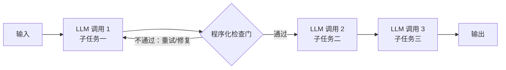
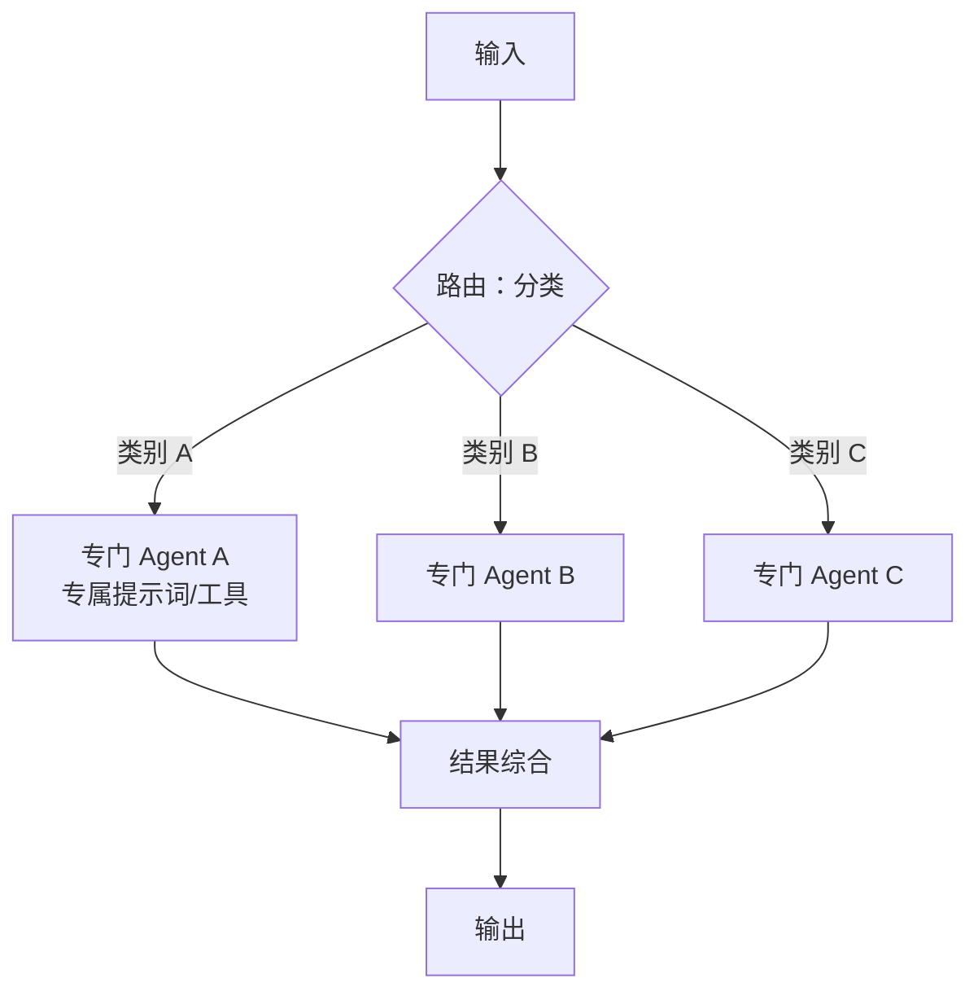
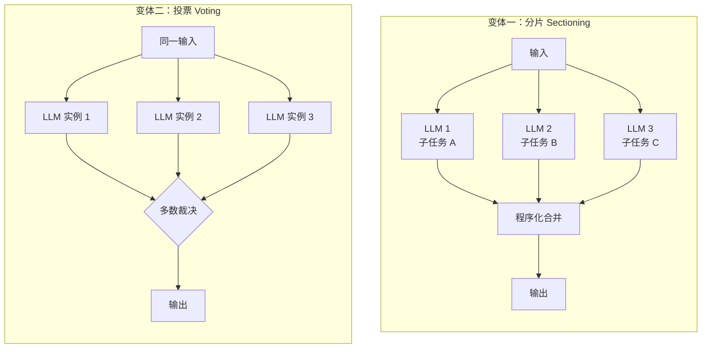
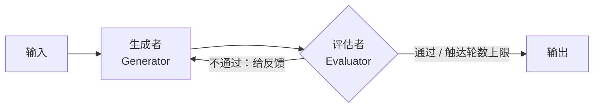
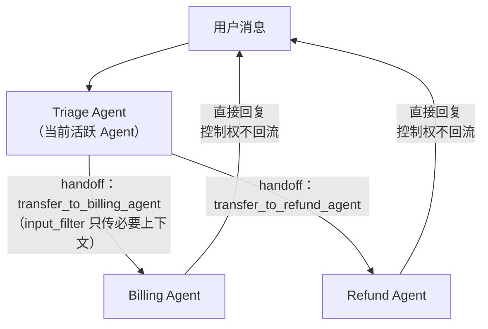
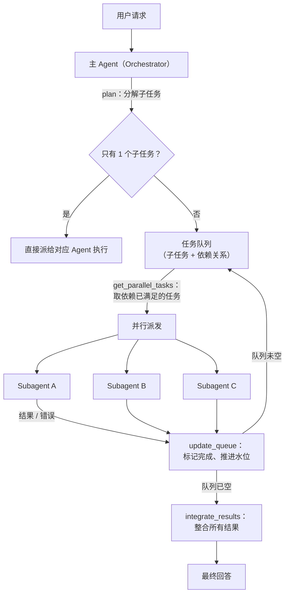
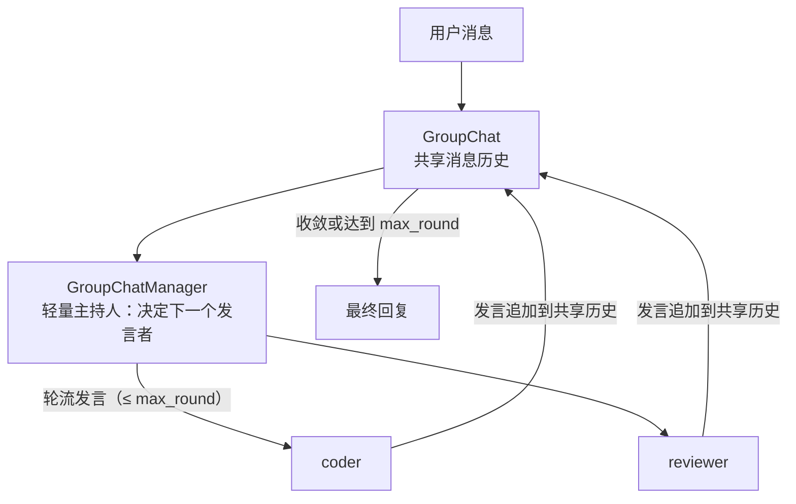
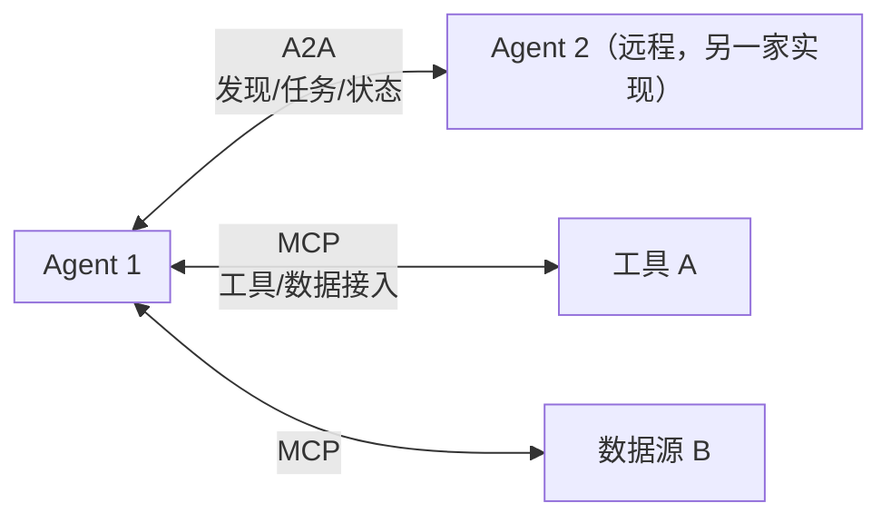

# 总览

**多智能体系统 = 架构（骨架）+ 拓扑（协作的形状）+ 设计（跑通的细节）。**


**能单 Agent 解决就不要上多 Agent；**

**上多 Agent 时，先选拓扑，再定协议，最后设终止条件。**


# 主流框架的架构取向

同样的架构，不同框架用不同的「驱动方式」实现——选框架本质上是选驱动方式：

| 框架 | 出品方 | 驱动方式 | 架构取向 | 一句话定位 |
|---|---|---|---|---|
| **AutoGen / AG2** | 微软（后分叉 AG2） | 对话驱动 | Agent 即对话参与者，协作=轮流说话 | 对话驱动的多 Agent 协作 |
| **LangGraph** | LangChain | 图驱动 | 把编排显式写成状态图（节点+边+共享状态） | 最底层最灵活，拓扑任你画 |
| **CrewAI** | João Moura | 角色驱动 | Agent 即团队成员（role/goal/backstory） | 角色扮演式的「AI 员工团队」 |
| **OpenAI Agents SDK** | OpenAI（前身 Swarm） | 移交驱动 | Agent 间协作=移交（handoff 即工具） | 极简主义，适合分流场景 |
| **MetaGPT** | 社区 | SOP 驱动 | 把标准操作流程编码进角色链 | 把软件公司的流程制度固化 |
| **AgentScope** | 阿里 | 消息驱动 | 显式消息传递 + 容错 | 工程化容错见长 |
| **Magentic-One** | 微软 | 任务账本驱动 | Orchestrator + 4 个通用执行体 | AutoGen 之上的通用任务套件 |
| **Claude Agent SDK** | Anthropic | 编排提示词驱动 | 主 Agent + subagents（独立上下文） | 编排逻辑放在提示词里，代码层薄 |
| **Dify / n8n** | 社区/商业 | 可视化节点驱动 | 低代码工作流 | 快速搭建，牺牲灵活性 |


# 拓扑

## 链式拓扑

**结构**：任务分解为固定步骤序列，每步处理上一步输出，可插程序化检查门。



**何时用**：任务能干净地分解成固定子任务，用延迟换准确率。例：生成营销文案 → 翻译成另一语言。

**框架落地**

- **Anthropic（原生工作流，Prompt Chaining）**：Anthropic《Building Effective Agents》的第一档模式——能用可预测的固定代码路径（workflow）就不要用自由自主（agent）
- **CrewAI（Process.sequential）**：按任务列表顺序执行，上个任务的输出作为下个的上下文：

```python
from crewai import Agent, Task, Crew, Process

coder = Agent(role="Python 编程专家", goal="写出正确可读的代码",
              backstory="十年后端开发经验，熟悉算法与工程规范。")
reviewer = Agent(role="代码审查专家", goal="找出缺陷并提出改进",
                 backstory="资深评审者，关注正确性、性能与风格。")

# 链式：coder 的产出自动成为 reviewer 的上下文
crew = Crew(
    agents=[coder, reviewer],
    tasks=[
        Task(description="实现快速排序", agent=coder),
        Task(description="审查上面的实现", agent=reviewer),
    ],
    process=Process.sequential,
)
```

- **MetaGPT（SOP 角色链）**：链式拓扑的极致形态——把人类组织的标准操作流程固化：产品经理写 PRD → 架构师设计 → 工程师写码 → QA 测试。核心论点：只给角色不给流程，多 Agent 会陷入「鸡同鸭讲」；每个角色产出结构化工件（PRD 文档、设计文档、代码），下家消费上家的工件而非自由聊天。**任务越明确越该学它，探索性任务才需要自由对话**

## 路由拓扑

**结构**：先分类输入，再导向专门的下游处理，结果综合。



**何时用**：输入有清晰类别，混在一起互相拖累。例：客服问题分流（退款/技术/咨询）；简单问题给小模型、难题给大模型。

**框架落地**

- **LangChain（Router 模式）**：路由步用一次 LLM 分类，再调用专门 Agent。路由器无状态，每个请求都要重路由——重复请求上比有状态模式多花一次调用
- **OpenAI Agents SDK（Triage Agent）**：见下方移交拓扑的代码——`triage_agent` 本身就是一个路由器，路由动作通过移交实现
- **Anthropic（原生工作流，Routing）**：分类可由 LLM 或传统分类器完成，强调「关注点分离」

## 并行拓扑

**结构**：两个变体——**分片**（独立子任务并行，各自专注）与**投票**（同一任务多次跑取多数，提高置信度）。



**何时用**：子任务可并行提速，或需要多视角。例：一个实例答用户、另一个同时筛违规内容；多路排查代码漏洞。

**框架数据（LangChain 官方实测）**

| 场景 | Subagents | Handoffs | Skills | Router |
|---|---|---|---|---|
| 单次请求（买咖啡） | 4 次调用 | **3 次 ✅** | **3 次 ✅** | **3 次 ✅** |
| 重复请求（第二轮再来一次） | 8 次 | **5 次 ✅** | **5 次 ✅** | 6 次 |
| 多域并行（对比三种语言） | **5 次 / ~9K tokens ✅** | 7+ 次 / 14K+ | 3 次 / 15K | **5 次 / ~9K tokens ✅** |

三个关键洞察：

1. **Subagents 贵在回流**：结果要经主 Agent 综合，单任务多一次调用——这是集中控制的代价
2. **有状态模式（Handoffs/Skills）在重复请求上省 40–50% 调用**：上轮的控制权/知识还在，不用重走流程
3. **多域任务选可并行的模式（Subagents/Router）**：移交只能串行且对话历史滚雪球；Skills 调用最少但每个后续调用都背着全部已加载知识

**变体：投票**。同一任务跑多份取多数，等价于「辩论的收敛版」——不需要 Agent 互相说服，只需要裁判或多数票。

## 循环拓扑

**结构**：一个 LLM 生成，另一个评估给反馈，循环直到达标。



**何时用**：有清晰评估标准，且迭代有可衡量的收益。判据：人类给出反馈时产出确实会变好，且 LLM 能给出这种反馈。例：文学翻译互评；需要多轮搜索的分析任务。

**框架落地**

- **AutoGen（`max_consecutive_auto_reply`）**：生成者与审查者循环对话，轮数上限硬控——代码见平级拓扑的 `user_proxy` 参数
- **LangGraph**：循环就是图上的一条回边，配合条件边判断「过/不过」，是表达循环拓扑最自然的方式
- **审查者角色的出处**：原文四角色中的 Reviewer（评估结果，提出改进建议）就是循环拓扑的发动机

**注意**：循环拓扑必须配终止设计（见设计一章），否则两个 Agent 会互相客气改稿到天荒地老。

## 移交拓扑

**结构**：Agent 之间通过工具调用**转移控制权**，控制权不回流，有状态——上轮的活跃 Agent 下轮还在。



**何时用**：阶段边界清晰、按状态切换处理者的场景。例：客服 app 中订单、退款、FAQ 各有专门 Agent，用户问题在它们之间流转。

**框架落地：OpenAI Agents SDK**——核心洞察是**移交对 LLM 就是一个工具调用**：

```python
from agents import Agent, handoff

billing_agent = Agent(name="Billing agent")
refund_agent = Agent(name="Refund agent")

# 移交在模型眼里就是调用 transfer_to_refund_agent 这个工具
triage_agent = Agent(
    name="Triage agent",
    handoffs=[billing_agent, handoff(refund_agent)],
)
```

关键参数：`handoff_description` 提示何时该移交；`input_filter` 过滤传给下一个 Agent 的历史（**上下文交接裁剪**：只传必要信息，缓解信息瓶颈）；`on_handoff` 回调可在移交瞬间预取数据。前身 Swarm 是实验项目，Agents SDK 是其生产化：加了 Guardrails（护栏）、Sessions（会话状态）、Tracing（观测）。

**与主从的区别**：移交后控制权不回流主 Agent；主从里所有结果都要回主 Agent 综合。单任务移交省一次调用，但失去了集中验收。

## 主从拓扑

**结构**：主 Agent（Orchestrator）负责任务分解和结果整合，从 Agent（Subagent）负责执行具体任务。层次架构的代表拓扑，也是实践中性价比最高的默认起点。



**适用场景**

- 任务可以清晰地分解为独立子任务的场景
- 需要不同专业技能的 Agent 协作完成的场景
- 需要中央协调和控制的复杂工作流

**关键区别（与并行拓扑）**：Anthropic 指出——主从的子任务**不是预先定义的**，而是由编排者根据具体输入动态决定（例如编码任务：要改哪些文件、怎么改，取决于任务本身）。并行拓扑的子任务是事先切好的。

### 原生实现（理解原理用）

```python
# ==================== 主从 Agent 模式实现 ====================

class OrchestratorAgent:
    """
    主编排 Agent（主 Agent）
    负责任务分解、分配和结果整合
    """

    def __init__(self, llm, subagents):
        # 语言模型
        self.llm = llm
        # 从 Agent 字典
        self.subagents = {a.role: a for a in subagents}

    def handle_request(self, request):
        """
        处理用户请求
        完整的编排流程
        """
        # ==================== 分析阶段 ====================
        # 分析请求，决定是否需要多个 Agent 协作
        plan = self.llm.plan(request)

        if len(plan.subtasks) == 1:
            # 单一任务，直接分发给对应 Agent
            target_role = plan.target_role
            return self.subagents[target_role].execute(plan.subtasks[0])

        # ==================== 多 Agent 协作阶段 ====================
        # 创建任务队列
        task_queue = self.create_task_queue(plan.subtasks)

        # 存储已完成的结果
        results = []

        # 处理循环，直到所有任务完成
        while task_queue:
            # 获取可以并行执行的任务
            parallel_tasks = self.get_parallel_tasks(task_queue)

            # 并行执行
            parallel_results = self.execute_in_parallel(parallel_tasks)
            results.extend(parallel_results)

            # 更新任务队列
            # 处理依赖关系，移除已完成任务，添加新任务
            task_queue = self.update_queue(task_queue, parallel_results)

        # ==================== 整合阶段 ====================
        # 整合所有结果
        return self.integrate_results(results)

    def create_task_queue(self, subtasks):
        """创建任务队列"""
        return TaskQueue(subtasks)

    def get_parallel_tasks(self, task_queue):
        """
        获取可以并行执行的任务
        排除有依赖关系的任务
        """
        ready_tasks = []
        for task in task_queue.tasks:
            # 检查任务依赖是否都满足
            if all(dep in task_queue.completed for dep in task.dependencies):
                ready_tasks.append(task)
        return ready_tasks

    def execute_in_parallel(self, tasks):
        """并行执行多个任务"""
        import concurrent.futures

        results = []
        with concurrent.futures.ThreadPoolExecutor() as executor:
            # 提交所有任务
            future_to_task = {
                executor.submit(self.execute_task, task): task
                for task in tasks
            }

            # 收集结果
            for future in concurrent.futures.as_completed(future_to_task):
                task = future_to_task[future]
                try:
                    result = future.result()
                    results.append(result)
                except Exception as e:
                    results.append(TaskResult(task=task, error=str(e)))

        return results

    def execute_task(self, task):
        """执行单个任务"""
        agent = self.subagents.get(task.role)
        if not agent:
            return TaskResult(task=task, error=f"Unknown role: {task.role}")

        return agent.execute(task.description)

    def update_queue(self, task_queue, completed_results):
        """更新任务队列"""
        # 将已完成任务标记为完成
        for result in completed_results:
            task_queue.completed.add(result.task.id)

        # 移除已完成的任务
        task_queue.tasks = [
            t for t in task_queue.tasks
            if t.id not in task_queue.completed
        ]

        return task_queue

    def integrate_results(self, results):
        """
        整合多个 Agent 的结果
        生成最终回答
        """
        prompt = f"""
整合以下 Agent 的执行结果，生成最终回答。

结果列表：
{results}

请整合成一个完整、连贯的回答。
"""
        return self.llm.generate(prompt)


class Subagent:
    """从 Agent 基类"""

    def __init__(self, role, llm, tools=None):
        self.role = role
        self.llm = llm
        self.tools = tools or []

    def execute(self, task):
        """执行任务的具体逻辑"""
        raise NotImplementedError
```

这段代码的编排闭环：`plan`（分解）→ `get_parallel_tasks`（依赖排序，只派依赖已满足的任务）→ `execute_in_parallel`（线程池并行）→ `update_queue`（推进水位）→ `integrate_results`（整合）。

### 框架落地

**CrewAI（Process.hierarchical）**——主从模式的框架化实现，必须指定 `manager_llm` 或 `manager_agent`，由管理者动态分解、分配、验收：

```python
crew = Crew(
    agents=[coder, reviewer],
    tasks=[Task(description="写一个快速排序算法并审查代码")],
    process=Process.hierarchical,
    manager_llm="gpt-4o",          # 或 manager_agent=my_manager_agent
)
```

**LangGraph（Supervisor / Hierarchical）**——Supervisor 模式：主管节点作为路由中枢，把工作派给专家节点，结果回流；Hierarchical 模式：主管之上再有主管，两级主从；另有 Network 模式（任意 Agent 可互调，最自由最难控）。框架内置 checkpointer（状态持久化、断点恢复）和 human-in-the-loop（中断等确认）——原生代码里的 `task_queue`/`update_queue` 工程细节框架都做掉了。

**Magentic-One（微软，AutoGen 之上）**——编排者 + 四个通用执行体：WebSurfer（浏览器）、FileSurfer（文件）、Coder（写码）、ComputerTerminal（执行）。编排者维护**任务账本**（facts ledger 记事实、progress ledger 记进度）：持续核对「事实还成立吗」「进度对吗」，发现卡住就重新规划——是终止条件与协调失败模式的框架级解法。

**Claude Agent SDK（Anthropic）**——编排逻辑写在提示词里：主 Agent 把 subagents 当工具调用，所有路由经过主 Agent；并行派发 3–5 个 subagent，靠共享任务清单避免重复劳动。

### 优缺点

| 优点 | 缺点 |
|---|---|
| 结构清晰，易于理解和实现 | 主 Agent 成为单点故障 |
| 中央协调，易于控制 | 主 Agent 可能成为性能瓶颈 |
| 适合层次分明的任务 | 灵活性较低，难以动态调整 |
| 调试方便，可追踪每个子任务 | 不适合对等交互频繁的场景 |

## 平级拓扑（群聊）

**结构**：所有 Agent 地位平等，直接通信协作，无固定中央调度（或只有轻量主持人）。



**何时用**：需要频繁对等交互、观点碰撞的场景。

**框架落地：AutoGen**——微软开发的多 Agent 编程框架，提供简洁的 API 构建多 Agent 对话系统，大大简化开发复杂度。

**核心概念**

| 概念 | 作用 |
|---|---|
| `AssistantAgent` | 能够调用工具的智能助手 Agent |
| `UserProxyAgent` | 代表用户行为，可以执行代码和工具调用 |
| `GroupChat` | 支持多个 Agent 之间的群聊协作 |
| `GroupChatManager` | 管理群聊中的 Agent 交互 |

```python
# ==================== AutoGen 基本使用 ====================

# 导入 autogen 框架
import autogen
from autogen import AssistantAgent, UserProxyAgent, GroupChat, GroupChatManager

# ==================== 配置 LLM ====================
# 创建一个配置字典
llm_config = {
    "model": "gpt-4",
    "api_key": "your-api-key",  # 实际使用时从环境变量读取
    "temperature": 0.7
}

# ==================== 创建单个 Agent ====================

# 创建助手 Agent
assistant = AssistantAgent(
    name="assistant",
    system_message="""
    你是一个有用的 Python 编程助手。
    你可以帮助用户编写、调试和优化代码。
    """,
    llm_config=llm_config
)

# 创建用户代理 Agent
# human_input_mode="NEVER" 表示不需要人工输入
# max_consecutive_auto_reply=10 表示最多连续自动回复 10 次
user_proxy = UserProxyAgent(
    name="user_proxy",
    human_input_mode="NEVER",
    max_consecutive_auto_reply=10
)

# ==================== 单 Agent 对话 ====================
# 启动对话
user_proxy.initiate_chat(
    assistant,
    message="帮我写一个快速排序算法"
)

# ==================== 多 Agent 群聊 ====================

# 创建多个 Agent
coder = AssistantAgent(
    name="coder",
    system_message="你是一个 Python 编程专家，负责编写代码。",
    llm_config=llm_config
)

reviewer = AssistantAgent(
    name="reviewer",
    system_message="你是一个代码审查专家，负责审查代码质量。",
    llm_config=llm_config
)

# 创建群聊
group_chat = GroupChat(
    agents=[coder, reviewer],
    messages=[],
    max_round=10  # 最多对话 10 轮
)

# 创建群聊管理器
manager = GroupChatManager(
    groupchat=group_chat,
    llm_config=llm_config
)

# 启动群聊
user_proxy.initiate_chat(
    manager,
    message="写一个快速排序算法并审查代码"
)
```

要点：`GroupChatManager` 是「轻量主持人」而非主从里的主编排者——它只管轮流发言和轮数上限，不做任务分解；`max_round=10` 和 `max_consecutive_auto_reply=10` 就是终止设计在框架里的直接体现。

**变体：辩论模式**——两个 AssistantAgent 各持立场互相批驳，裁判（或多数票）收敛。适合事实核查、方案评审等「需要碰撞才能出结论」的任务。

## 拓扑选型

原文章节小结的结论：**选择合适的多 Agent 架构需要根据具体场景。对于简单场景，单个 Agent 即可满足需求；对于复杂场景，需要根据任务特点选择合适的架构模式。**

| 你的任务特征 | 推荐拓扑 | 框架案例 |
|---|---|---|
| 步骤固定、顺序清晰 | 链式 | CrewAI sequential、MetaGPT |
| 输入类别清晰、要分流 | 路由 | LangChain Router、OpenAI Triage |
| 子任务独立可并行 / 需多视角 | 并行（分片/投票） | Claude Agent SDK subagents |
| 有明确质量标准、可迭代 | 循环 | AutoGen 双 Agent 互评、LangGraph 回边 |
| 阶段边界清晰、按状态切换 | 移交 | OpenAI Agents SDK |
| 任务可分解、需集中验收 | 主从 | CrewAI hierarchical、LangGraph Supervisor、Magentic-One |
| 需要对等讨论、观点碰撞 | 平级群聊 | AutoGen GroupChat、辩论模式 |


# 通信协议底座

形态决定谁和谁连，协议决定怎么连。多 Agent 系统需要标准化的通信协议，A2A 和 MCP 是两个重要的协议标准。

## MCP（Agent ↔ 工具）

MCP（Model Context Protocol）是一种开放标准协议，使得 AI 模型能够安全地与外部工具和数据源连接。MCP 是工具接入的标准协议，**类似于 USB 接口的作用**。

**核心组件**

| 组件   | 作用                          |
| ------ | ----------------------------- |
| Host   | 运行 AI 应用的宿主环境        |
| Client | 与 MCP 服务器建立连接的客户端 |
| Server | 提供工具和资源的服务端        |

**MCP 工具定义示例**（一个 filesystem Server 声明自己提供的工具与资源）：

```json
{
    "name": "filesystem",
    "description": "文件系统操作工具",
    "version": "1.0.0",
    "tools": [
        {
            "name": "read_file",
            "description": "读取文件内容",
            "inputSchema": {
                "type": "object",
                "properties": {
                    "path": {
                        "type": "string",
                        "description": "文件路径，必填"
                    },
                    "encoding": {
                        "type": "string",
                        "description": "文件编码，可选，默认为 utf-8"
                    }
                },
                "required": ["path"]
            }
        },
        {
            "name": "write_file",
            "description": "写入文件内容",
            "inputSchema": {
                "type": "object",
                "properties": {
                    "path": {
                        "type": "string",
                        "description": "文件路径，必填"
                    },
                    "content": {
                        "type": "string",
                        "description": "文件内容，必填"
                    }
                },
                "required": ["path", "content"]
            }
        },
        {
            "name": "list_directory",
            "description": "列出目录内容",
            "inputSchema": {
                "type": "object",
                "properties": {
                    "path": {
                        "type": "string",
                        "description": "目录路径"
                    }
                }
            }
        }
    ],
    "resources": [
        {
            "uri": "file://config",
            "description": "配置文件"
        }
    ]
}
```

## A2A（Agent ↔ Agent）

A2A（Agent-to-Agent）协议定义了 Agent 之间通信的标准格式。它由谷歌发起，后捐赠给 Linux Foundation，由来自 AWS、Cisco、Google、IBM、Microsoft、Salesforce 的技术指导委员会维护。

**核心功能**

| 功能                              | 说明                                  |
| --------------------------------- | ------------------------------------- |
| 代理发现（Agent Discovery）       | Agent 能够发现其他 Agent 的能力和服务 |
| 任务协作（Task Collaboration）    | 多个 Agent 能够协同完成复杂任务       |
| 状态同步（State Synchronization） | Agent 之间能够同步状态信息            |

A2A 的设计取向是**能力不透明**：远端 Agent 不暴露自己的记忆、工具和思考过程，只通过标准化接口声明「我能做什么」——这与 MCP 把工具细节完整暴露给模型恰好相反。

## 两个协议的分工

**注意**：A2A 和 MCP 解决的问题不同。A2A 解决的是 **Agent 之间的通信**问题，MCP 解决的是 **Agent 与外部工具的连接**问题。两者可以结合使用，构建完整的多 Agent 系统。




# 设计

拓扑定了「形状」，设计决定它能不能跑通。四个设计面：角色、通信与上下文、协调与编排、终止与安全。

## 角色设计

有效的多 Agent 系统需要明确的角色定义。每个 Agent 应该有自己的专长和职责范围，协作机制确保多个 Agent 能够协调工作。

**常见角色定义**

| 角色 | 职责 |
|---|---|
| 规划者（Planner） | 分解复杂任务，制定执行计划 |
| 执行者（Executor） | 调用工具，执行具体操作 |
| 审核者（Reviewer） | 评估结果，提出改进建议 |
| 协调者（Coordinator） | 管理 Agent 间的通信和任务分配 |

### 原生实现（理解原理用）

```python
# ==================== 多 Agent 系统基础实现 ====================

class Agent:
    """
    基础 Agent 类
    每个 Agent 有自己的角色、工具和执行逻辑
    """

    def __init__(self, role, llm, tools):
        # Agent 的角色名称
        self.role = role
        # 关联的语言模型
        self.llm = llm
        # 可用工具列表
        self.tools = tools

    def execute(self, task, context=None):
        """
        执行任务
        :param task: 任务描述
        :param context: 上下文信息
        :return: 执行结果
        """
        # 构建提示词
        prompt = self.build_prompt(task, context)

        # 生成响应
        response = self.llm.generate(prompt)

        # 如果需要调用工具
        if response.needs_tool_call:
            return self.execute_tool(response)

        return response.content

    def build_prompt(self, task, context):
        """构建 Agent 的提示词"""
        return f"角色：{self.role}\n任务：{task}\n上下文：{context}"

    def execute_tool(self, response):
        """执行工具调用"""
        tool_name = response.tool_name
        tool_input = response.tool_input

        # 从工具列表中找到对应工具
        tool = self.get_tool(tool_name)

        # 执行工具
        return tool.execute(tool_input)


class MultiAgentSystem:
    """
    多 Agent 协作系统
    负责管理多个 Agent 之间的协作
    """

    def __init__(self, agents, coordinator):
        # Agent 字典，key 是角色名
        self.agents = {a.role: a for a in agents}
        # 协调者 Agent
        self.coordinator = coordinator

    def solve(self, task):
        """
        解决复杂任务
        通过协调多个 Agent 协作完成
        """
        # 第一步：协调者分析任务，决定需要哪些 Agent 参与
        plan = self.coordinator.decompose(task)

        # 第二步：分发任务给相应 Agent
        results = {}
        for role, subtask in plan.subtasks.items():
            # 获取对应角色的 Agent
            agent = self.agents.get(role)
            if agent:
                # 执行子任务
                results[role] = agent.execute(subtask)

        # 第三步：协调者整合结果
        final_result = self.coordinator.integrate(results)

        return final_result


class CoordinatorAgent:
    """协调者 Agent"""

    def __init__(self, llm):
        self.llm = llm

    def decompose(self, task):
        """
        分解任务
        分析任务，决定需要哪些 Agent 以及如何分工
        """
        prompt = f"""
分析以下任务，分解为子任务并分配给合适的 Agent。

任务：{task}

请输出：
1. 需要哪些 Agent（角色）
2. 每个 Agent 负责什么子任务
3. 子任务之间的依赖关系

输出格式：JSON
"""
        response = self.llm.generate(prompt)
        return Plan.parse(response)

    def integrate(self, results):
        """
        整合多个 Agent 的结果
        """
        prompt = f"""
整合以下 Agent 的执行结果，生成最终回答。

结果列表：
{results}

请整合并输出最终结果。
"""
        return self.llm.generate(prompt)
```

**协作闭环注解**：`decompose`（分解）→ 分发执行 → `integrate`（整合）。提示词里已要求输出「子任务之间的依赖关系」，但 `solve` 的 for 循环是顺序遍历，没真正用上依赖信息——完整版见主从拓扑的 `get_parallel_tasks` / `update_queue`。

### 框架落地

**CrewAI：角色的三件套定义**——role（角色）、goal（目标）、backstory（背景），把上面 `build_prompt` 里的「角色：」一行工程化：

```python
from crewai import Agent

coder = Agent(
    role="Python 编程专家",
    goal="写出正确、可读的代码",
    backstory="十年后端开发经验，熟悉算法与工程规范。",
)
```

**AutoGen：执行者的工具注册**——执行者角色「调用工具」的能力在框架里怎么接：

```python
# ==================== AutoGen 工具调用 ====================

import autogen
from autogen import AssistantAgent, UserProxyAgent

# 定义工具列表
# 这些工具会被注册到 Agent 的工具列表中
tools = [
    {
        "name": "calculate",
        "description": "执行数学计算",
        "parameters": {
            "type": "object",
            "properties": {
                "expression": {
                    "type": "string",
                    "description": "要计算的数学表达式，如 '2+3*5'"
                }
            },
            "required": ["expression"]
        }
    },
    {
        "name": "search_web",
        "description": "搜索网页信息",
        "parameters": {
            "type": "object",
            "properties": {
                "query": {
                    "type": "string",
                    "description": "搜索关键词"
                }
            },
            "required": ["query"]
        }
    }
]

# 创建具有工具调用能力的 Agent
assistant = AssistantAgent(
    name="assistant",
    system_message="""
    你是一个有用的助手。
    当需要计算或查找信息时，你可以调用相关工具。
    """,
    llm_config={
        "model": "gpt-4",
        "api_key": "your-api-key"
    },
    tools=tools  # 注册工具
)

# 创建用户代理
user_proxy = UserProxyAgent(
    name="user_proxy",
    human_input_mode="NEVER"
)

# 启动对话，Agent 会自动调用工具
user_proxy.initiate_chat(
    assistant,
    message="计算 (15 + 25) * 2 等于多少？"
)

# 回复示例：
# Agent 可能会回复：
# "我来计算一下：(15 + 25) * 2 = 40 * 2 = 80"
# 或者直接调用 calculate 工具获取结果
```

**角色数量原则**：角色的本质是「提示词 + 工具集 + 上下文的组合」，不是组织架构图上的一格。角色数按「上下文真的需要隔离」来定——每个子 Agent 只挂自己那几个工具、只加载自己领域的知识，才是拆角色的理由。

## 通信与上下文设计

### 三种信息通路

| 通路 | 机制 | 适合 | 风险 |
|---|---|---|---|
| 消息传递 | Agent 间点对点/群聊发消息（AutoGen 群聊、AgentScope） | 对等讨论 | 历史滚雪球、跑题 |
| 共享黑板 | 外置工件（任务清单、共享文档），大家读写 | 并行协作、防重复漏项 | 读写冲突、需约定格式 |
| 移交 | 控制权+精选上下文一次性转移（OpenAI `input_filter`） | 阶段切换 | 裁剪过度丢关键信息 |

### 上下文工程是第一性原理

多 Agent 的本质不是「多个脑子比一个聪明」，而是**上下文隔离带来的专注**。单 Agent 的三个实际痛点，全是上下文问题：

| 单 Agent 痛点 | 多 Agent 怎么解 |
|---|---|
| 工具太多，选择退化（超过 ~20 个工具后选错率明显上升） | 每个子 Agent 只挂自己那几个工具 |
| 上下文窗口有限，装不下全部领域知识 | 每个子 Agent 只加载自己领域的知识 |
| 注意力稀释：长上下文中间的信息容易被忽略（lost in the middle） | 每个子 Agent 的上下文短而干净 |

LangChain 文档说得很直白：**多 Agent 设计的中心就是上下文工程——决定每个 Agent 能看到什么信息**。系统的质量取决于「每个 Agent 拿到的数据恰好是它任务所需的」。

由此推出：**如果一个问题不需要隔离上下文就能解决，就不需要多 Agent。** Anthropic 的说法更狠：先把单次 LLM 调用用检索和示例优化到位，通常就够了；用框架也要理解底层代码，抽象层会掩盖 prompt 与响应、增加调试难度。

### 上下文隔离是双刃剑

隔离带来专注的同时也带来**信息丢失**，两个具体表现：

- **子 Agent 看不到全局**：它不知道主 Agent 的整体意图和其他子 Agent 的进展，产出可能「局部正确、全局跑偏」——所以分解时给每个子任务写清楚「为什么做」比只写「做什么」重要
- **主 Agent 只能看摘要**：子 Agent 的完整过程（几十轮工具调用）不可能回传，主 Agent 只能消费浓缩结果。浓缩这一步就是信息瓶颈：摘要丢掉的关键细节，后面无法找回

缓解手段：把共享状态外置成**所有 Agent 都可读写的显式工件**（任务清单、共享文档、黑板），而不是依赖消息传递把上下文传来传去；移交场景用 `input_filter` 类机制做**有意裁剪**而非默认全传。

## 协调与编排设计

### 编排闭环

分解 → 依赖排序 → 并行执行 → 整合。主从代码里最值得学的两个函数：

- `get_parallel_tasks`：只派发「依赖已满足」的任务——分解时就必须产出依赖关系
- `update_queue`：完成任务标记、水位推进、失败不丢（`TaskResult(task, error)` 记录而不是抛出）

### 协调成本是 O(n²)，Agent 不是越多越好

n 个 Agent 两两通信的边数是 n(n-1)/2。5 个 Agent 就有 10 条通信边，每条边都是潜在的误解点。经验法则：

- **一条流水线能解决的不组队**：能用链式串起来的，就不引入群聊
- **并行 worker 数量收敛**：Anthropic 研究系统里 lead agent 通常只派 3–5 个 subagent，多了之后 lead agent 自己都会误判进度（并行铺开后的典型失败：过早宣布完成、重复派活）
- **复杂度守恒**：从单 Agent 到多 Agent，提示词层面的复杂度没有消失，而是转移到了协议层（消息格式）、编排层（分解/依赖/重试）、调试层（trace 从一条线变成一张网；一个错误结论会被下游当事实消费，错误传播且难定位）。多 Agent 是「用可维护的结构化复杂度换不可维护的提示词复杂度」——值得，但先把观测建好再上规模

### 可验证性决定委派的可行性

主从模式能工作的隐含前提是**主 Agent 能验收子 Agent 的产出**。写代码委派得动，因为有测试可跑；「这个文档写得好不好」就难委派，因为验收标准模糊，主 Agent 只能把子结果再看一遍——等于自己重做一遍。

所以任务分解时先问：**每个子任务的完成与否，能不能被程序化或结构化地判定？** 能 → 放心并行委派；不能 → 串行单 Agent 自己做，或把验收标准先写进子任务定义里。

## 终止与安全设计

单 Agent 死循环顶多烧自己的 token；多 Agent 群聊可以互相「礼貌地」聊到天荒地老——你审我改、我再改你再审，谁都不同意收尾。代码里反复出现的参数就是为此：`max_consecutive_auto_reply=10`、`max_round=10`、`while task_queue`。

**四道闸**

1. **轮数上限**（max_round 类参数，硬停）
2. **预算上限**（token/费用预算，到线即停）
3. **收敛判据**（Reviewer 给出 PASS/FAIL 的显式裁决，而不是开放式建议）
4. **人工闸门**（不可逆操作——发布、删除、花钱——一律停下来问人；AutoGen 的 `human_input_mode` 就是这道闸的参数化）

## 设计原则汇总

| 原则 | 内容 |
|---|---|
| **模式阶梯** | 先单 Agent + 好工具打到极限 → 加 RAG/技能 → 才拆多 Agent；拆的时候从协作最弱的拓扑选起，主从次之，自由群聊最后 |
| **复杂度守恒** | 多 Agent 不消灭复杂度，只转移复杂度（协议/编排/调试），观测先行 |
| **组织同构** | 经理+外包=主从；敏捷小队/会诊=平级群聊；流水线=链式；质检员=循环；交接班=移交——按你的任务像哪种组织形态来选 |
| **一句话选型** | 先选拓扑（形状），再定协议（连接），最后设终止条件（什么时候停） |


# 框架与选型速查

## 框架对比总表

| 框架 | 核心抽象 | 编排模式 | 适配拓扑 | 特点 |
|---|---|---|---|---|
| **AutoGen / AG2** | ConversableAgent、GroupChat | 群聊、嵌套对话；v0.4 起事件驱动 | 平级、循环 | 对话驱动；`max_round` 控收敛 |
| **LangGraph** | 图状态机（节点+边+共享 State） | Supervisor / Hierarchical / Network 任你画 | 全部（自己画） | checkpointer 断点恢复、human-in-the-loop |
| **CrewAI** | Crew（role/goal/backstory + Task + Process） | sequential / hierarchical | 链式、主从 | 角色三件套上手最快 |
| **OpenAI Agents SDK** | Agent + Handoff + Guardrail | 移交链 + 编排提示词 | 移交、路由 | `input_filter` 上下文裁剪、Tracing |
| **MetaGPT** | SOP + 角色流水线 | 固定角色链 PM→架构师→工程师→QA | 链式 | 结构化工件传递，流程即制度 |
| **CAMEL / OWL** | Role-Playing、Inception Prompting | 双角色自主推进 | 循环、平级 | 学术最早的角色扮演框架之一 |
| **AgentScope** | 显式消息传递 + 容错 | 消息交换自由编排 | 平级 | 工程化容错、透明度高 |
| **Magentic-One** | Orchestrator + 4 通用执行体 | 任务账本 + 编排者循环 | 主从 | facts/progress ledger 防跑偏 |
| **Claude Agent SDK** | 主 Agent + subagents | 编排提示词 + 并行工具调用 | 主从、并行 | 独立上下文、共享任务清单 |
| **Dify / n8n** | 可视化节点 | 低代码工作流 | 链式、路由 | 快速搭建，牺牲灵活性 |

## 框架怎么选

| 你的情况 | 建议 |
|---|---|
| 学习/原型，想理解多 Agent 本质 | 手写「主从拓扑」的原生代码，再读 AutoGen |
| 想要角色团队、快速出活 | CrewAI（sequential 起步，复杂再 hierarchical） |
| 需要精确控制流程、可恢复、可审批 | LangGraph |
| 客服/分流类移交场景 | OpenAI Agents SDK |
| 固定业务流程的软件生产自动化 | MetaGPT 思路（角色 + SOP + 结构化工件） |
| 生产环境最小依赖 | 不引框架，直接 LLM API 手写编排（Anthropic 建议） |

## 共同趋势（2025–2026）

1. 编排逻辑从框架代码往**提示词 + 图定义**迁移
2. **可观测性**（trace 每个 Agent 每次调用）成为标配而非可选
3. 通信协议标准化（A2A + MCP）让 Agent 从框架锁定走向互操作——框架的价值从「提供通信管道」退到「提供现成拓扑和工程脚手架」


# 调研来源

**原文（骨架来源）**

- [菜鸟教程 · 多智能体系统（Multi-Agent System）](https://www.runoob.com/ai-agent/multi-agent-system.html)——三大挑战、层次/平级架构、四角色、AutoGen 核心概念与代码、A2A/MCP、主从模式及全部代码均出自此文，已按「架构—拓扑—设计」重新归位

**设计模式与框架调研**

- [Anthropic · Building Effective Agents](https://www.anthropic.com/engineering/building-effective-agents)——提示链、路由、并行化、编排者-工作者、评估者-优化者五种工作流及选择判据
- [LangChain Docs · Multi-agent](https://docs.langchain.com/oss/python/langchain/multi-agent)——Subagents/Handoffs/Skills/Router 模式与性能实测数据
- [OpenAI Agents SDK · Handoffs](https://openai.github.io/openai-agents-python/handoffs/)——移交即工具、input_filter 上下文裁剪
- [CrewAI Docs · Processes](https://docs.crewai.com/concepts/processes)——sequential / hierarchical 双 Process
- Du, Y. et al. (2023). *Improving Factuality and Reasoning in Language Models through Multiagent Debate*（辩论模式）
- Li, G. et al. (2023). *CAMEL: Communicative Agents for "Mind" Exploration*（角色扮演/Inception Prompting）
- Hong, S. et al. (2023). *MetaGPT: Meta Programming for Multi-Agent Collaborative Framework*（SOP 编码）
- Reid G. Smith (1980). *The Contract Net Protocol*（合同网协议）

**协议调研**

- [A2A Protocol 官网](https://a2a-protocol.org/)——谷歌发起，已捐赠 Linux Foundation，TSC 含 AWS/Cisco/Google/IBM/Microsoft/Salesforce
- [Model Context Protocol](https://modelcontextprotocol.io/)——Host/Client/Server 架构与工具定义规范
