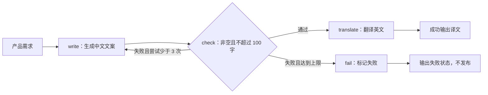
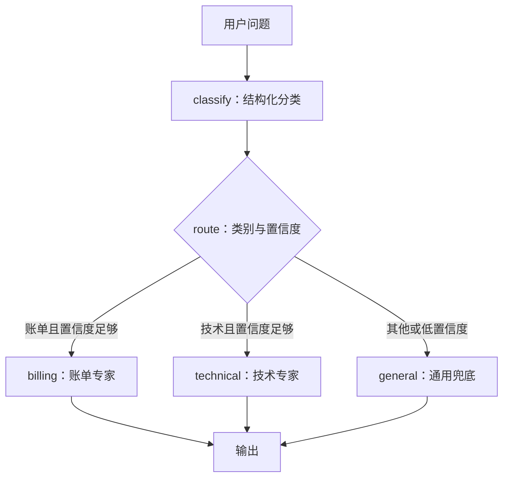
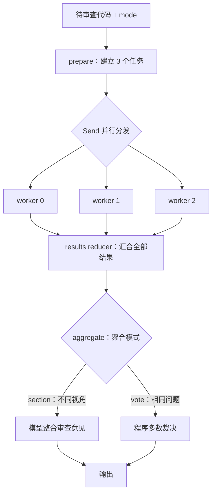
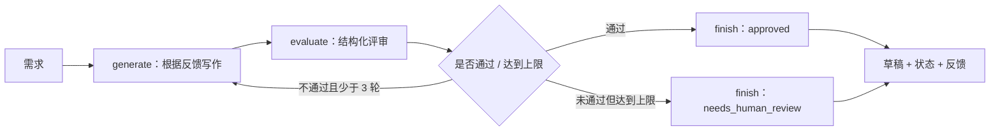
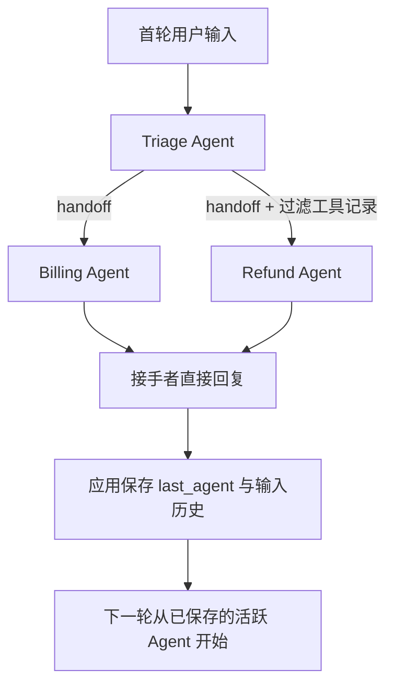
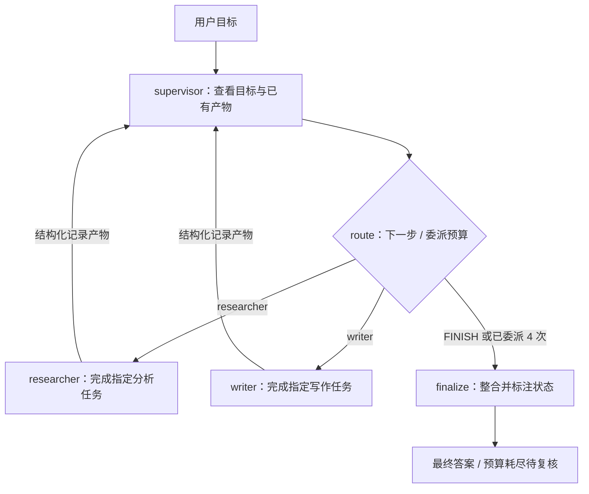
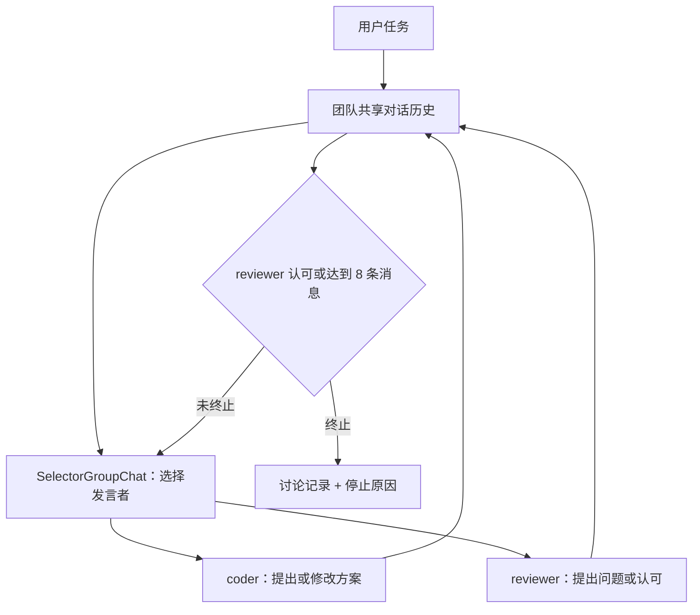
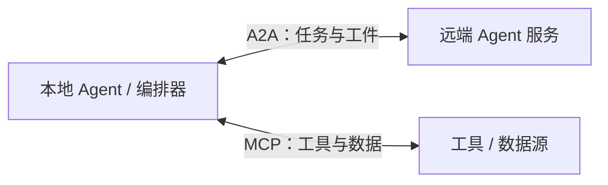

# 总览

**多智能体系统 = 架构（骨架）+ 拓扑（协作形状）+ 设计（运行细节）。**

* 能用单次模型调用或单 Agent 解决，就不要为了“多智能体”拆角色。

* 上多 Agent 时，先选拓扑，再定上下文交接方式，最后设终止条件。

* **多个 LLM 调用不一定是多个自主 Agent。** 下文用角色化模型节点展示协作；需要工具调用、自主执行时，可将节点替换为专家 Agent 或子图，外层拓扑不变。

<br />

<br />

# 拓扑

## 链式拓扑

### 唯一选型：LangGraph

**结构**：任务按预先定义的步骤顺序执行，上一步产物作为下一步输入，可以插入程序化检查门。带返工回边时，准确说是“主链 + 局部循环”。

**何时用**：步骤固定、每步职责明确，例如生成文案 → 长度校验 → 翻译。

**选择理由**：链不难写，难的是检查失败后只返工指定步骤、限制次数并保留状态。LangGraph 用普通边、条件边和 State 直接表达这些要求。

### 链路图



### 代码案例

```python
from typing import TypedDict
from langgraph.graph import StateGraph, START, END

import os
from langchain_openai import ChatOpenAI

llm = ChatOpenAI(
    model=os.getenv("OPENAI_MODEL", "gpt-4o-mini"),
    temperature=0,
    timeout=60,
    max_retries=2,
)

def ask(role: str, task: str) -> str:
    response = llm.invoke([("system", role), ("human", task)])
    if not isinstance(response.content, str):
        raise TypeError("案例要求模型返回文本")
    return response.content

class ChainState(TypedDict):
    request: str
    draft: str
    approved: bool
    attempts: int
    result: str
    status: str

def write(state: ChainState):
    draft = ask(
        "你是中文营销文案作者。只返回文案，不超过 100 字。",
        f"需求：{state['request']}。上次文案：{state['draft']}。若超长请压缩。",
    )
    return {"draft": draft, "attempts": state["attempts"] + 1}

def check(state: ChainState):
    return {"approved": 0 < len(state["draft"].strip()) <= 100}

def after_check(state: ChainState):
    if state["approved"]:
        return "translate"
    return "write" if state["attempts"] < 3 else "fail"

def translate(state: ChainState):
    return {
        "result": ask("将以下文案翻译为英文，只返回译文。", state["draft"]),
        "status": "success",
    }

def fail(state: ChainState):
    return {"status": "failed", "result": "中文文案未通过校验，停止翻译。"}

builder = StateGraph(ChainState)
for name, node in [("write", write), ("check", check),
                   ("translate", translate), ("fail", fail)]:
    builder.add_node(name, node)
builder.add_edge(START, "write")
builder.add_edge("write", "check")
builder.add_conditional_edges("check", after_check, {
    "write": "write", "translate": "translate", "fail": "fail",
})
builder.add_edge("translate", END)
builder.add_edge("fail", END)
app = builder.compile()

result = app.invoke({
    "request": "为便携咖啡杯写一段广告", "draft": "", "approved": False,
    "attempts": 0, "result": "", "status": "pending",
})
print(result["status"], result["result"])
```

**关键点**：长度检查只保证形式约束，不代表内容质量合格。达到上限仍未通过，应返回失败，而不是把未校验草稿当成成功产物。

## 路由拓扑

### 唯一选型：LangGraph

**结构**：先分类输入，再选择一个专门处理器；低置信度或其他类别进入兜底分支。本例不是同时调用全部专家。

**何时用**：客服问题分流、按任务类型选择专家，或按问题难度选择模型。

**选择理由**：分类输出、条件边和专家节点分离，便于约束类别、追踪错误分流、设置兜底。它与移交不同：这里每个请求都从分类入口开始，不维护“当前活跃专家”。

### 链路图



### 代码案例

```python
from typing import TypedDict, Literal
from pydantic import BaseModel, Field
from langgraph.graph import StateGraph, START, END

import os
from langchain_openai import ChatOpenAI

llm = ChatOpenAI(
    model=os.getenv("OPENAI_MODEL", "gpt-4o-mini"),
    temperature=0,
    timeout=60,
    max_retries=2,
)

def ask(role: str, task: str) -> str:
    response = llm.invoke([("system", role), ("human", task)])
    if not isinstance(response.content, str):
        raise TypeError("案例要求模型返回文本")
    return response.content

class Classification(BaseModel):
    category: Literal["billing", "technical", "general"]
    confidence: float = Field(ge=0, le=1)

class RouteState(TypedDict):
    question: str
    category: str
    confidence: float
    answer: str

classifier = llm.with_structured_output(Classification)

def classify(state: RouteState):
    decision = classifier.invoke([
        ("system", "分类为 billing（账单退款）、technical（技术）或 general（其他），给出置信度。"),
        ("human", state["question"]),
    ])
    return decision.model_dump()

def route(state: RouteState):
    return state["category"] if state["confidence"] >= 0.8 else "general"

def billing(state: RouteState):
    return {"answer": ask("你是账单客服。只提供指导，不声称已经完成退款。", state["question"])}

def technical(state: RouteState):
    return {"answer": ask("你是技术支持。给出可验证的排查步骤。", state["question"])}

def general(state: RouteState):
    return {"answer": ask("你是通用客服。信息不足时先澄清。", state["question"])}

builder = StateGraph(RouteState)
for name, node in [("classify", classify), ("billing", billing),
                   ("technical", technical), ("general", general)]:
    builder.add_node(name, node)
builder.add_edge(START, "classify")
builder.add_conditional_edges("classify", route, {
    "billing": "billing", "technical": "technical", "general": "general",
})
for name in ("billing", "technical", "general"):
    builder.add_edge(name, END)
app = builder.compile()

result = app.invoke({
    "question": "我的订单如何退款？", "category": "general",
    "confidence": 0.0, "answer": "",
})
print(result["category"], result["answer"])
```

**关键点**：模型自报置信度不是校准后的概率，应在真实分类数据上评测阈值。结构化输出保证格式，不保证分类正确；调用或解析异常不等同于低置信度，仍需单独处理。

## 并行拓扑

### 唯一选型：LangGraph

**结构**：预先确定可独立处理的任务，分发并行运行，再统一聚合。两个常用变体：

* **分片**：不同专家分析不同方面，再整合。

* **投票**：多个独立实例回答同一问题，再按明确规则裁决；一致不等于事实正确，错误可能相关。

**何时用**：多视角代码审查、独立资料分析，或有可枚举判据的多次评审。

**选择理由**：`Send` 表达动态 fan-out，State reducer 汇聚并发写入；汇合后再整合，而不是让多个分支争写同一个输出字段。

### 链路图



### 代码案例

同一段代码支持 `section` 与 `vote` 两种模式：

```python
import operator
from typing import Annotated, TypedDict, Literal
from pydantic import BaseModel
from langgraph.graph import StateGraph, START, END
from langgraph.types import Send
import os
from langchain_openai import ChatOpenAI

llm = ChatOpenAI(
    model=os.getenv("OPENAI_MODEL", "gpt-4o-mini"),
    temperature=0,
    timeout=60,
    max_retries=2,
)

def ask(role: str, task: str) -> str:
    response = llm.invoke([("system", role), ("human", task)])
    if not isinstance(response.content, str):
        raise TypeError("案例要求模型返回文本")
    return response.content

class Verdict(BaseModel):
    passed: bool
    reason: str

class ParallelState(TypedDict):
    code: str
    mode: Literal["section", "vote"]
    jobs: list[dict]
    results: Annotated[list[dict], operator.add]
    answer: str

judge = llm.with_structured_output(Verdict)

def prepare(state: ParallelState):
    facets = ["正确性", "性能", "边界条件"] if state["mode"] == "section" else ["正确性"] * 3
    return {"jobs": [{"id": i, "facet": facet} for i, facet in enumerate(facets)]}

def dispatch(state: ParallelState):
    return [Send("worker", {**job, "code": state["code"], "mode": state["mode"]})
            for job in state["jobs"]]

def worker(job: dict):
    if job["mode"] == "vote":
        verdict = judge.invoke([
            ("system", "独立审查代码是否对所有整数列表正确排序；passed 表示是否通过，给出原因。"),
            ("human", job["code"]),
        ])
        item = {"id": job["id"], **verdict.model_dump()}
    else:
        text = ask(f"你是代码审查专家，仅从{job['facet']}角度评审。", job["code"])
        item = {"id": job["id"], "facet": job["facet"], "text": text}
    return {"results": [item]}

def aggregate(state: ParallelState):
    items = sorted(state["results"], key=lambda item: item["id"])
    if state["mode"] == "vote":
        passed = sum(item["passed"] for item in items)
        return {"answer": f"多数判断：{'通过' if passed > len(items) / 2 else '不通过'}；明细：{items}"}
    notes = "\n".join(f"{item['facet']}：{item['text']}" for item in items)
    return {"answer": ask("整合审查意见，去重但保留分歧，不声称已运行测试。", notes)}

builder = StateGraph(ParallelState)
builder.add_node("prepare", prepare)
builder.add_node("worker", worker)
builder.add_node("aggregate", aggregate)
builder.add_edge(START, "prepare")
builder.add_conditional_edges("prepare", dispatch, ["worker"])
builder.add_edge("worker", "aggregate")
builder.add_edge("aggregate", END)
app = builder.compile()

result = app.invoke({
    "code": "def sort_numbers(xs):\n    return sorted(xs)",
    "mode": "section",  # 改为 vote 即可运行投票变体
    "jobs": [], "results": [], "answer": "",
}, config={"max_concurrency": 3})
print(result["answer"])
```

**关键点**：`results` 用 reducer 聚合，结果顺序不应依赖完成先后。这里每个 worker 只有一个节点，属于同一并行步；若分支有不同长度，应额外设计可靠的汇合机制。相同模型在低温度下投票可能高度一致，不能据此认为有三个独立证据来源。

## 循环拓扑

### 唯一选型：LangGraph

**结构**：生成者输出草稿，评估者给出通过/不通过及反馈，不通过则返工，直到通过或达到上限。

**何时用**：存在清晰验收标准，并且反馈能带来可衡量改进的任务，例如翻译评审、报告修订。

**选择理由**：回边表达返工，State 保存草稿、反馈与轮数；显式区分“通过”与“到达上限但未通过”，避免无限互评或误报成功。

### 链路图



### 代码案例

```python
from typing import TypedDict
from pydantic import BaseModel
from langgraph.graph import StateGraph, START, END

import os
from langchain_openai import ChatOpenAI

llm = ChatOpenAI(
    model=os.getenv("OPENAI_MODEL", "gpt-4o-mini"),
    temperature=0,
    timeout=60,
    max_retries=2,
)

def ask(role: str, task: str) -> str:
    response = llm.invoke([("system", role), ("human", task)])
    if not isinstance(response.content, str):
        raise TypeError("案例要求模型返回文本")
    return response.content

class Review(BaseModel):
    approved: bool
    feedback: str

class ReviewState(TypedDict):
    request: str
    draft: str
    feedback: str
    approved: bool
    rounds: int
    status: str

reviewer = llm.with_structured_output(Review)

def generate(state: ReviewState):
    draft = ask(
        "你是写作者。根据需求和评审反馈重写，只返回正文。",
        f"需求：{state['request']}\n旧稿：{state['draft']}\n反馈：{state['feedback']}",
    )
    return {"draft": draft, "rounds": state["rounds"] + 1}

def evaluate(state: ReviewState):
    review = reviewer.invoke([
        ("system", "检查是否覆盖需求、无明显矛盾、表述清晰。未通过时给出具体修改意见。"),
        ("human", f"需求：{state['request']}\n草稿：{state['draft']}"),
    ])
    if not state["draft"].strip():
        return {"approved": False, "feedback": "正文为空，请重写。"}
    return review.model_dump()

def next_step(state: ReviewState):
    return "finish" if state["approved"] or state["rounds"] >= 3 else "generate"

def finish(state: ReviewState):
    return {"status": "approved" if state["approved"] else "needs_human_review"}

builder = StateGraph(ReviewState)
builder.add_node("generate", generate)
builder.add_node("evaluate", evaluate)
builder.add_node("finish", finish)
builder.add_edge(START, "generate")
builder.add_edge("generate", "evaluate")
builder.add_conditional_edges("evaluate", next_step, {
    "generate": "generate", "finish": "finish",
})
builder.add_edge("finish", END)
app = builder.compile()

result = app.invoke({
    "request": "写一段说明，包含咖啡杯的适用人群、使用方式和清洁注意事项。",
    "draft": "", "feedback": "", "approved": False, "rounds": 0, "status": "pending",
})
print(result["status"], result["rounds"], result["draft"], result["feedback"])
```

**关键点**：LLM 评审不是事实验证。能用测试、规则或数据库验证的部分，应优先做程序校验；最大轮数只是防死循环，不保证质量。

## 移交拓扑

### 唯一选型：OpenAI Agents SDK

**结构**：当前 Agent 通过 handoff 将当前请求的处理权转给另一位 Agent。接手者继续执行并直接回复，不需要自动回到原 Agent 综合；也可以显式配置其他 handoff 再次转交。

**何时用**：客服交接、业务阶段切换、由当前处理者连续服务用户。

**选择理由**：handoff 原生表达控制权交接，且有上下文过滤和追踪能力，不必自己把移交编码成普通函数调用约定。

### 链路图



### 代码案例

本节独立运行，**不需要 LangGraph 公共前置代码**。

```python
import asyncio
import os
from agents import Agent, Runner, handoff
from agents.extensions import handoff_filters

MODEL = os.getenv("OPENAI_MODEL", "gpt-4o-mini")

billing_agent = Agent(
    name="Billing Agent", model=MODEL,
    handoff_description="处理账单、发票问题。",
    instructions="你是账单客服。指导用户查询账单和发票；没有工具时不要声称已执行操作。",
)
refund_agent = Agent(
    name="Refund Agent", model=MODEL,
    handoff_description="处理退款咨询。",
    instructions="你是退款客服。先收集订单和退款原因；没有退款工具，不要声称已退款。",
)
triage_agent = Agent(
    name="Triage Agent", model=MODEL,
    instructions="根据用户意图移交：退款给 Refund Agent，账单和发票给 Billing Agent。其他问题先澄清。",
    handoffs=[
        billing_agent,
        handoff(refund_agent, input_filter=handoff_filters.remove_all_tools),
    ],
)

async def main():
    active_agent = triage_agent
    history = []
    for message in ["我想咨询订单退款。", "订单号是 EXAMPLE-123，因为重复购买。"]:
        history.append({"role": "user", "content": message})
        result = await Runner.run(active_agent, input=history, max_turns=6)
        print(result.last_agent.name, result.final_output)
        # SDK 不会替应用自动记住下一轮从哪个 Agent 开始
        active_agent = result.last_agent
        history = result.to_input_list()

asyncio.run(main())
```

**关键点**：

* `result.last_agent` 保存当前活跃 Agent，`to_input_list()` 保存本轮历史；生产中可结合会话存储持久化。

* `remove_all_tools` 只删除工具调用相关记录，不等于隐私脱敏或“只传必要信息”。敏感信息过滤与最小上下文策略需另行实现。

* `max_turns` 限制一次 Runner 执行的轮数；总会话预算需要应用层控制。

* 与主从的区别：本例由接手者直接输出，不把结果当成子任务返回给 Triage 再做总结。

## 主从拓扑

### 唯一选型：LangGraph

**结构**：主 Agent 根据请求与已有结果决定委派哪个专家、交代什么任务；专家完成后返回主 Agent，主 Agent 再决定继续委派还是整合输出。

**何时用**：子任务由输入动态决定、需要集中验收、专家有不同工具或上下文的复杂任务。

**选择理由**：Supervisor 的决策、专家执行、产物回流与终止都能放入图中，便于限制委派次数、隔离专家输入，并进一步扩展为子图或分层管理。

**与并行的区别**：并行是一种执行关系；主从是一种控制关系，两者可以组合。本节选择串行 Supervisor，突出“动态委派 → 回流 → 重新决策”，不额外引入依赖队列或并行调度器。

### 链路图



### 代码案例

```python
import json
import operator
from typing import Annotated, TypedDict, Literal
from pydantic import BaseModel
from langgraph.graph import StateGraph, START, END

import os
from langchain_openai import ChatOpenAI

llm = ChatOpenAI(
    model=os.getenv("OPENAI_MODEL", "gpt-4o-mini"),
    temperature=0,
    timeout=60,
    max_retries=2,
)

def ask(role: str, task: str) -> str:
    response = llm.invoke([("system", role), ("human", task)])
    if not isinstance(response.content, str):
        raise TypeError("案例要求模型返回文本")
    return response.content

class Decision(BaseModel):
    next_agent: Literal["researcher", "writer", "FINISH"]
    task: str

class TeamState(TypedDict):
    request: str
    next_agent: str
    task: str
    artifacts: Annotated[list[dict], operator.add]
    calls: int
    status: str
    answer: str

planner = llm.with_structured_output(Decision)

def supervisor(state: TeamState):
    if state["calls"] >= 4:
        return {"next_agent": "FINISH", "task": "", "status": "budget_exhausted"}
    decision = planner.invoke([
        ("system", "你是主管。researcher 负责分析，writer 负责组织成文。根据目标和已有产物动态委派；"
                   "每次给一个具体任务，避免重复；信息足够时选 FINISH。专家没有联网工具，不要要求其伪造检索结果。"),
        ("human", json.dumps({"goal": state["request"], "artifacts": state["artifacts"]}, ensure_ascii=False)),
    ])
    return {"next_agent": decision.next_agent, "task": decision.task,
            "status": "ready" if decision.next_agent == "FINISH" else "working"}

def route(state: TeamState):
    return state["next_agent"]

def run_expert(state: TeamState, name: str, role: str):
    # 明确选择专家可见信息；不自动传入完整对话或其他专家的工具过程
    content = ask(role, json.dumps({
        "goal": state["request"], "task": state["task"], "artifacts": state["artifacts"],
    }, ensure_ascii=False))
    return {"artifacts": [{"agent": name, "task": state["task"], "content": content}],
            "calls": state["calls"] + 1}

def researcher(state: TeamState):
    return run_expert(state, "researcher", "你是分析专家。完成指定任务，标明假设与不确定性。没有联网工具。")

def writer(state: TeamState):
    return run_expert(state, "writer", "你是写作专家。依据已有产物完成指定任务，不杜撰事实。")

def finalize(state: TeamState):
    answer = ask("整合目标与专家产物。标注未解决项；预算耗尽不代表任务成功完成。", json.dumps({
        "goal": state["request"], "artifacts": state["artifacts"], "status": state["status"],
    }, ensure_ascii=False))
    return {"answer": answer}

builder = StateGraph(TeamState)
for name, node in [("supervisor", supervisor), ("researcher", researcher),
                   ("writer", writer), ("finalize", finalize)]:
    builder.add_node(name, node)
builder.add_edge(START, "supervisor")
builder.add_conditional_edges("supervisor", route, {
    "researcher": "researcher", "writer": "writer", "FINISH": "finalize",
})
builder.add_edge("researcher", "supervisor")
builder.add_edge("writer", "supervisor")
builder.add_edge("finalize", END)
app = builder.compile()

result = app.invoke({
    "request": "为小型团队设计客服知识库建设方案，包含实施步骤和风险。",
    "next_agent": "", "task": "", "artifacts": [], "calls": 0,
    "status": "pending", "answer": "",
})
print(result["status"], result["calls"], result["answer"])
```

**关键点**：

* 主管真正根据输入和已完成产物动态生成任务，而不是预先写死任务列表。

* 本例把专家产物全部交给主管；规模增大后，应按任务裁剪或检索相关工件，避免 State 越来越大。

* `ready` 只是主管认为可以整合，不是客观验收通过。高风险业务必须加入独立验证与人工审批。

* LangGraph 不会自动生成业务任务队列、处理任务依赖或保证副作用只执行一次；这些仍需显式建模。

## 平级拓扑（群聊）

### 唯一选型：AutoGen AgentChat

**结构**：多个 Agent 共享讨论历史并交换观点；轻量主持器决定下一位发言者，但不承担主从模式的任务拆解与验收。

**何时用**：方案讨论、代码评审、观点碰撞。参与者不是完全去中心化，而是业务角色平级，发言由团队调度器组织。

**选择理由**：共享消息、发言选择与终止策略是 AgentChat 的直接抽象，比自己搭建群聊消息循环更自然。

### 链路图



### 代码案例

本节独立运行，**不需要 LangGraph 公共前置代码**。

```python
import asyncio
import os
from autogen_agentchat.agents import AssistantAgent
from autogen_agentchat.conditions import MaxMessageTermination, TextMentionTermination
from autogen_agentchat.teams import SelectorGroupChat
from autogen_ext.models.openai import OpenAIChatCompletionClient

import os
from langchain_openai import ChatOpenAI

llm = ChatOpenAI(
    model=os.getenv("OPENAI_MODEL", "gpt-4o-mini"),
    temperature=0,
    timeout=60,
    max_retries=2,
)

def ask(role: str, task: str) -> str:
    response = llm.invoke([("system", role), ("human", task)])
    if not isinstance(response.content, str):
        raise TypeError("案例要求模型返回文本")
    return response.content

async def main():
    model_client = OpenAIChatCompletionClient(
        model=os.getenv("OPENAI_MODEL", "gpt-4o-mini"),
        api_key=os.environ["OPENAI_API_KEY"],
    )
    try:
        coder = AssistantAgent(
            "coder", model_client=model_client,
            description="负责提出实现方案并根据反馈修订代码。",
            system_message="你是实现者。给出可运行的 Python 代码，根据 reviewer 的具体意见修订。",
        )
        reviewer = AssistantAgent(
            "reviewer", model_client=model_client,
            description="负责审查实现的正确性与边界条件。",
            system_message="你是审查者。未通过时指出具体缺陷；通过时回复 APPROVE 及理由。不要声称已运行测试。",
        )
        team = SelectorGroupChat(
            [coder, reviewer], model_client=model_client,
            termination_condition=(
                TextMentionTermination("APPROVE", sources=["reviewer"])
                | MaxMessageTermination(8)
            ),
        )
        result = await team.run(task="实现并审查快速排序，说明重复元素和空列表如何处理。")
        for message in result.messages:
            print(f"{message.source}: {message.content}")
        print("停止原因：", result.stop_reason)
    finally:
        await model_client.close()

asyncio.run(main())
```

**关键点**：

* 使用新版 `autogen_agentchat`，不混入旧版 `UserProxyAgent`、`GroupChatManager` 等 API。

* 认可标记只接受 `reviewer` 的消息，避免实现者或用户消息触发同名关键词导致提前停止。

* 达到消息上限只表示讨论结束，不表示代码通过；`APPROVE` 也只是模型审查结论，仍需沙箱中的真实测试。

* 平级群聊并不一定更强：消息历史增长、讨论跑题和错误相互强化，都可能让它比显式流水线更难控。

# 通信协议底座

**拓扑决定谁和谁协作，协议决定不同系统如何连接。** 同一进程中的这些代码案例不需要先引入 MCP 或 A2A。

## MCP：Agent ↔ 工具与数据

MCP（Model Context Protocol）提供模型应用连接工具、资源等外部能力的标准接口。常见组件是 Host、Client、Server。

* **Host**：承载 AI 应用与权限策略。

* **Client**：连接 MCP Server。

* **Server**：提供工具、资源或提示模板等能力。

工具示意：

```json
{
  "name": "lookup_order",
  "description": "查询订单，只读操作",
  "inputSchema": {
    "type": "object",
    "properties": {"order_id": {"type": "string"}},
    "required": ["order_id"],
    "additionalProperties": false
  }
}
```

这是工具描述片段，不是完整可运行的 MCP Server。涉及退款、删除、发布等操作时，还需权限与审批，不能因为接入协议就默认安全。

## A2A：Agent ↔ 远端 Agent

A2A（Agent-to-Agent）用于不同 Agent 系统之间的发现、任务提交与状态/工件交换。它由 Google 发起，后进入 Linux Foundation 体系。

远端 Agent 通过接口声明能力，不必公开内部提示词、工具过程或记忆。A2A 不会替应用决定拓扑、验收标准或重试策略。



**分工**：MCP 主要解决外部能力接入，A2A 主要解决跨 Agent 系统协作；两者可组合，但不是完成多 Agent 的前置条件。

# 设计

## 角色与上下文

角色的本质是**指令 + 模型 + 工具集 + 可见上下文**，不是组织架构图上的一个头衔。

| 角色                   | 核心职责           | 典型产物               |
| -------------------- | -------------- | ------------------ |
| Planner / Supervisor | 拆解目标、委派、决定是否继续 | 明确任务、下一步决策         |
| Executor / Expert    | 执行专门任务         | 结构化结果、证据、错误        |
| Reviewer             | 按标准验证并给反馈      | PASS/FAIL、具体修改项    |
| Coordinator          | 管理消息与执行状态      | 活跃 Agent、任务状态、汇合结果 |

只有需要不同工具权限、知识范围或独立上下文时，才值得拆角色。每个任务至少说明：目标、输入、约束、输出格式、验收标准。

### 三种信息通路

| 通路        | 本文对应方式                    | 适合        | 风险             |
| --------- | ------------------------- | --------- | -------------- |
| 共享状态 / 工件 | LangGraph State、外部文档或对象存储 | 流程编排、结果汇总 | 并发冲突、状态膨胀      |
| 消息传递      | AutoGen 共享讨论历史            | 对等讨论      | 历史滚雪球、相互强化错误   |
| 控制权移交     | OpenAI Agents SDK handoff | 阶段交接、连续客服 | 上下文传递过多或裁剪丢失信息 |

**共享 State 不等于模型自动读取所有内容。** 必须像代码中的 `ask()` 一样明确选择传入字段。大工件宜保存为带版本的外部对象，State 仅存引用与必要摘要。

## 协调与编排

* **顺序能解决，就不用群聊**：确定流程优先显式边，开放式讨论不是默认选项。

* **并行写入必须定义合并方式**：reducer、唯一任务 ID、稳定排序和去重都应按语义设计；简单追加不天然幂等。

* **主从需要可验证的委派**：主管能不能验收子任务，是是否适合拆分的重要前提。

* **依赖队列要显式实现**：只有依赖已满足的任务才能派发；失败不是完成，不能直接推进依赖水位。

* **恢复不是自动无副作用**：配置 checkpointer 后可以保存图状态，但外部调用重放仍可能导致重复发布、扣款或写入，需幂等键和事务设计。

* **可观测性先行**：记录节点输入/输出、路由理由、模型与工具耗时、token、重试次数和失败状态；日志中要脱敏。

全互联协作的通信边数是 `n(n-1)/2`，但不是所有拓扑的协调成本都必然是 O(n²)。应根据实际连接关系与消息量评估，避免把全互联的复杂度套到链式、星型等拓扑。

## 终止与安全

必须区分：**业务验收通过、预算耗尽停止、执行异常、等待人工**。

四道闸：

1. **次数上限**：返工次数、委派次数、消息数、Runner 轮数，分别按框架与业务设置。
2. **费用与时间上限**：单次调用超时不等于整个任务有总预算，需额外计量。
3. **明确收敛判据**：使用结构化状态或测试结果，不依赖“看起来聊完了”。
4. **人工审批**：不可逆或高风险操作，在执行前验证权限并请求确认。

本章案例的次数限制只展示其中一部分。生产系统还需取消机制、限流、异常恢复与审计，不能将示例直接视为完整生产方案。

## 设计原则汇总

| 原则    | 内容                                                  |
| ----- | --------------------------------------------------- |
| 最小复杂度 | 单次调用 → 单 Agent → 固定工作流 → 按需要拆多 Agent                |
| 上下文优先 | 先确定每个角色需要看什么，再决定拆多少角色                               |
| 显式状态  | 完成、失败、待审、超限分别表示，不混为成功                               |
| 工程控制  | 模型决定内容，程序控制硬性预算、权限与关键状态转移                           |
| 模式组合  | 拓扑不是互斥选项：链式可带循环，主从可并行，移交后可进入局部工作流                   |
| 学习路径  | 优先 LangGraph 的链式 → 路由 → 循环 → 并行 → 主从，再学 handoff 与群聊 |

# 参考资料

以下链接用于进一步核对 API 与设计模式；安装后应锁定实际验证过的依赖版本。

* [LangGraph · Workflows and agents](https://docs.langchain.com/oss/python/langgraph/workflows-agents)：提示链、路由、并行、编排者—工作者和评估循环。

* [LangGraph · Graph API](https://docs.langchain.com/oss/python/langgraph/graph-api)：State、reducer、条件边和 Send。

* [LangGraph · Persistence](https://docs.langchain.com/oss/python/langgraph/persistence)：检查点与状态持久化。

* [LangChain · Multi-agent](https://docs.langchain.com/oss/python/langchain/multi-agent)：多 Agent 与上下文设计。

* [OpenAI Agents SDK · Handoffs](https://openai.github.io/openai-agents-python/handoffs/)：控制权交接与输入过滤。

* [OpenAI Agents SDK · Running agents](https://openai.github.io/openai-agents-python/running_agents/)：Runner、执行循环与会话延续。

* [AutoGen · SelectorGroupChat](https://microsoft.github.io/autogen/stable/user-guide/agentchat-user-guide/selector-group-chat.html)：群聊与发言者选择。

* [AutoGen · Termination](https://microsoft.github.io/autogen/stable/user-guide/agentchat-user-guide/tutorial/termination.html)：终止条件。

* [Anthropic · Building Effective Agents](https://www.anthropic.com/engineering/building-effective-agents)：工作流模式与最小复杂度原则。

* [MCP 官网](https://modelcontextprotocol.io/) 与 [A2A 官网](https://a2a-protocol.org/)：协议规范。

* [菜鸟教程 · 多智能体系统](https://www.runoob.com/ai-agent/multi-agent-system.html)：原文架构与角色讨论的参考来源；本文代码已按所选框架重新编写。

